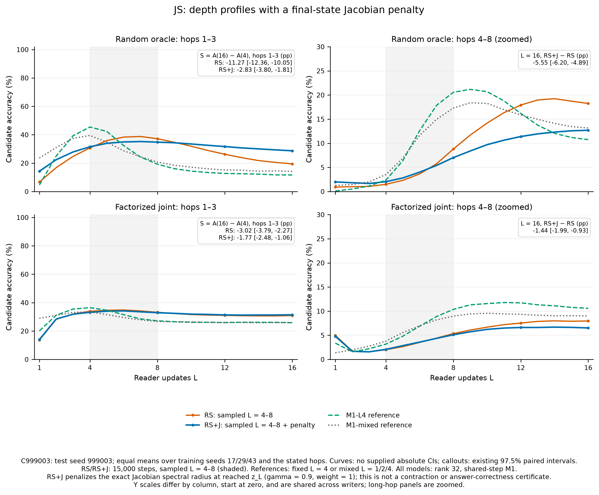

> **Superseded.** The manuscript of record is `docs/paper/tex/paper.tex` (PDF: `docs/paper/paper.pdf`, WP-T11 Part B). This markdown draft is kept for history; the evidence ledgers are unchanged.

# Iterative Queries in a Low-Rank Memory Adapter: Composition, Writer Dependence, and Budget Limits

*Manuscript draft (revised after the second external reviews, WP-T11: Section 8.6, the related-work additions and the seed-level statistics). Code cutoff: `f1dd6e2`; numerical and claim authority:
[symbolic evidence ledger](evidence_symbolic.md) and
[LLM evidence ledger](evidence_llm.md). Main-text experimental claims carry ledger
IDs in HTML comments. Symbolic results (including the registered follow-ups IVD, CVH,
TSM, UNS and NCR) and the completed LLM writer screens (including RFX and the WP-L6
stop), the P1-L oracle-reader confirmation with P1L-C and its per-step readouts, its second-scale repeat (P5L), and the DPFP negative
result (P1L-D not run) are included; no registered result remains pending.
P1-L Amendments B6/B7 and the run locks, committed after that cutoff, are cited where
stated; [Appendix C](#appendix-c-claim-contract) lists each principal claim with its
comparator, writer, split and gate.*

## Abstract

Can a low-rank adapter use additional computation to extract compositions from a fixed
context memory? We study a reader that repeatedly updates a low-dimensional query while
holding both its input and memory snapshot fixed. The associated writer performs one
decay-first delta update per eligible context token. Under orthogonal oracle writing,
additional reads improve reachable-hop accuracy and exceed fixed-query and memory-free
controls. <!-- S1 --><!-- S2 --> Learned writing changes the result: the original joint
writer gives a smaller, seed-dependent benefit, while factorized writing gives stronger
walk-specific depth effects but fails to preserve single-hop accuracy. <!-- S3 --><!-- S9 -->
The primary comparison is against a single read at the same rank, with added
latency reported as a cost; no efficiency advantage over a larger-rank single read
is claimed. <!-- FR1 --> At rank32, the reachable-hop L4−L1 benefit
shrinks from E12 to E36 under the registered load/layout changes, while the multi-read
capability criterion still holds at the tested training loads. <!-- IS1 --><!-- IS2 -->
Post-hoc learned halting fails hop1 preservation in the six primary frozen-reader
families; a hop-1-constrained threshold gives one registered pass, for random-oracle
writing, after about two executed updates and with no latency gain.
<!-- HL1 --><!-- CV1 --><!-- CV3 --> Training-time terminal-Jacobian regularization reduces
overshoot without meeting the registered removal criterion, and decreases longer-walk accuracy.
<!-- JS1 --><!-- JS3 --> Conditional theory separates composition inside a fixed
output subspace, limitations of one-read observations, writer shortcuts, and fixed-point
certificates. In a single frozen language-model module, the completed validation
screens, including the registered DPFP screens, select no learned writer, despite informative input probes and a usable
supplied-answer-code output path.<!-- DP1 --> In the registered oracle-reader confirmation, one shared module iterated four times
exceeds a single read of equal parameter count at rank128 on two backbone sizes of one family (Qwen3-0.6B-Base and Qwen3-1.7B-Base),
the four-unshared-reads reader fails its registered gate at both, a bridge-patching test at the smaller size gives no causal claim, and at rank32 the readers did not learn to use the oracle memory.
<!-- LL2 --><!-- LL3 --><!-- LL9 --><!-- LP4 --><!-- LP7 --><!-- LP9 --><!-- LP11 --><!-- LP15 --><!-- PC1 --> At its trained depth the shared reader reaches hop 3; run deeper, the same checkpoint reaches hops 4–8 at 9.9–16.6% (0.6B) and 9.8–20.9% (1.7B) with the depth chosen by the label, while it loses hop 1 (descriptive; Section 8.6). <!-- LP21 --> All results use a closed 1,024-name vocabulary and
depths within those trained, oracle and learned writers are separate claims, and the
language-model oracle is not the symbolic oracle; the 256 unseen-pool names of that
vocabulary enter only as a descriptive scope row, where the depth gain is also present, and no
claim is made beyond the vocabulary, about new entity codes, or about multiple reads in the
language model at rank32. <!-- UN2 --><!-- UN3 --><!-- LP2 --><!-- LP6 --> The resulting contribution is a bounded account of when repeated memory
access helps, together with negative results that prevent capability gains from being
mistaken for general efficiency or end-to-end reasoning gains. <!-- B7 --><!-- B8 --><!-- B9 -->

## 1. Problem and scope

A context-dependent adapter must decide both what to store and how to query it. Increasing
the size of its memory or bottleneck is one option; spending more computation on a stored
representation is another. These choices answer different questions. A larger state may
retain information that a smaller state loses, whereas an additional query may reveal a
composition already represented in the smaller state. Neither possibility follows merely
from counting parameters. We therefore ask whether the query can evolve productively
without changing the input, rewriting the context, or executing the frozen base projection
again inside the reader loop.

The distinction is easiest to formulate for a chain of associations. A query specifies a
starting entity, and the target is the chain terminal. A reader with a suitable memory map
can retrieve a successor, use that result to form another query, and continue. However,
accuracy on a terminal task need not identify that algorithm. A learned writer may expose
information about the terminal set directly, so a model can answer some questions without
following their paths. Proposition 10 provides an explicit conditional construction of
such an endpoint statistic; factorizing writer inputs removes a particular direct term,
without eliminating every possible source of global information.

Our empirical scope is correspondingly specific. Orthogonal oracle writing supplies a
clear positive result for shared evolving-query readers, whereas the learned joint-writer
benefit at rank32 varies across the tested training seeds. <!-- S1 --><!-- S3 --> A
factorized writer changes the depth profile and increases walk specificity, including
when its T1-pretrained writer is frozen, but none of those factorized conditions passes
the full hop-preservation gate. <!-- S9 --> In one frozen language-model module with a clean oracle memory, the shared reader
composes at rank128 on two backbone sizes of one family while the registered four-unshared-reads reader does not (Section 8); no
claim is made for any other size or as a trend. <!-- LP9 --><!-- LP11 --><!-- LP15 --><!-- LP20 --> At its trained depth that reader reaches hop 3; run deeper it reaches later hops only at low accuracy (Section 8.6). <!-- LP21 --> This combination motivates treating writer
design and reader depth as interacting parts of an inference system, rather than
equating a positive average depth effect with a complete solution.

Three limits apply to every claim below. All entities come from a closed 1,024-name
vocabulary, and every evaluation set draws on its seen pool, with one descriptive
exception: a scope row on the 256-name unseen pool of the same vocabulary (Section 9), which
supports only the wording that the depth gain is also present there. <!-- UN2 --><!-- UN3 -->
Nothing here concerns names outside the vocabulary or new entity codes. Effects are stated at the trained hops and depths; longer hops appear only
as measured cells. Oracle writers and learned writers answer different questions and are
never pooled, and the language-model oracle of Section 8 differs from the symbolic oracle.
<!-- LP2 --><!-- LP6 --> [Appendix C](#appendix-c-claim-contract) lists each principal claim with its
comparator, writer, split, gate and evidence rows.

We distinguish three questions. First, does changing evaluation depth improve one
trained reader while preserving its input and memory? Second, do separately trained
evolving-query systems outperform single-read, fixed-query, or memory-free controls
at the same rank? Third, what parameter and measured-latency costs accompany those
comparisons? We hold rank fixed to separate additional reader computation from
increased representation width, and report extra inference latency as a cost.
<!-- FR1 --> Earlier P2-S and
P2-S-F1 comparisons with larger single reads remain historical evidence, including
the original practical-gate failure; they supply no efficiency claim for this paper.
<!-- B1 --><!-- B5 --><!-- B7 --><!-- FR1 -->

The paper presents both the useful mechanism and its restrictions. The rank follow-up
changes training duration as well as rank, the sharing follow-up compares separately
trained systems. <!-- S8 --><!-- B3 --> Early stopping pilots are screening-only;
P4-S-L and JS subsequently use separate confirmation sets and report adjusted or
registered intervals. <!-- H1 --><!-- H4 --><!-- HL1 --><!-- JS1 --> The completed
LLM writer screens and the oracle-reader confirmation answer separate
questions; symbolic reader selection supplies no missing LLM effect.
<!-- B9 --><!-- LL9 --><!-- LP4 --> Keeping these distinctions explicit makes the negative outcomes informative:
they specify which interpretation of additional reader computation survives each control.

## 2. Related work and boundaries

[LoRA](https://arxiv.org/abs/2106.09685) supplies the starting parameterization: a frozen
base projection plus a trained low-rank branch. Our question concerns context-conditioned
computation inside that branch. It does not depend on presenting recurrence itself as a
new addition to low-rank adaptation. The [dated literature audit](../reports/lit_check.md)
is the scope record for the comparisons below; we retain its access limitations rather
than turning an incomplete search into a priority claim.

Associative fast weights are the closest antecedent to the memory access pattern.
[Ba et al.](https://arxiv.org/html/1610.06258v3) already use an evolving inner state to
read fixed fast weights repeatedly, with sustained input during the inner loop. Their
construction makes clear that repeated access to a fixed matrix predates this adapter
study. [Schlag et al.](https://proceedings.mlr.press/v139/schlag21a.html) connect linear
attention to fast-weight programming and motivate delta-style updates that correct
stored key–value associations. We use that lineage to separate the slow parameters
that learn a representation from the online matrix that stores the current context.

[δ-mem](https://arxiv.org/html/2605.12357v2) combines associative online state with
low-rank corrections to a frozen language model. Its old-state read provides a useful
comparison with our separation between writing the context and spending several reader
updates on the resulting snapshot. The relevant distinction is the read schedule and
query evolution, not a claim that associative memory or context-dependent low-rank
corrections are new. Matching these schedules also requires specifying the writer's
decay/update order, because nominally similar delta rules can retain different states.

Looped models investigate where repeated computation should occur.
[MixerLoop](https://arxiv.org/abs/2608.18230) repeats a delta-network mixer while applying
its dense feed-forward component once; the literature audit distinguishes its repeated
mixer updates from the fixed-memory reader considered here. [MemReasoner](https://arxiv.org/abs/2503.07903)
is a close memory-and-composition neighbor, with an end-to-end trained memory-augmented
language model. These comparisons motivate describing the exact object being iterated:
a low-dimensional query, a whole hidden state, or an update that also rewrites memory.
They do not justify transferring a result between those objects without an equivalence
argument.

[Deep equilibrium models](https://arxiv.org/abs/1909.01377) motivate another distinct
question: finding and differentiating through a fixed point. Our finite-depth reader
need not be a contraction to be useful, and a fixed-point error certificate would not
by itself establish correct task predictions. RecLoRA remains a related-work item whose
full-text architectural comparison is **TODO**: the committed audit could not verify its
page-level claims. We consequently make no claim about absent nonlinearities, routing,
or token mixing in that work, and do not use its unverified publication status in the
argument. The contribution sought here is a reproducible composition-and-budget study
with explicit writer controls and conditional analysis.

### Latent recurrence, sharing, and stopping

The [latent-reasoning survey](https://arxiv.org/html/2507.06203v2) distinguishes
vertical activation recurrence at fixed token/time from evolution across sequence
history. Our reader uses the former axis while the writer updates memory across
tokens. [Huginn](https://arxiv.org/html/2502.05171v2) supplies precedents for shared
Transformer recurrence, reinjected input, heavy-tailed training-depth sampling,
and heuristic prediction-KL exits. [Coconut](https://arxiv.org/html/2412.06769v4)
instead adds latent sequence positions by reusing hidden states as input embeddings;
its default fixed latent length should not be confused with guaranteed adaptive
halting. These are different placements of latent computation, with different caches
and training objectives.

[Ouro](https://arxiv.org/pdf/2510.25741v6) learns exit allocation for shared Transformer
loops and reports degradation beyond trained depth. That is a precedent for studying
nonmonotone depth, not a diagnosis of this reader's failure mechanism.
[Relaxed Recursive Transformers](https://arxiv.org/html/2410.20672v3) use depth-specific
LoRA to relax full-block sharing and train all model parameters; their oracle-exit
batching simulations do not establish this adapter's measured efficiency.
[Mixture-of-Recursions](https://arxiv.org/html/2507.10524v3) adds learned token-level
depth routing, including a variant that reuses first-recursion KV for later queries.
Consequently fixed context alone is not a unique distinction. Our specified compact
delta state, low-dimensional reader, and separate write schedule define the comparison.

Degradation from extra iterations is a known failure of recurrent depth, separate from this
adapter. [Bansal et al.](https://arxiv.org/abs/2202.05826) report that recurrent networks can
lose accuracy when iterated beyond their training depth ("overthinking"), and reduce it with a
recall path that reinjects the input together with progressive training. The reader's
reinjected u is analogous to a recall path, and no progressive or stay objective is trained
here. [Think-at-Hard](https://arxiv.org/abs/2511.08577) reports that extra loop iterations can
turn correct tokens into errors in looped language models, and
[Kohli et al.](https://arxiv.org/abs/2604.07822) report that recurrent-depth transformers can
compose knowledge, need more recurrence for deeper compositions, and overthink under excessive
recurrence. We therefore read the loss of short-hop accuracy at larger L (Sections 5.1 and 7)
as an instance of a known failure in a new setting, not as a defect specific to this reader,
and we do not test the remedies those works propose. <!-- S7 --><!-- JS1 -->

[STARS](https://arxiv.org/html/2605.26733v1) already combines sampled depth with
Jacobian-vector regularization of looped dynamics. Its practical sampled-state proxy
is not a certified spectral radius or global contraction constant.
[ReLIT](https://arxiv.org/html/2608.08113v1) combines a frozen-backbone anchor with
recursive full-sequence answer/scratchpad updates and ACT halting. These precedents
narrow any claim about reinjection, frozen-backbone latent recurrence, or stabilization.
They motivate the [JS protocol](../prereg/JS.md); its separate adapter results are
reported in Section 7.

### Multi-hop composition, regression memories, and retrieval in weights

The works in this subsection were added after two external literature reviews
([rv-fable](../review/rv-fable_2026-10-27.md) and [rv-astra](../review/rv-astra_2026-10-27.md))
opened their primary pages. We cite only what their abstracts and the review notes support,
re-read no full text for this manuscript, and draw no priority claim from them.

Latent multi-hop composition in language models has a substantial literature.
[Yang et al. (2024)](https://arxiv.org/abs/2402.16837) look for and intervene on the bridge
entity of two-hop queries, and [Yang et al. (2025)](https://arxiv.org/abs/2411.16679) remove
shortcuts and find relation-dependent composition.
[Balesni et al.](https://arxiv.org/abs/2411.16353) report both failures and successes of
latent two-hop reasoning across synthetic and natural settings.
[Biran et al.](https://arxiv.org/abs/2406.12775) report that the bridge is resolved early and
the second hop starts too late in the layer stack,
[Yu et al.](https://arxiv.org/abs/2502.10835) let early layers read later-layer states, and
[Liu et al.](https://arxiv.org/abs/2601.03542) report that later-hop answers can be decodable
before the bridge. [Guo et al.](https://arxiv.org/abs/2502.13913) find in-context two-hop
reasoning with distractors near guessing before fine-tuning. For out-of-distribution
composition, [Zhang et al.](https://arxiv.org/abs/2608.07261) report failure when upper layers
map facts to outputs instead of reasoning, and that recurrent-style training that reuses
circuitry helped there; [Lin et al.](https://arxiv.org/abs/2509.24653) report that identity
supervision on bridges enables unseen compositions, and
[Wang et al.](https://arxiv.org/abs/2405.15071) that composition does not generalize out of
distribution without grokking. Our setting differs: facts reach the reader only through a
fixed-size adapter memory, and hops are spent in a reader loop rather than in layer depth.
These studies therefore bound what we may claim without predicting our results. In particular,
Zhang et al. make it unsafe to read B8's in-distribution advantage over the shared reader
(Section 6; B8 is also not parameter-matched) as evidence for the unshared design, because that advantage is measured on trained
hops and names; and the paper reports only a descriptive scope row on unseen-pool names of its
closed vocabulary (Section 9), not a test of composition over new names or codes.
<!-- B3 --><!-- B6 --><!-- UN2 --><!-- UN3 -->

Associative memory can also be viewed as regression at test time.
[Wang et al.](https://arxiv.org/abs/2501.12352) treat a delta-rule write as one gradient step
on a recall loss, with least squares as the exact minimizer.
[Yang et al.](https://arxiv.org/abs/2406.06484) parallelize delta-rule linear transformers over
sequence length, and [Titans](https://arxiv.org/abs/2501.00663),
[ATLAS](https://arxiv.org/abs/2505.23735), and [TTT layers](https://arxiv.org/abs/2407.04620)
train the memory itself at test time, ATLAS over a window of past tokens rather than only the
latest one. Our writer is the one-step delta update, which need not reach the regression
solution when keys are correlated (cf. Proposition 11). Whether that gap contributes to the
deployed-read distortion in Section 8.3 is untested, because the audit identifies no unique
cause, and we study none of these alternative writers. <!-- LL7 --><!-- LL9 -->

Slot and lookup memories give each stored item its own address.
[End-to-end memory networks](https://arxiv.org/abs/1503.08895) learn several memory hops over
stored items, and [key–value memory networks](https://aclanthology.org/D16-1147/) separate the
addressing representation from the returned one, so multi-hop reading of a memory and
key–value separation are long established and we claim neither.
[Hopfield networks](https://arxiv.org/abs/2008.02217) retrieve stored patterns in a single
softmax step, [memory layers](https://arxiv.org/abs/2412.09764) scale trainable key–value
lookup inside language models, and [Memory Mosaics](https://arxiv.org/abs/2405.06394) compose
networks of associative memories. Their state grows with the number of stored items, whereas
the reader here uses a fixed-size delta-rule state in which facts superpose. No slot-memory
baseline is run, and no result here bears on how a slot memory would behave.

Facts can also live in, or be written into, parameters.
[Geva et al.](https://arxiv.org/abs/2012.14913) interpret feed-forward layers as key–value
memories; [ROME](https://arxiv.org/abs/2202.05262) edits a factual association with a
rank-one update and [MEMIT](https://arxiv.org/abs/2210.07229) scales such edits to many facts,
a linear associative write into persistent weights rather than into a resettable per-episode
state. [Larimar](https://arxiv.org/abs/2403.11901) attaches an episodic memory with one-shot
writes to a language model; [Cartridges](https://arxiv.org/abs/2506.06266) and
[StreamAdapter](https://arxiv.org/abs/2411.09289) compress a context into a trained
key–value cache and a parameter update, respectively, Cartridges by training on each context,
whereas the writers studied here are single-pass delta updates. Three 2026 reports on
memories for frozen language models locate the bottleneck in reading or extraction rather
than in storage ([Frozen Memory Is Not Enough](https://arxiv.org/abs/2608.17050),
[Prometheus Mind](https://arxiv.org/abs/2601.15324), and a workshop paper on
[a hidden-state memory layer](https://neurips.cc/virtual/2026/170472)). That is compatible
with, but does not confirm, the read-distortion measurements of Section 8.3, whose cause the
audit leaves unidentified. <!-- LL7 --><!-- LL9 -->

Two further external reviews ([rv-fable](../review/rv-fable_2026-10-29.md) and [rv-astra](../review/rv-astra_2026-10-29.md), 2026-10-29) added the works
below. We cite their abstract pages as the reviewers recorded them, did not re-open the pages for this manuscript, and claim no priority from any of them.
We study none of the writers, objectives or architectures named here; our writers are the one-step delta writer, its DPFP-feature variant and the oracle writers.
[Zahn et al.](https://arxiv.org/abs/2601.15313) report that semantic keys overlap and recall falls near chance after a few related facts, while identifier keys do
not, a setting close to the key-overlap questions of Section 8.3. Several works read the delta rule as online regression or filtering:
[Pandey and Singh](https://arxiv.org/abs/2605.11196) use online ridge by Sherman–Morrison as approximate key orthogonalization;
[Gated KalmaNet](https://arxiv.org/abs/2511.21016) shows a full-covariance Kalman update to be online ridge regression with fading memory;
[Kalman Linear Attention](https://arxiv.org/abs/2602.10743) filters in information form, scan-parallel;
[Kalman Delta Networks](https://arxiv.org/abs/2609.07816) use a per-channel Kalman gain whose isotropic case is the delta rule;
[Preconditioned DeltaNet](https://arxiv.org/abs/2604.21100) reads the delta rule as a first-order regression step and adds preconditioning;
[Longhorn](https://arxiv.org/abs/2407.14207) derives a state-space update as closed-form online recall;
[MesaNet](https://arxiv.org/abs/2506.05233) optimizes a local regression at test time; and
[Q-Delta](https://arxiv.org/abs/2606.08804) studies keys transformed by subsequent updates. Other works change the objective, the retention or the update:
[It's All Connected](https://arxiv.org/abs/2504.13173) (attentional-bias objectives and retention gates),
[Nested Learning](https://arxiv.org/abs/2512.24695) (a self-modifying model with continuum memory),
[End-to-End Test-Time Training](https://arxiv.org/abs/2512.23675) (a meta-learned initialization),
[Test-Time Training Done Right](https://arxiv.org/abs/2505.23884) (whole-chunk updates),
[Infini-attention](https://arxiv.org/abs/2404.07143) (compressive memory with a delta-style update),
[Gated DeltaNet-2](https://arxiv.org/abs/2605.22791) (separate erase and write gates),
[Gated Slot Attention-2](https://arxiv.org/abs/2610.02816) (two-sided association correction through slots),
[DeltaProduct](https://arxiv.org/abs/2502.10297) and [Sparse Delta Memory](https://arxiv.org/abs/2607.07386) (richer updates or larger states).
[CAMELoT](https://arxiv.org/abs/2402.13449) attaches a training-free associative memory to a frozen language model, as a neighbor of the frozen-backbone
setting here. These are different writers from those tested, and the learned-writer stop of Section 8.5 applies only to the writers it tested.

For looped and latent reasoning, [DiscoLoop](https://arxiv.org/abs/2607.00341) reports that a bridge can be decodable yet misaligned for the next loop and mixes
decoded embeddings with continuous states; [Fan, Svete and Lee](https://arxiv.org/abs/2606.31779) (called LOTUS in rv-astra) supervise looped transformers per position;
[Chen](https://arxiv.org/abs/2603.21676) trains with final-only supervision, a near-identity gate and depth extrapolation, where intermediate supervision hurt;
[Kuo et al.](https://arxiv.org/abs/2606.29983) report that a randomized loop count stabilizes extrapolation; and
[CODI](https://arxiv.org/abs/2502.21074) and [Recurrent Self-Improvement](https://arxiv.org/abs/2610.10623) distill explicit reasoning into latent reasoning or
use deeper teachers. [Sanford et al.](https://arxiv.org/abs/2402.09268) show that logarithmic depth suffices for k-hop problems, so one hop per read is a design
choice of this adapter and not a bound. [Liang and Pan](https://arxiv.org/abs/2602.00449) warn that decodable intermediate states do not establish a complete serial
algorithm, which is the boundary the per-step readouts of Section 8.5 respect: they are decoding only. <!-- LP5 --> [The orthogonalized read as a training scaffold](https://arxiv.org/abs/2607.19390)
is reported as a removable training aid and not an inference rescue; whether sharing acts as such a scaffold for B8 is untested here. None of these
training objectives, stopping rules or distillation methods is used in this paper.

### Verbalizable directions and the readout boundary

[Verbalizable Representations Form a Global Workspace in Language Models](https://transformer-circuits.pub/2026/workspace/index.html)
defines J-lens using averaged transport from intermediate residuals toward final-layer
representations and vocabulary readout. Its sparse J-space construction is generally
a union of cones from an overcomplete frame, not the adapter's fixed col(B) or a single
rank-r subspace. It motivates asking whether intermediate reader states expose the
expected entities, while separating readability from causal use. The downstream
transport Jacobian and the reader's recurrent transition Jacobian are different
objects. The [expanded primary-source audit](../reports/lit_check.md#wp-t6-latent-recurrence-verbalizable-directions-and-stability)
records versions, access limits, and these distinctions; it supports no new priority claim.

## 3. Method: one write schedule, repeated low-dimensional reads

Let a frozen linear projection map an input x to Wx+b. Its adapter first forms u=Ax,
where A has output dimension r. A memory matrix M has shape r_mem×r_mem. With column-vector
notation, the shared reader is

\[
z^{(0)}=u,\qquad
z^{(s+1)}=u+\rho\,\phi(Rz^{(s)}+UMQz^{(s)}),\qquad
y=Wx+b+\alpha Bz^{(L)}.
\]

The same M is used throughout the inner loop. Q maps the current state to a memory
query, U maps its read back into the reader coordinates, and B supplies the output
bottleneck. The input is reinjected at every update. Increasing L therefore changes
the reader computation while leaving the base-projection schedule unchanged. Setting
L to zero gives the ordinary low-rank branch; this identity specifies a limiting case,
not an empirical claim that different trained readers coincide.

The memory writer uses a normalized key k and value v derived from the designated
writer inputs. The unfactorized learned writer takes
\(k=Ku/\max(\|Ku\|_2,\epsilon)\) and \(v=Vu\), with a positive norm clamp and
learned scalar sigmoid gates; factorization instead separates its head/relation
and tail projections. Oracle conditions specify their codes and gate values
directly. For an eligible write, the decay-first update is

\[
\bar M=\lambda M,\qquad
M^+=\bar M+\beta(v-\bar Mk)k^T.
\]

Reading precedes the current token's write. Padding neither reads nor writes, reset
clears the state before use, and a skipped write does not trigger decay. In the memory-QA
protocol, support facts populate the state and questions read without writing. Separate
questions and evaluation depths fork from the same completed context snapshot. These
semantics define which information remains fixed when a reader is evaluated at a
different depth; the binding specification is [notation.md](../notation.md).

We use M1 for ReLU and M1-lin for identity activation. B5 holds its initial memory query
fixed and caches the resulting read while allowing internal iterations; B3 removes the
memory path. B6 spends budget on larger rank in a single step, and B7 enlarges the
memory dimension while retaining the smaller reader dimension. B8 replaces shared
R/U/Q with step-specific matrices and is trained for a fixed unrolled depth. It is a
separate architecture comparison, not a reader that can be extended by reusing a
uniquely defined next shared step. It is also not parameter-matched to the shared
readers: the extra step matrices add 3(r²+2r·r_mem) parameters, that is 9,216 at
r=r_mem=32 and 147,456 at r=r_mem=128, or +8.9% (rank32) and +31.0% (rank128) of the
language-model adapter and +69.2% of the symbolic unfactorized joint model. <!-- FR1 -->

Writer conditions determine which cross-reader comparisons hold memory representations
fixed. Oracle writing uses specified entity codes. <!-- S2 --> A T1-pretrained frozen writer is
shared across the reader variants for its seed. <!-- S5 --><!-- S9 --> Under joint writing, however, each
reader variant trains its own writer, so a contrast with B5 or B3 compares learned
systems rather than isolating query evolution under an identical learned writer.
<!-- S2 --><!-- S3 --><!-- S5 --><!-- S9 --> The factorized learned conditions restrict
keys and the initial query/input projection to head/relation information and values
to the tail input. <!-- S9 --> Later reader queries can incorporate previously read values. <!-- S9 -->
This removes
the direct head-subtraction statistic analyzed in Proposition 10. This is a structural
restriction on an identified shortcut, not a universal guarantee about learned algorithms.

The symbolic primary layout contains 12 edges in chains of lengths 8 and 4, with
64-dimensional entity representations and rho=0.25; the primary reader and memory
dimensions are both 32. <!-- S1 --><!-- S3 --><!-- S9 --> Readers train on hops1–3, with
mixed depths {1,2,4} unless a fixed-depth comparison is explicitly named. <!-- S1 --><!-- S9 --><!-- B3 -->
These task conditions are part of every claim below. We separately account for trained
parameters, persistent state, prepared-query latency, and training protocol, because
matching one does not match the others.

## 4. Theory: useful computation without unconditional guarantees

**Fixed subspace, variable computation (Proposition 1).** At fixed memory and depth,
the branch has the form alpha B f(Ax), so its output lies in col(B), and its local
input-Jacobian rank is bounded by r wherever differentiable. Equal Ax implies equal
branch outputs only when the other inputs, including M and L, are fixed. Nothing in
this statement prevents f from changing with reader depth. Nor is it a global rank
bound on a stacked sequence map through history-dependent memories. Thus a depth
comparison can measure different computation inside the same bottleneck without
claiming an expanded output subspace.

**Composition order (Proposition 2).** For an identity activation, shared matrices,
constant reinjection, and a fixed snapshot, define T=rho(R+UMQ). The exact state is
\(z^{(L)}=\sum_{j=0}^{L}T^j u\). Additional steps permit higher-order products involving
memory. When the recurrent and memory terms do not commute, these are ordered matrix
products, not a scalar binomial expansion. At fixed M and L the map is still linear
and may be precomputed at a preparation/storage cost; the identity therefore supplies
neither an irreducible serial-computation lower bound nor an accuracy guarantee.

**An existence construction for chain following (Proposition 3).** Suppose all episode
entity codes in disjoint directed chains are orthonormal across the entire episode
(so their number does not exceed r), memory starts at zero, and each edge is written
once with exact unit gates. Suppose the linear reader implements an aligned
successor map with effective gain greater than one, maps terminals to zero, and has
no leakage onto competing codes. With a
matching code decoder, successive visited nodes receive increasing weights and the
terminal remains the prediction after enough steps. This aligned chain transition is
nilpotent on the entity-code span, so finite stabilization is possible even without Euclidean contraction;
acyclic data alone do not make an arbitrary learned transition nilpotent.
Exact storage alone does not ensure the required gain, query/value alignment, or decoder;
the theorem does not state that optimization must find this construction.

**Interference and information access (Propositions 4 and 5).** Nonorthogonal delta
writes can alter previously stored associations. A telescoping bound on differences
of operator powers permits memory error to be amplified with depth, while allowing
special cases with no growth. Separately, a one-read or fixed-query reader observes
the context only through MQu, given its fixed input and side information. Episodes
with identical observations must receive identical predictions. A chain-specific
Bayes ceiling needs the additional aligned first-hop and side-information assumptions;
it is not an impossibility theorem for every learned query or larger one-read model.

**Fixed-point error versus answers (Proposition 7).** For
\(F(z)=u+\rho\phi((R+UMQ)z)\), a valid global Lipschitz constant c<1 gives a unique
fixed point and \(\|z-z^*\|\le\|F(z)-z\|/(1-c)\). One sufficient upper bound is
\(\bar c=|\rho|L_\phi(\|R\|+\|U\|\|M\|\|Q\|)\).
A bound above one is inconclusive about actual contraction. Even a valid state-error
bound needs decoder-margin and task assumptions before it can say anything about a
label, and label stability alone is not correctness. Residual thresholds without a
certificate are empirical stopping policies.

The JS penalty is motivated by a different sufficient condition: for a smooth map
at an actual fixed point, transition spectral radius below one implies local
asymptotic stability. A finite last-read state need not be fixed, pointwise radii
do not control all transient products, and ReLU boundaries need additional care.
Thus the [preregistered stability study](../prereg/JS.md) tests a regularizer rather
than certifying a fixed point. Its reached-state radii and reduced overshoot do not
verify Proposition 3's exact terminal-annihilation construction or establish a
contraction or correctness certificate. <!-- JS1 --><!-- JS6 --> The failed sufficient
bounds from P4 establish no state-divergence claim. <!-- H3 -->

**Writer information and the final decoder (Propositions 10 and 11).** Under specified
common unit keys, constant gates, and zero initial memory, the writer admits an exact
exponentially weighted value expression. Difference values of the form
\(D(e_{tail}-e_{head})\) can expose endpoint statistics when the weighting error is
controlled relative to the decoder's endpoint margins; common keys alone are
insufficient. Tail-only factorization removes the direct head-subtraction term but
leaves other global statistics possible. More generally, an exact delta read is a
signed combination of written values whose coefficients depend on later-write key
erasure. Its interference depends on the value Gram matrix as well as key alignment.
Normalized addressing objectives do not set raw query magnitude, and an auxiliary
value decoder need not agree with the actual reader or downstream model. These are
conditional explanations and diagnostic requirements, not fitted causes of the
symbolic or language-model outcomes.

The remaining propositions set additional boundaries. The bias-free ReLU transmission
obstruction concerns an exact through-map on a positively spanning code set, not
universal classification failure of the residual reader (Prop.6). Exact elimination
of a high-dimensional recurrence requires its entire update to remain in a fixed
output subspace (Prop.8). The pure zero-output-factor double-BA dead start concerns
that branch's first derivative, not every V2 initialization (Prop.9). We use none of
these identities as evidence of a measured elimination speedup or a universal ranking
between linear and nonlinear readers. Full assumptions, proofs, and counterexamples
are in [theory.md](../theory.md); Appendix A gives proof sketches.

## 5. Mechanism experiments: depth is useful under specific writing conditions

We report candidate-restricted accuracy and distinguish percentage points (pp) from
absolute percentages. <!-- S1 --><!-- S9 --> Confirmation intervals are 97.5% paired episode-bootstrap
intervals conditional on the three fixed training seeds; absolute point profiles
have no standalone confidence intervals. <!-- S1 --><!-- S3 --><!-- S9 --> The depth
effect D is L4 minus L1 on hops2–3; walk specificity W subtracts the corresponding
effect on far hops6–8. This subtraction prevents a generic all-hop shift from being
described as selective improvement on the trained reachable hops. How far D measures
composition rather than escape from a neighbour error is qualified in Section 6.
<!-- PM1 -->

The primary protocol treats reach, specificity, preservation of the single-hop task,
and replication as separate requirements; an improvement on only the reachable-hop
average is insufficient for its full gate. <!-- S1 --><!-- S4 --><!-- S5 --><!-- S9 -->
The fixed-query comparison addresses a different alternative explanation: internal
iterations may help even when the context observation is cached. The memory-free
comparison asks whether those iterations need any stored context at all. Neither
control is replaced by a larger-rank comparison, which changes the representation
budget. These distinctions explain why we retain both the registered composite
outcome and its component contrasts instead of selecting whichever metric is most
favorable for a particular writer.

The primary stage and its follow-ups also differ in evidential strength. The
original stage includes the registered changed-layout replication, whereas the
rank and factorized follow-ups report their own unreplicated results on the
reused confirmation set. <!-- S1 --><!-- S5 --><!-- S8 --><!-- S9 --> For learned
writers, a within-checkpoint depth contrast fixes that checkpoint's writer and
memory; a comparison of reader variants generally does not fix the jointly
trained writer. <!-- S3 --><!-- S9 --> We consequently interpret depth effects,
control effects, and cross-writer differences separately. A figure showing one
checkpoint helps expose the depth trajectory, but it cannot replace the pooled
endpoint or its training-seed breakdown.

### 5.1 Oracle writing and controlled reader contrasts

With orthogonal oracle writing, r32 M1 has D=+92.883 pp [92.233,93.550] and
W=+92.872 pp [92.208,93.564] on confirmation seed777001, while also improving hop1.
<!-- S1 --> The separately trained evolving-query reader exceeds B5 by +92.892 pp
[92.150,93.542] and B3 by +85.233 pp [84.233,86.183] on hops2–3 at L4, using the
same primary oracle codebook. <!-- S2 --> These contrasts support repeated,
query-dependent memory use for the tested task, rather than an explanation solely
in terms of more memory-free iterations. <!-- S1 --><!-- S2 -->

Exact one-hop-per-read timing is nevertheless not an empirical result. <!-- S7 -->
For the trained orthogonal M1-lin reader, hop4 accuracy at L4 is 2.483%, and hop8 at
L8 is zero, despite high accuracies for some intermediate longer hops at L8. <!-- S7 -->
Its hop1 accuracy falls from 99.567% at L1 to 96.550% at L4 and 26.300% at L8.
<!-- S7 --> These cells reject the automatic identification of a trained reader with
Proposition 3's aligned construction; they do not refute its sufficient conditions.
<!-- S7 --> The apparent benefit of depth must be described by hop and evaluation
depth, including the short-hop losses.

Random oracle codes give a different balance. At r32, M1 improves reachable hops by
+33.258 pp [32.016,34.484] but loses 18.933 pp on hop1; M1-lin likewise has a positive
depth effect and a substantial hop1 loss. <!-- S6 --> Both conditions fail only the
hop-preservation criterion. <!-- S6 --> Random oracle codes therefore should not be
treated as interference-free storage, and their positive reachable-hop effect should
not be relabeled a full gate pass. <!-- S6 -->

*Figure 1. Quality versus evaluation depth by hop: P1-S oracle_orth/M1-lin uses the
individual seed17 checkpoint; F2 joint_fact/M1 uses the three-seed mean of fixed-checkpoint
sweeps because individual-checkpoint F2 cells are not committed. <!-- S7 --><!-- S9 --> Candidate-restricted
accuracy, confirmation seed777001; source selectors are recorded with the figure. <!-- S7 --><!-- S9 -->
Curves have no confidence bands and do not imply exact one-hop timing or hop preservation.
<!-- S7 --><!-- S9 --> [PDF](figures/quality_depth.pdf).*

*Figure 2. Hop×L views of the same committed conditions: the left panel is seed17,
and the right panel is the three-seed mean, as in Figure 1. <!-- S7 --><!-- S9 --> Training hop lengths and
evaluation depths must be distinguished when reading extrapolation cells; successful
individual cells do not establish uniform longer-hop success. <!-- S7 --><!-- S9 -->
[PDF](figures/hop_depth_heatmap.pdf).*

### 5.2 Learned writers, factorization, and seed dependence

The unfactorized joint r32 M1 condition passes the registered gate with a much
smaller effect: D=+8.292 pp [7.383,9.292] and W=+2.492 pp [1.244,3.733]. <!-- S3 -->
Its mean advantage over B5 is +7.767 pp [6.516,9.050], but the three seed effects
are +9.300, −17.700, and +31.700 pp. <!-- S3 --> The pooled interval is consequently
compatible with a failed training seed, and it does not establish improvement for a
population of new seeds. <!-- S3 --> The joint linear reader fails the primary depth
gate, with specificity −0.408 pp [−1.475,0.753]. <!-- S4 -->

Unfactorized frozen T1 writers fail the replication-specificity criterion for both
readers; the M1 replication interval includes zero. <!-- S5 --> This result does not
show that joint training is necessary for every composable writer, because factorized
frozen writers produce positive depth and specificity effects under the tested F2
protocol. <!-- S5 --><!-- S9 --> Even the matched factorized T1 sources' validation
accuracies above 91% do not certify the full T2 gate after freezing: the resulting
readers retain positive depth effects but fail hop1 preservation. <!-- S12 --><!-- S9 -->

Factorization makes the distinction between composition evidence and overall utility
particularly clear. On the reused confirmation set C777, joint_fact M1 yields
D=+22.975 pp [22.017,23.975] and W=+20.158 pp [19.058,21.192], but H=−35.617 pp
[−37.217,−33.933]. <!-- S9 --> All
four factorized writer/reader conditions fail the complete depth gate because of
hop1 loss, even though their reach, specificity, and control contrasts pass the
reported criteria. <!-- S9 --> Moreover, joint_fact M1's final L4 reachable-hop
contrast against the unfactorized joint system is −19.108 pp [−20.534,−17.600],
despite a larger depth contrast. <!-- S10 --> Improving a contrast from a weaker
L1 baseline is therefore not equivalent to improving the deployed L4 system.
<!-- S10 -->

The larger-rank follow-up gives stronger joint-code effects in its tested regimes:
r64 M1 has D=+30.533 pp [29.225,31.900], and its B5 contrast is +24.017 pp
[22.575,25.575] pooled, with seed effects +22.575, +25.075, and +24.400 pp. <!-- S8 -->
However, rank and training steps are confounded: it uses 20,000 training steps instead
of the primary study's 15,000, and has no replication, so the comparison cannot isolate
rank or establish new-seed robustness. Its evaluation also reuses the C777 confirmation
set after P1-S, so its intervals are not an independent confirmation. <!-- S8 -->

*Figure 3. Paired hops2–3 contrasts at L4 against fixed-query B5 and memory-free B3;
displayed intervals are the released 97.5% episode-bootstrap intervals. <!-- S2 --><!-- S3 --><!-- S9 --> Oracle and
learned writer conditions must retain their different sharing controls, and positive
pooled effects do not require every training seed to improve. <!-- S2 --><!-- S3 --><!-- S9 -->
[PDF](figures/paired_controls.pdf).*

### 5.3 Counterfactual specificity and decision history

Successor swaps provide screening-only diagnostics without released confidence
intervals. <!-- S11 --> For joint M1 at L4, among the
specified P1-S rows whose new path fits, the new-terminal follow rate is 44.220%
versus 35.293% for the unswapped query; joint M1-lin is nearly unchanged at
48.336% versus 47.913%. <!-- S11 --> The factorized M1 new-path-length-one stratum
has 47.985% versus 4.426%, but that different stratum prevents interpreting the
cross-study rate difference as a controlled factorization effect. <!-- S11 -->
These responses are consistent with path-sensitive behavior without uniquely
identifying pointer chasing or excluding global terminal statistics. <!-- S11 -->

The continuation decision also needs disclosure. The evidence ledger's
[decision-history correction, item 4](evidence_symbolic.md#discrepancies-and-interpretation-corrections) records an
explicit deviation from F2's original no-go rule: the orchestrator continued toward
P1-L using the earlier joint/M1 pass, while using F2 to inform writer form. <!-- S3 --><!-- S9 -->
This decision did not turn the factorized failures into passes. <!-- S9 --> It belongs
in the interpretation of the study, because a preregistered gate and a later justified
continuation decision are different records.

## 6. Same-rank comparisons, reported costs, and historical budget controls

The primary baseline is the single read at the same rank, so the shared-reader
comparison changes computation depth without increasing parameter count. <!-- FR1 --> With an
otherwise identical architecture, shared M1-L4 and B4 have exactly the same parameter
count, and "equal parameters" is reserved for that pair. <!-- FR1 --> B8 is not
parameter-matched to either: its step-specific R/U/Q add 3(r²+2r·r_mem) parameters,
9,216 at r=r_mem=32 and 147,456 at r=r_mem=128. <!-- FR1 --> The registered P1-L adapter
counts are 103,426 becoming 112,642 at rank32 (+8.9%) and 475,138 becoming 622,594 at
rank128 (+31.0%); in the symbolic unfactorized joint model the counts are 13,314 becoming
22,530 (+69.2%). <!-- FR1 --> Each percentage belongs to its own model; none is the
proportion of trainable oracle parameters or a whole-backbone figure. <!-- FR1 --> Extra
reader latency is reported as a cost of the additional computation. <!-- FR1 -->

### Historical rank, state, and sharing controls

P2-S compares r32 shared M1 at L4 with larger single reads and an unshared reader on
confirmation set C888; the reference M1 uses mixed-depth training, while B6/B7 train at
L1 and B8 (+9,216 parameters, not parameter-matched) at fixed
L4. <!-- B1 --><!-- B2 --><!-- B3 --><!-- B4 --> With unfactorized joint writing, M1
beats B6/r64 on reachable hops by +14.875 pp [13.658,16.184] pooled, but the three seed
effects are +33.125, −20.675, and +32.175 pp, so seed29 is negative. <!-- B1 --> The M1−B6/r128 contrast is −3.233 pp
[−4.675,−1.833], and M1 also scores below both larger-state B7 configurations. <!-- B1 --> Thus the claim
that these larger single reads cannot replace the tested joint system is not
supported. <!-- B1 --> With random oracle codes, by contrast, M1 exceeds B6/r64
and r128 by +34.750 and +34.775 pp, respectively, with positive intervals and positive
effects in every tested seed. <!-- B2 -->

The factorized follow-up, which reuses the P2-S confirmation set C888, also supports a
bounded capability claim. Mixed-depth
joint_fact M1/r32 at L4 exceeds B6/r64, B6/r128, B7/r_mem64, and B7/r_mem128 by
+24.017, +24.242, +23.875, and +23.550 pp, respectively; every reported interval
and tested-seed effect is positive. <!-- B5 --> These are comparisons against the
specified trained architectures, not an information-theoretic ceiling for every
single-read function. <!-- B5 -->

On the primary E12 layout the uniform-candidate chance level is 1/14≈7.1%. The single
reads in these comparisons score far below it on reachable hops: 0.025% and 0.000% for
B6/r64 and r128 under random oracle codes, and 0.242–0.933% for the larger single reads
under factorized joint writing. <!-- B2 --><!-- B5 --> The frozen-writer factorized M1 at
L1 shows the same pattern, at 1.983% on hop2 and 1.033% on hop3. <!-- S12 --> Accuracy far
below chance indicates systematic errors rather than uninformed guessing. One candidate
explanation is that a single read tends to return the one-hop neighbour of the queried
entity, in which case part of a depth effect would be escape from that error rather than
composition. **Neighbour-confusion rate.** NCR categorises the wrong hop2 answers of the
single read (L1) of released M1 and of B4, from the saved screening (S4242) and confirmation
(C777) predictions of the existing r32 P1-S and F2 runs, with descriptive 95% intervals. In the
16 groups whose hop2 accuracy is below the 7.143% chance line (t1_frozen_fact, joint_fact,
oracle_random and oracle_orth, each with M1 and B4 on both sets), the share of errors that
name the one-hop neighbour is 58.667–100.000%, against 7.692% for a uniform wrong guess, and
every interval lower bound exceeds the uniform value. <!-- PM1 --> The share is 89.739–100.000%
for B4 and 58.667–87.159% for M1, while the unfactorized joint and t1_frozen writers read above
chance at hop2 with first-hop shares of 5.3–23.0%. <!-- PM1 --><!-- NC2 --> A share above
its uniform value says that the single read returns the neighbour more often than a uniform error
would; it does not identify the mechanism. <!-- PM1 --> The tables qualify the reading of D
only: in the groups below chance, part of the L4−L1 gain on hops2–3 may measure escape from
the neighbour error rather than composition, and because the errors at L4 are not categorised,
no fraction of D is estimated. <!-- PM1 -->

The two kinds of positive result should not be combined into an unrestricted resource
claim. A fixed-rank depth sweep spends more reader operations at the same persistent
state size. A larger-rank single read changes both its representational width and
state storage, while a larger-memory comparison changes the state while retaining the
same reader width. <!-- B1 --><!-- B5 --> Each comparison rules out a different explanation for the observed
accuracy; none licenses replacing measured latency by an analytic operation count.
The current factorized result establishes only the tested capability contrast, with
its accuracy–latency frontier still unmeasured. <!-- B5 --><!-- B8 -->

Matching training depth narrows the sharing question. On the reused set C888, B8 minus
shared M1-L4 has reachable-hop effects of +13.217 pp [11.983,14.450] for joint writing,
+5.458 [4.242,6.750] for joint_fact, and +3.200 [1.958,4.517] for random oracle
writing, each positive in every tested seed. <!-- B3 --> This comparison also changes parameter count and, for learned
joint writing, writer parameters; it is not a parameter-neutral causal estimate
of sharing. B8 is not parameter-matched to M1-L4: the joint model has 22,530 versus
13,314 parameters (+9,216, +69.2%), and oracle_random has 16,386 versus 7,170 registered
and 13,312 versus 4,096 trained parameters (+128.5% and +225.0%); joint_fact totals are
not recorded. <!-- B3 --><!-- FR1 --> Fixed-L4 shared training improves over the mixed-depth
reference, reducing the joint B8 gap from 33.733 to 13.217 pp, but the selected
protocol comparison does not identify a unique causal fraction due to depth.
<!-- B4 --> B8's pooled long-hop accuracy at evaluation L4 is lower for all three
writers, so its trained-hop advantage is not evidence of superior depth extrapolation.
<!-- B6 -->

Under P2-S's original registered practical criterion, the result is negative. <!-- B7 --> Joint M1/r32 at L4 attains 48.017% hops1–3 accuracy
at 0.848 ms per prepared batch64, whereas joint B6/r128 at L1 attains 57.244% at
0.352 ms; these are descriptive CUDA-event means without timing intervals. <!-- B7 -->
Every eligible joint M1 depth point is matched by an equal-or-faster single-step
point for both tested batch sizes, and Gate 3 fails. <!-- B7 --> Those models spend
different parameter and state budgets, so the negative practical result does not
erase the fixed-budget composition contrast; it rejects a broader efficiency claim.
<!-- S3 --><!-- B7 --> P2-S-F1 supplies no factorized accuracy–latency benchmark.
<!-- B8 --> This historical measurement gap is not converted into an efficiency
claim, and the same-rank design does not relabel the earlier gate.
<!-- B7 --><!-- FR1 -->

The parameter and storage differences make the intended tradeoff concrete: the
joint M1 point has 13,314 trained parameters and 4,096 persistent FP32 bytes per
episode, versus 114,690 parameters and 65,536 bytes for B6/r128. <!-- B7 --> A
reader may therefore be attractive under a strict state allocation even when it
does not win the measured latency comparison. That possible application is a
conditional design choice, not a practical advantage established for the full
request path. The reported timings exclude the context writer and other preparation,
and the follow-up's aggregate resource ledger cannot supply missing comparative
training costs for individual models. <!-- B7 --><!-- B8 -->

*Figure 4. P2-S accuracy–latency points, with larger-rank single reads marked. <!-- B7 -->
Accuracy averages hops1–3, rather than only the reachable-hop endpoint; timings
exclude writer/context preparation and are descriptive means. <!-- B7 --> Different ranks trade
different parameters and persistent-state budgets. <!-- B7 --><!-- B8 -->
[PDF](figures/budget_latency.pdf).*

### Memory load, adaptation, and updated facts

Study IS uses a new confirmation set, C999 (evaluation seed999001, 2,000 episodes
per load), at r=r_mem=32, with oracle_random and joint_fact as primary writers.
<!-- IS1 --><!-- IS2 --> Its fixed E12-trained M1 checkpoints are evaluated at
E6/12/18/24/36; increasing load also changes chain layout and candidate count.
<!-- IS1 --> D(E) compares L4 with L1 on reachable hops2–3 within each checkpoint.
For oracle writing, D falls from 34.750 pp at E12 to 7.492 pp at E36, with
DeltaD=−27.258 pp [−28.800,−25.816]; for factorized writing it falls from
24.042 to 4.642 pp, with DeltaD=−19.400 pp [−20.542,−18.241]. <!-- IS1 -->
Both changes are negative in every tested seed (seeds17/29/43: oracle_random −28.725,
−25.900, −27.150 pp; joint_fact −20.525, −19.200, −18.475 pp); their 97.5% intervals use
independent load bootstrap streams rather than cross-layout episode pairing. <!-- IS1 -->
This supports the registered operational load/depth prediction without identifying
crosstalk as its sole cause or validating Proposition 4's operator bound as tight.
<!-- IS1 -->

IVD asks whether key interference explains this shrinkage, on the same frozen r32 M1
checkpoints and a new set C999004 (evaluation seed999004, 2,000 episodes per checkpoint). It
keeps the twelve-fact chains, queries, answers and the 14-entity candidate set fixed, adds up
to 24 extra facts whose heads lie outside the episode and whose tails lie inside it, and
varies the overlap of the extras' keys with the relevant keys at equal load. Its endpoint
is IC=G(low)−G(high) at load 24, where G is L4−L1 of M1 on hops2–3; a writer passes if
IC≥5 pp and the lower bound of the 97.5% interval is above 0. <!-- IV1 --><!-- IV2 --> For
oracle_random, with constructed key codes, IC=+13.975 pp [12.642,15.242] (seeds +14.850,
+13.250, +13.825 pp) and the achieved overlap gap is 0.500, so the shrinkage is consistent with
key interference, identified by IVD for oracle_random. <!-- IV1 --> For joint_fact, whose
overlap is selected among candidate heads, IC=+3.208 pp [2.175,4.208] is below the 5 pp
threshold (overlap gap 0.285): the paper does not offer interference as the identified
explanation of the IS shrinkage for joint_fact, and states that load, graph layout and
candidate distribution were changed together in IS. <!-- IV2 --> At load 24 G is below the
unmodified base cell in every cell, including low overlap (oracle_random +25.542 pp at low
overlap against +33.092; joint_fact +10.833 against +23.383), and a decay-only control leaves
joint_fact's G unchanged at +23.383 pp. <!-- IV3 --> The extras bring the stored facts to 18
or 36, outside the readers' training distribution, and the constructed codes can themselves
be out of distribution; the result narrows the IS wording for one writer and does not make
interference the sole cause for either. <!-- IV1 --><!-- IV2 -->

*Figure 6. Plan §9.3 item4: fixed E12-trained shared M1 checkpoints across load/layout
conditions, averaging seeds17/29/43 and hops2–3 on C999. <!-- IS1 --> Top panels show
absolute accuracy means without supplied CIs; bottom panels reuse the released
97.5% within-load L4−L1 intervals. <!-- IS1 --> The same checkpoint per seed is used
at every load, while chain layouts and candidate counts covary. <!-- IS1 -->
[PDF](figures/memory_load_depth.pdf).*

For models trained at their evaluation load, all tested E12/24/36 M1@4 and B8@4
contrasts against B4@1 meet the registered point≥3 pp and CI lower>0 rule, and all 36
tested-seed effects are positive. <!-- IS2 --> B8 adds 9,216 parameters, so it is not
parameter-matched to B4 or M1; the percentage depends on the writer's parameter count.
<!-- FR1 --> At the largest tested load, E36, their reachable-hop margins are:
<!-- IS2 -->

| Writer | M1-mixed@4−B4@1, pp [97.5% CI] | B8@4−B4@1 (B8 +9,216 parameters), pp [97.5% CI] |
| --- | --- | --- |
| oracle_random | +4.483 [3.950,5.033] <!-- IS2 --> | +5.942 [5.225,6.675] <!-- IS2 --> |
| joint_fact | +3.433 [2.983,3.867] <!-- IS2 --> | +5.008 [4.500,5.500] <!-- IS2 --> |

The factorized M1 interval need not have its lower endpoint above 3 pp to qualify;
the threshold applies to the point estimate. <!-- IS2 --> These are separately trained
systems with different depth/sharing conditions, not a recheck of hop1 preservation
or the practical latency gate; the capability failure boundary beyond E36 was not
located. <!-- IS2 --><!-- B7 --> Under the inherited learning rate and fixed-step
protocol, all eight load-specific E24/E36 training contrasts against E12-trained
models evaluated at the same load are negative, ranging from −6.283 to −2.042 pp,
with negative intervals and negative effects in all 24 seed-level contrasts. <!-- IS3 --> That result does not show that independently
tuned or convergence-matched load adaptation is generally harmful. <!-- IS3 -->

The update-task check uses unchanged E12-trained readers with 14 stored facts:
12 current edges plus two obsolete records; its pooled queries cover hops1–4.
<!-- IS4 --> For B8@4 (+9,216 parameters, not parameter-matched to the shared readers;
FR1), the absolute current/stale rates are:
<!-- IS4 -->

| Writer | Current, affected paths, % [97.5% CI] | Current, untouched paths, % [97.5% CI] | Obsolete terminal, affected paths, % [97.5% CI] |
| --- | --- | --- | --- |
| oracle_random | 41.750 [40.235,43.300] <!-- IS4 --> | 37.606 [36.051,39.211] <!-- IS4 --> | 0.510 [0.332,0.712] <!-- IS4 --> |
| joint_fact | 28.619 [27.452,29.735] <!-- IS4 --> | 30.468 [29.357,31.648] <!-- IS4 --> | 6.035 [5.486,6.591] <!-- IS4 --> |

Current terminals are selected more often than obsolete ones in these primary B8
conditions, with partial overall success. <!-- IS4 --> These are absolute-rate
intervals, not paired intervals for current−stale or affected−untouched effects;
untouched-path stale rates are undefined. <!-- IS4 --> They establish neither a
causal benefit from updating nor a guarantee that every reader follows updated paths.
<!-- IS4 -->

## 7. Stopping and overshoot: post-hoc selection and training-time regularization

### Earlier screening policies

The earlier label-free policies select thresholds using mean validation accuracy, freeze them,
and evaluate on screening seed4242 without confidence intervals; no confirmation
result is supplied for those pilots. <!-- H1 --><!-- H4 --> Relative-change stopping on random-oracle
r128 M1, from the 20,000-step rank-follow-up checkpoints where rank and training steps
are confounded, increases long-hop accuracy from 45.747% at L8 to 70.690%, using 8.301 mean
updates, but its hop1 accuracy remains below L1: 87.883% versus 99.983%. <!-- H1 -->
The corresponding linear reader also improves long-hop screening accuracy while
retaining a hop1 loss. <!-- H1 --> This is a selected empirical tradeoff, not a
certificate that the chain terminal has been reached. <!-- H1 --><!-- H3 -->

The tested r32 factorized stopping policies do not repair the hop1 preservation
failure. <!-- H4 --> All 12 factorized
family/rule choices fail hop1 preservation; even each family's descriptively
least-loss screening rule loses between 24.900 and 41.733 pp relative to L1.
<!-- H4 --> The unfactorized joint/M1 screening flag supplies no adaptive benefit
either: all three rules use exactly 16 mean updates and reproduce fixed-L16
endpoints, with a negative specificity effect in one training seed (minimum seed W
−0.125 pp). <!-- H5 -->
These outcomes restrict the tested rules, rather than ruling out every possible
halting policy. <!-- H4 --><!-- H5 -->

Fewer reader updates also do not imply lower runtime. For oracle_random/r128/M1
at batch64, fixed L16 takes 2.912 ms and relative-change stopping takes 11.059 ms;
all 48 adaptive family/rule/batch cells are slower than L16 in both CUDA and wall
means. <!-- H2 --> This result includes the tested implementation's active-query
bookkeeping and candidate decoding, and is not a claim about optimized future
implementations or end-to-end latency. <!-- H2 -->

Finally, none of the 96,000 validation-plus-screening episode evaluations has a
sufficient factorized contraction bound below one. <!-- H3 --> This establishes
the absence of a certificate from that test, not actual noncontraction or
divergence. <!-- H3 --> The label-informed true-hop reference is not an accuracy
upper bound for these learned readers, reinforcing that update count cannot
simply be identified with graph distance. <!-- H6 -->

*Figure 5. Screening stopping accuracy versus prepared-reader latency, with mean
and exported tail-timing views identified separately. <!-- H1 --><!-- H2 --> Thresholds are selected on
validation; plotted screening points have no confidence intervals. <!-- H1 --><!-- H2 --> Tail columns
aggregate timing summaries and must not be read as a pooled request-latency
distribution. <!-- H2 --> Fewer steps do not establish a speedup. <!-- H1 --><!-- H2 -->
[PDF](figures/stopping_latency.pdf).*

### Learned post-hoc halting on frozen readers

P4-S-L trains a separate 3,393-parameter halting head for each frozen reader, using
state and step features with supervised correctness targets. <!-- HL1 --> Inputs
exclude answer labels, graph distance, correctness, and decoder-confidence features;
the targets still make head training supervised. <!-- HL1 --> Reader and writer
parameters remain frozen, and one threshold per family is selected on V4242 and
locked before fresh confirmation C999002 (test seed999002, 2,000 episodes).
<!-- HL1 --> The six primary rank32 families are the two activations crossed with
factorized joint, frozen factorized, and random-oracle writing. <!-- HL1 -->

None qualifies: all pass the reach and specificity requirements but fail the
hop1 preservation point threshold H≥−1 pp. <!-- HL1 --> Here H/D compare the learned
policy with L1 on hop1/hops2–3, and W subtracts the far-hop effect on hops6–8.
<!-- HL1 --> The following intervals are the registered **99.166667%** paired
episode intervals, adjusted for six primary families, conditional on seeds17/29/43.
<!-- HL1 -->

| Writer / reader | H, pp (pooled; seeds17/29/43) | D, pp | W, pp [99.166667% CI] |
| --- | --- | --- | --- |
| joint_fact / M1 | −33.900; seeds −33.850/−34.950/−32.900 <!-- HL1 --> | +21.583 <!-- HL1 --> | +16.517 [15.263,17.666] <!-- HL1 --> |
| joint_fact / M1-lin | −49.150; seeds −52.050/−46.200/−49.200 <!-- HL1 --> | +24.733 <!-- HL1 --> | +15.439 [14.026,16.886] <!-- HL1 --> |
| oracle_random / M1 | −15.700; seeds −12.350/−19.250/−15.500 <!-- HL1 --> | +32.508 <!-- HL1 --> | +27.975 [26.379,29.575] <!-- HL1 --> |
| oracle_random / M1-lin | −20.850; seeds −17.800/−20.350/−24.400 <!-- HL1 --> | +37.500 <!-- HL1 --> | +18.839 [16.947,20.678] <!-- HL1 --> |
| t1_frozen_fact / M1 | −21.900; seeds −22.300/−20.450/−22.950 <!-- HL1 --> | +9.442 <!-- HL1 --> | +6.892 [5.996,7.774] <!-- HL1 --> |
| t1_frozen_fact / M1-lin | −26.167; seeds −26.350/−25.500/−26.650 <!-- HL1 --> | +10.217 <!-- HL1 --> | +7.550 [6.661,8.447] <!-- HL1 --> |

All eighteen primary per-seed H point estimates also fail preservation. <!-- HL1 -->
The descriptive unfactorized joint/M1 row satisfies the numerical inequalities,
but is outside the primary set and is not a formal qualifying repair. <!-- HL5 -->
Learned halting exceeds each family's validation-selected label-free reference in
overall accuracy by +0.883 to +1.615 pp in the four joint_fact/oracle_random rows,
with positive adjusted intervals; the two frozen-factorized intervals include zero.
<!-- HL2 --> These gains coexist with the preservation failure. <!-- HL1 --><!-- HL2 -->
The label-informed any-step oracle remains 10.250–36.338 pp above the learned policy
in primary families; it upper-bounds selection among the tested frozen candidates,
unlike the distinct true-hop reference. <!-- HL3 --> These results reject this
head-training and selection scheme as a repair, without ruling out all learned halting.
<!-- HL1 -->

Selected depth is also different from executed work. On confirmation, primary-family
means span 5.306–10.038 selected updates but 12.740–15.995 executed updates.
<!-- HL4 --> If no state crosses the threshold, all 16 updates execute before the
earliest maximum-probability state is selected; the post-state feature adds one
memory read beyond the executed updates. <!-- HL4 --> In the separate prepared
batch64 timing population, primary learned-policy CUDA means are 20.533–25.253 ms
versus 3.072–3.308 ms for fixed L16, with no timing CIs. <!-- HL4 --> Those timings
include the halting head and bookkeeping, exclude writer/backbone preparation,
and do not establish a speedup or end-to-end request cost. <!-- HL4 -->

### Hop-1-constrained thresholds and continuation-value heads

CVH reuses the nine frozen r32 M1 readers of P4-S-L (random-oracle, joint_fact and
t1_frozen_fact writers, seeds17/29/43) on a new confirmation set C999005 (test seed999005,
2,000 episodes per reader). Arm A1 keeps the P4-S-L head, whose label is that the candidate
argmax at step s is correct, and chooses its threshold on validation under a hop-1 constraint;
arm A2 trains a new head of the same size to predict whether a later read would still lower
the answer's loss by a 0.25-nat margin. An arm passes if its hops2–3 gain over L1 is at least
3 pp with the interval above 0, its hop-1 change is at least −1 pp, and its mean executed
updates are at most 8; the intervals are 99.166667% (six comparisons) and condition on the
three seeds. <!-- CV1 --> Every validation threshold preserved hop 1, so the confirmation set
was opened for all three families. <!-- CV2 -->

Exactly one arm passes: A1 for oracle_random, with θ=0.10, a hops2–3 gain of +9.950 pp
[9.153,10.845] over L1, a hop-1 change of +2.883 pp and 1.968 mean executed updates. A halting
head with the correctness label and a hop-1-constrained validation threshold repairs overshoot
for oracle_random on these frozen readers. <!-- CV1 --> The pass is a registered pattern, not
a match to fixed-depth reading: the arm's gain is −23.275 pp [−24.622,−21.942] against fixed L4
and −2.908 pp [−4.122,−1.608] against fixed L16, and the P4-S-L head at its original threshold
(A0) still loses 14.800 pp on hop 1. <!-- CV1 --><!-- CV4 --> The A2 head for oracle_random gains
only +0.492 pp [0.336,0.675], and both heads for joint_fact and t1_frozen_fact stop at the first
read for every query (θ=0.05, gain +0.000 pp, 1.000 executed updates), so no head repairs
overshoot for the factorized families. <!-- CV2 --> No latency claim is made for any arm. The
passing arm takes 7.829 ms against 3.108 ms for the fixed 16-update read on a prepared batch of
64, and the four arms whose wall time is below fixed L16 (2.395–2.420 ms against 3.081–3.114 ms)
stop at step 1 and do not pass. <!-- CV3 --> The earlier P4-S-L failures stay reported. <!-- HL1 -->
No gate depends on CVH. <!-- CV1 -->

### Random-depth training with a final-state Jacobian penalty

JS changes training instead of fitting an exit to frozen trajectories. Its RS
baseline samples one shared-reader depth uniformly from 4–8 per batch; RS+J adds
\(\max(\operatorname{rad}(J(z_L))-.9,0)^2\) with weight 1, averaged over episode/query
states at the final training read. <!-- JS1 --><!-- JS6 --> Here rad denotes
spectral radius, distinct from the reader scale rho. The ReLU transition Jacobian
uses the next-update gate at reached z_L, with derivative zero at a zero preactivation;
full numerical eigenvalues are computed in float32, rather than estimated by a power
method. <!-- JS6 --> This is a regularizer, not certified eigenvalue arithmetic or
an assertion that the reached state is fixed. <!-- JS6 --> The two conditions share
initialization and data/depth RNG streams within seed, then optimize separately;
learned writers may therefore diverge. <!-- JS1 --> Both use M1/ReLU, rank32,
15,000 steps, batch64, and learning rate 0.003. <!-- JS1 -->

Fresh confirmation C999003 uses test seed999003 and 2,000 episodes, with thresholds
locked on V4242 before test. <!-- JS1 --><!-- JS4 --> In this study **short** means
hops1–3, rather than the earlier reach endpoint's hops2–3; long remains hops4–8.
<!-- JS1 --><!-- JS3 --> The registered overshoot statistic is S=Acc16−Acc4 on short
hops, and DeltaS=S(RS+J)−S(RS). <!-- JS1 --> All following JS contrast intervals are
97.5% paired episode intervals conditional on the three fixed training seeds; the
per-seed point effects (seeds17/29/43) follow each pooled value.
<!-- JS1 -->

| Writer | S(RS), pp [97.5% CI] | S(RS+J), pp [97.5% CI] | DeltaS, pp [97.5% CI] |
| --- | --- | --- | --- |
| oracle_random | −11.267 [−12.356,−10.050]; seeds −11.900/−11.017/−10.883 <!-- JS1 --> | −2.833 [−3.800,−1.806]; seeds −3.533/−2.400/−2.567 <!-- JS1 --> | +8.433 [7.483,9.418]; seeds +8.367/+8.617/+8.317 <!-- JS1 --> |
| joint_fact | −3.017 [−3.789,−2.272]; seeds −2.800/−1.950/−4.300 <!-- JS1 --> | −1.772 [−2.484,−1.061]; seeds −1.983/−0.900/−2.433 <!-- JS1 --> | +1.244 [0.222,2.200]; seeds +0.817/+1.050/+1.867 <!-- JS1 --> |

Both writers reduce overshoot, with positive DeltaS in every seed, but neither
meets the registered removal criterion: in addition to positive DeltaS and CI,
S(RS+J) must be at least −1 pp. <!-- JS1 --> Other endpoints expose the cost:
<!-- JS2 --><!-- JS3 --><!-- JS4 -->

| RS+J−RS endpoint | oracle_random, pp [97.5% CI] | joint_fact, pp [97.5% CI] |
| --- | --- | --- |
| E2: short hops at L4 | +0.789 [0.261,1.295]; seeds +1.200/+0.883/+0.283 <!-- JS2 --> | −0.728 [−1.567,0.067]; seeds −0.233/−0.733/−1.217 <!-- JS2 --> |
| E3: long hops at L16 | −5.547 [−6.200,−4.890]; seeds −5.670/−4.540/−6.430 <!-- JS3 --> | −1.443 [−1.990,−0.933]; seeds −0.630/−1.250/−2.450 <!-- JS3 --> |
| E4: stopped, all hops | −1.040 [−1.538,−0.544]; seeds −0.694/−0.513/−1.913 <!-- JS4 --> | −0.677 [−1.227,−0.115]; seeds −0.163/−0.606/−1.263 <!-- JS4 --> |

Thus longer-walk and stopped accuracy decline for both writers, while joint_fact's
L4 short-hop interval crosses zero. <!-- JS2 --><!-- JS3 --><!-- JS4 --> RS+J's stopped
accuracy is 18.704%/15.879% for oracle_random/joint_fact, with 15.938/15.028 mean
reads under separately validation-selected relative-change thresholds and cap16;
absolute-rate and read-count CIs are unavailable. <!-- JS4 --> This supplies no
measured latency advantage. <!-- JS4 -->

*Figure 7. JS C999003: three-seed mean candidate accuracy versus depth, short
hops1–3 and long hops4–8, for RS, RS+J, and unchanged M1-L4/M1-mixed references.
<!-- JS1 --><!-- JS3 --><!-- JS5 --> Shading marks RS training depths4–8; absolute
curves have no supplied CIs, while callouts reuse the released 97.5% endpoint
intervals. <!-- JS1 --><!-- JS3 --> Reduced overshoot retains negative S and costs
longer-walk accuracy. <!-- JS1 --><!-- JS3 --> Y scales differ by column; the
long-hop panels are labeled as zoomed views. [PDF](figures/js_overshoot.pdf).*

The references distinguish random-depth training from the additional penalty.
At L4, random-oracle RS scores below both references on short hops; factorized
RS scores below M1-L4, while its +0.483 pp contrast with M1-mixed has an interval
crossing zero. <!-- JS5 --> At L16, RS exceeds both on short hops for both writers. <!-- JS5 --> On long hops at L16,
RS exceeds both references for oracle_random but scores below both for joint_fact.
<!-- JS5 --> These contrasts change training history; RS+J−RS is the comparison
that tests adding the penalty. <!-- JS1 --><!-- JS5 -->

The descriptive L16 mean radius falls from 1.307 to 1.053 for oracle_random and
from 0.861 to 0.834 for joint_fact; only 22.238% and 92.698% of RS+J reached states,
respectively, have radius below 1. <!-- JS6 --> These summaries pool all hops and
three seeds and have no radius CIs. <!-- JS6 --> A pointwise radius below 1 at a
finite state does not certify global contraction, convergence, terminal
annihilation, or a correct decoded answer. Lower radii coexist here with the
longer-walk and stopped-accuracy losses. <!-- JS3 --><!-- JS4 --><!-- JS6 -->

### Stay training and a sticky gate

TSM trains eighteen new r32 M1 readers (oracle_random and joint_fact writers, seeds17/29/43,
15,000 steps, the released learning rate 0.003 with no search): T0 is M1-L4 retrained under the
same code, T1 trains at depth 8 with an answer loss at every step s≥hop, and T2 adds a
content-gated sticky update with two extra parameters. Evaluation uses a new set C999007
(seed999007, 2,000 episodes) at depths 1, 4, 8 and 16, with the released B4 at L1 as the
same-rank reference, and 98.75% intervals for the four arm-writer comparisons. An arm passes
only if, for both writers, accuracy on hops1–3 differs between L16 and L4 by at most 1 pp
(point), hops4–8 at L8 fall at most 1 pp below T0 (point), and the hops2–3 gain of L4 over B4 at
L1 is at least 3 pp with the interval above 0. <!-- TS1 --> No arm passes for either writer. The
gain condition holds in all four arm-writer cells (+16.575 and +16.567 pp for oracle_random
T1 and T2, +16.950 and +21.533 pp for joint_fact) and the stay condition in one (joint_fact T1,
−0.794 pp), but the far condition fails in all four (−11.667, −11.780, −5.733 and −4.553 pp).
<!-- TS1 --> Neither stay training nor the sticky gate removed the overshoot under this protocol;
fixed-depth training (M1-L4, B8) remains the remedy found, and the result does not generalise
from one learning rate. <!-- TS1 --> Descriptively, hop 1 at L16 falls by 22.5–44.0 pp relative
to each arm's own L1 in all four cells. <!-- TS2 -->

## 8. A single language-model module: writer screens and oracle-reader confirmation

### 8.1 Access protocol and scoring

The LLM experiments use frozen `Qwen/Qwen3-0.6B-Base`, revision
`da87bfb608c14b7cf20ba1ce41287e8de496c0cd`, with one adapter at the zero-based
layer-14 attention `o_proj` (2048→1024); the second-scale confirmation (Section 8.5) uses `Qwen/Qwen3-1.7B-Base`, revision
`ea980cb0a6c2ae4b936e82123acc929f1cec04c1` (28 layers, `o_proj` 2048→2048). <!-- LP1 --><!-- LP15 --> The backbone uses bf16 and
SDPA; the adapter and memory state use fp32. <!-- LP1 --> The primary protocol
is memory-only: support facts populate the adapter memory, then their backbone
KV is discarded before questions are answered. <!-- LP1 --> Templated relations
use single-token names, and the primary metric is unrestricted full-vocabulary
greedy exact match at the one-token answer position. <!-- LP1 --> Secondary
candidate-restricted accuracy and auxiliary name-probe accuracy measure different
objects; neither substitutes for full-vocabulary EM. <!-- LP1 --><!-- LL2 -->

The completed writer studies use T1 single-hop facts, seed17, and validation
seed4242 with 1,000 episodes and one scored question per episode. <!-- LL1 --><!-- LL4 --><!-- LL6 --><!-- LL9 -->
Diagnosis and repair use E16, four relations, and head sharing 0.3; ordinary
writer fits use M1 at L1, with ranks identified below. <!-- LL4 --><!-- LL6 --><!-- LL9 -->
Their training batches contain four questions per episode, but that does not
make the validation sample 4,000 independent answers. <!-- LL4 --><!-- LL6 -->
These are sequential validation screens with reused questions and no confirmation
intervals or new-training-seed replication. <!-- LL1 --><!-- LL4 --><!-- LL6 --><!-- LL9 -->
The backbone is frozen during T1 fitting, while eligible adapter parameters,
including recurrence matrices, can train; the term writer stage does not imply
a frozen reader recurrence. <!-- LL4 --><!-- LL5 -->

### 8.2 Information and output controls, then writer repair

Pilot-1 found no admissible writer capacity under its registered 1,500-step
budget: the best full-vocabulary validation EM was 0.3%, and the selected
fact-final policy at learning rate 0.0003 failed the capacity criteria at
E8/12/16/24. <!-- LL1 --> This is a budgeted negative result, rather than an
estimate of the architecture's maximum capacity. <!-- LL1 --> Separate rank32
frozen-feature probes recover tail identity at the tail-token input with 97.619%
accuracy, and question-start identity/relation at the final question position
with 99.4%/100.0%. <!-- LL2 --> These are independently fitted classifiers over
seen name identities, not proof that one shared A jointly preserves all required
information. <!-- LL2 -->

A supplied-answer-code control trains only a 1024×32 code table and B and reaches
98.7% full-vocabulary EM after 1,500 steps at learning rate 0.003. <!-- LL3 --> It
bypasses the reader and its rho scale, establishing that this output path can
express the answer when its identity is supplied; it does not establish learned
retrieval or accessible writer codes. <!-- LL3 --> Extending unassisted writer
training to 6,400 steps and moving A's input from `o_proj` to the pre-layer-14
residual did not rescue EM. <!-- LL4 --> At the final checkpoints, source-fact
key/query cosine top1 is 6.0–7.5%, compared with the 1/16=6.25% ranking baseline,
with negative mean true-key margins. <!-- LL4 --> This supports a failed-matching
diagnosis for those fits, without identifying a unique cause or showing that
additional training can never help. <!-- LL4 -->

The next screen adds input standardization (W1), normalized address supervision
(W2), clean-value auxiliary CE (W3), a pre-tail-key/tail-token-value architecture
(W4), and their W1+W2+W3 combination W5. <!-- LL5 --> W5 does not include W4;
W4 also has more deployed parameters than the other arms. <!-- LL5 --> Auxiliary
address and value labels exceed answer-only supervision, and the value head is
discarded for inference. <!-- LL5 --> At 4,800 steps, W2 has 78.9% key top1 but
only 0.5% EM; W5 reaches 7.8% EM. <!-- LL5 --> Thus improved normalized matching
need not imply useful deployed retrieval. <!-- LL5 -->

Fresh 32,900-step reruns give W5 14.4% EM, despite 82.4% key top1 and 39.3%
candidate accuracy. <!-- LL6 --> The diagnostic OA arm, the value/output ceiling, reaches
70.3% EM and 95.7% candidate accuracy. <!-- LL6 --> OA substitutes the true learned fact
value at every valid question token, bypassing the entire memory read, including
addressing, attenuation and interference; it bounds what the learned value encoding and
output path can achieve, and is not an addressing control. <!-- LL6 -->
It is also different from the supplied answer-state control and from P1-L's
fact-written random oracle. <!-- LL3 --><!-- LL6 --><!-- LP2 --> Neither W5 nor any
other eligible learned writer meets the selection threshold at this stage.
<!-- LL6 -->

### 8.3 Actual-read distortion and the final negative screen

WP-L4 audits the preceding W5 checkpoint without further training. Its mean query,
true-value, and deployed-read norms are 19.012, 30.750, and 159.350; mean normalized
squared read error is 26.635. <!-- LL7 --> The training-only value head decodes
clean values at 85.4% but actual reads at 10.5%. <!-- LL7 --> These measurements
make Proposition 11's distinction concrete: normalized key rankings omit raw
query scale, later-write erasure, and value-mixture geometry. They do not identify
which component uniquely causes the final answer failures. <!-- LL7 --> Zeroing
or shuffling the deployed memory reduces W5 EM from 14.4% to 0.1%/0.2% while
question inputs stay fixed; this establishes sensitivity to the tested memory
interventions, not successful path following. <!-- LL10 -->

The final screen tests R, which supervises the raw read with normalized squared
error and a stopped target/denominator; Rρ raises rho to 0.5, and RK adds a
distinct-address key-cosine penalty. <!-- LL8 --> OAρ is a diagnostic gain variant
of OA, the value/output ceiling. <!-- LL8 --> The final checkpoints are:

| Rank | Arm | Training steps | Full-vocabulary validation EM, % |
| --- | --- | --- | --- |
| 32 | R | 23,590 <!-- LL8 --> | 12.0 <!-- LL8 --> |
| 32 | Rρ | 24,220 <!-- LL8 --> | 12.2 <!-- LL8 --> |
| 32 | RK | 21,980 <!-- LL8 --> | 12.0 <!-- LL8 --> |
| 32 | OAρ, value/output ceiling (diagnostic) | 27,040 <!-- LL8 --> | 74.7 <!-- LL8 --> |
| 128 | W5 | 24,635 <!-- LL9 --> | 29.9 <!-- LL9 --> |
| 128 | R | 24,645 <!-- LL9 --> | 33.5 <!-- LL9 --> |
| 128 | OA, value/output ceiling (diagnostic) | 31,175 <!-- LL9 --> | 84.0 <!-- LL9 --> |

For the three read-supervised r32 arms, normalized read error remains
0.663–0.669 alongside 12.0–12.2% EM. <!-- LL8 -->
All are single-seed validation points without CIs; per-arm budgets were fixed by
timing, so final comparisons are not matched-step causal effects of rank or gain.
<!-- LL8 --><!-- LL9 --> The predeclared matched-step OAρ diagnostic at 6,580 steps
has higher observed EM than the earlier OA: 43.2% versus 33.7%. <!-- LL8 --> This does not
make either diagnostic eligible as a learned writer. <!-- LL8 --> R at rank128
has clean/read head accuracy 93.3%/19.7%, consistent with remaining read distortion,
while a decoder trained on clean values does not measure all information present
in a read. <!-- LL9 -->

The best eligible final arm is R/r128 at 33.5%, below both the 80% writer gate and
the 50% E8-retraining trigger; no E8 retraining occurred. <!-- LL9 --> The later DPFP screen did retrain once at E=8 (Section 8.5). <!-- DP1 --> The completed
selection therefore yields no learned P1-L condition and no P3; the separately
registered oracle-reader study is reported in Sections 8.4 and 8.5. <!-- LL9 --><!-- LP3 --><!-- LP4 -->
The negative result concerns these single-module tasks, supervision choices,
learning rates, and unequal fixed budgets. It establishes neither impossibility
of learned writing in LLMs nor a universal output-path bottleneck. <!-- LL3 --><!-- LL9 -->

RFX then separates storage, query and decoder at three frozen checkpoints (R at r128, R at r32
and the W5 rerun at r32; one seed, validation episodes 200,000–203,999, 4,000 queries). It
replaces only the read at the final question position, keeps the rest of the LM path, and trains
nothing. A replacement rescues if it halves the normalized read error and gains at least 10 pp
EM over the better of the deployed read and its gain-fitted version (33.8%, 11.6% and 14.9%).
<!-- RX1 --> Only an exact ridge store read with the true key rescues, at both R checkpoints (EM
84.2% and 49.05%, against clean controls of 84.4% and 48.8%). The exact store with the raw or
unit query reaches 38.75–38.80% at r128 and 13.48–13.65% at r32, and the deployed store with
the true key 39.9% and 13.95%, so no single factor rescues. <!-- RX1 --><!-- RX2 --> The
registered verdict is store+query at R/r128 and R/r32 and none at W5/r32, where the clean
control itself reaches only 17.6%. <!-- RX1 --> A refit linear decoder on the deployed reads
stays below the entity-restricted baseline (18.4%, 6.8% and 8.1%). <!-- RX2 --> Read
descriptively with the preregistered guide, the deployed store with the true key sits near each
checkpoint's own EM rather than near the OA level, which fits write interference in the delta
store more than a query bottleneck; this is one seed and not an identification of the cause.
<!-- RX3 --> The verdicts trigger no LSQ arm, so the separately registered DPFP screen was the only
one left at that point; its result, and that of the later DPFP-X, is in Section 8.5. <!-- RX1 --><!-- DP1 --> The true-key cells use the label and
are not deployable, and a substituted read is a distribution shift for the layers after it.
<!-- RX1 -->

### 8.4 Registered P1-L oracle-reader comparison

The symbolic reader selection motivates primary B8 trained at fixed L4, with
shared M1-L4 as a secondary comparator. <!-- B9 --><!-- LP3 --> P1-L registers two
`oracle_random` conditions, r=r_mem=32 and r=r_mem=128, with seeds17/29/43. <!-- LP3 -->
The writer constructs memory directly from the fact list using frozen random
unit key codes for (entity,relation) and fixed entity value codes, oracle seed17,
and lambda=beta=1. <!-- LP2 --> Support text is not rendered or forwarded through
the LM in this oracle protocol; question encoding and the reader/output path
still train. <!-- LP2 --> Random codes do not imply orthogonality, lossless memory,
or the exact Proposition 3 construction. <!-- LP2 -->

This oracle is not the symbolic oracle of Section 5.1. The symbolic oracle takes the
question code, the keys, the values and the decoder from one code table, so a read returns
exactly the code that addresses the next fact and every transition is identity-like. The
language-model oracle keys facts by independent random (entity,relation) pair codes and
stores entity value codes from a different table, so every read after the first needs the
reader to learn a map from a value code to an unrelated key, and the question encoding and
output path must be learned as well. Symbolic oracle results are therefore not carried over
to this condition. <!-- LP2 --><!-- LP6 -->

The task is T2 E12, chains(8,4), four relations, head sharing 0.3, trained on
hops1–3 and evaluated on hops1–8. <!-- LP1 --><!-- LP3 --> Per rank, B8@4 is compared
with B4@1, fixed-query B5-L4@4, and memory-free B3-L4@4; M1-L4 supplies the shared
variant. <!-- LP3 --> B8's primary comparison holds rank fixed but is not
parameter-matched: its step matrices add 9,216 adapter parameters at rank32 (103,426 to
112,642, +8.9%) and 147,456 at rank128 (475,138 to 622,594, +31.0%), and only the matched
shared M1-L4/B4 architecture has equal parameter counts. <!-- FR1 --><!-- LP3 --> Adapter parameters and inference time per question
are descriptive costs. <!-- LP3 --> B0–B2 provide descriptive baselines in both
access protocols; B1/B2 train with retained context and are not repeated at r128.
<!-- LP3 -->

The registered target was 17,000 training steps at r32, with r128 using that target if
the timing rule permitted. <!-- LP3 --> Pilot-2 selected learning rate 0.001 or 0.003 at
⌊S/3⌋ steps, using training seed17 and validation generator seed4242, before main
training, and the committed run locks record S=17,000 at both ranks: at rank32 lr 0.003
for M1-L4 and 0.001 for the other readers, at rank128 lr 0.001 for B3-L4 and 0.003 for the
others. <!-- LP3 --><!-- LP6 --> Over both learning rates, the selecting validation EM
(pooled hops1–3, 3,000 answers) of the memory readers is 0.033–0.133% at rank32 (1–4
answers), so those choices carry almost no information, and 3.1–8.1% at rank128.
<!-- LP6 --> Confirmation uses split `test`, episode
indices [100000,102000), after all required training; this range is not an
evaluation RNG seed. <!-- LP3 --> With two gated rank conditions, k=2, each gate
uses 97.5% pooled paired episode-bootstrap intervals from 2,000 draws and reports
seed-specific effects. <!-- LP3 -->

On hops2–3, G1-L requires B8@4−B4@1≥3 pp as a point estimate, CI lower>0, and
positive effects in every seed. <!-- LP3 --> Its hop1 point contrast must be
at least −1 pp, and the same checkpoints must have a positive interval on a typed
replication with three same-head distractors. <!-- LP3 --> G2-L requires positive
intervals against both fixed-query B5-L4 and memory-free B3-L4. <!-- LP3 -->
M1-L4 comparisons and its same-checkpoint L1–8 scan are secondary; B8 has no
shared-weight depth scan. <!-- LP3 --> No primary gate compares a lower-rank
multi-read system with a larger-rank single read. <!-- LP3 -->

Two amendments, registered before any confirmation score was read, bound how the
confirmation may be interpreted. An equal-parameter claim that more reads beat one read is
made only from the secondary contrast M1-L4@4−B4@1 (hops2–3, per rank), and only if it meets
the G1-L criterion (point ≥3 pp, 97.5% CI>0, positive in every seed); otherwise B8 is
reported with its parameter difference and no equal-parameter claim is made for the
language model (Amendment B6). <!-- LP3 --> At each rank a memory-use check precedes
interpretation: hop1 full-vocabulary EM of B4@1, B8@4 and M1-L4@4 must each exceed
B3-L4@4 with a 97.5% CI above 0, and otherwise that rank's G1-L, G2-L and equal-parameter
outcomes are reported but not interpreted as evidence for or against multiple reads. No
claim about multiple reads in the language model is made at rank32 whatever the gates show.
At rank128 the value-to-key transition is a learned lookup over the 768 seen names, so a
pass would show that the reader learns it and composes reads inside the language model; it
would not establish equivalence with the symbolic oracle, and no claim about unseen names is
made (Amendment B7). <!-- LP3 --><!-- LP6 -->

Before any confirmation score was read, the training logs and Pilot-2 validation of the main
runs were inspected. This is training and validation evidence, not a result of the registered
test; the logs are local files, and the committed record is Amendment B7. At rank32, after
17,000 steps, the memory readers (B4, B5-L4, B8, M1-L4) had batch accuracies of
0.391–1.641% against 0.312–0.391% for the memory-free B3-L4, while the context-retained
B1/B2 reached 99.375–100.000%; Pilot-2 validation at rank32 gave full-vocabulary EM of at most
0.3% and candidate accuracy of 7.2–9.1% against a 7.1% chance level. The rank32 readers were
therefore at or near the memory-free level. At rank128 the batch accuracies were
10.000–10.781% (B4), 10.312–13.516% (B5-L4), 11.250–12.812% (B8) and 28.125–41.250% (M1-L4),
against 0.312–0.625% for B3-L4. An in-sample capacity check of the oracle's independent key
and value tables puts hop2 addressing at 48.3% at rank32 and 99.85% at rank128 (rotation
keys: 99.2% and 100%); it is an upper bound and does not explain the rank32 failure at hop1.
The registered prediction was that rank32 fails the memory-use check and rank128 passes it;
it was made before any confirmation score, and Section 8.5 reports the check. <!-- LP6 --><!-- LP7 -->

WP-L6 asked whether a rank-32 M1-L4 reader can learn the oracle memory when the oracle's keys are
tied to its values. O-rot writes the key normalize(Π_ρ g_h) with one fixed orthogonal matrix per
relation and the value g_t; O-shared trains a code table jointly with the reader. Both use the
P1-L recipe (lr 0.003, seed17, 5,666 steps, validation seed4242), and an arm passes if its
final-checkpoint hop-1 full-vocabulary EM at L=4 is at least 30%. <!-- WL1 --> Neither passes:
O-rot reaches 0.1% and O-shared 11.8%, the registered decision is stop, and the study P1L-S that
would have used the selected code does not run. <!-- WL1 --> At rank 32 the LM path did not learn
these oracle codes within this budget (one seed, one learning rate, 5,666 steps); this is not a
proof of impossibility, O-shared above O-rot is descriptive and not a selection, and it adds no
statement about multiple reads at rank 32 (Amendment B7). <!-- WL1 --><!-- LP6 -->

### 8.5 Confirmation results and pending items

**Memory-use check.** The confirmation (Qwen3-0.6B-Base) used split `test`, episode indices [100000,102000), 2,000 episodes, training seeds
17/29/43 and 97.5% paired episode-bootstrap intervals (2,000 draws) in the memory-only protocol, with one oracle memory
(oracle seed17) shared by every reader; the intervals condition on the three seeds. Only the `oracle_random` condition ran,
because the writer screens selected no learned writer. Hop1 full-vocabulary EM, and each reader minus the memory-free
B3-L4@4 in percentage points:

| Rank | B4@1 | B8@4 | M1-L4@4 | B3-L4@4 | Memory-use check |
| --- | --- | --- | --- | --- | --- |
| 32 | 0.067% (+0.033 [0.000, 0.100]) | 0.067% (+0.033 [−0.050, 0.133]) | 0.150% (+0.117 [0.017, 0.233]) | 0.033% | fails |
| 128 | 19.633% (+19.633 [18.417, 20.933]) | 19.033% (+19.033 [17.867, 20.367]) | 47.850% (+47.850 [46.016, 49.667]) | 0.000% | passes, every seed |

<!-- LP7 --> The check fails at rank32, so the readers did not learn to use the oracle memory, and by Amendment B7 no claim about
multiple reads in the language model is made at rank32: its gate outcomes (G1-L and G2-L fail; B8@4−B4@1 on hops2–3
−0.008 pp [−0.108, 0.100]; M1-L4@4−B4@1 +0.058 pp [−0.050, 0.167]) are reported and not interpreted. <!-- LP7 --><!-- LP8 -->
The check passes at rank128 in every seed. It is a floor at hop1 and does not show that composition uses the memory. <!-- LP7 -->

**Rank128 (Qwen3-0.6B-Base).** On hops2–3, the gated reader B8 (four unshared reads) exceeds B4@1 by +0.983 pp [0.267, 1.717] (6.342% against
5.358%; seeds +0.925, +0.050, +1.975), below the registered 3 pp bar, so G1-L fails although its hop1 (−0.600 pp
[−1.984, 0.767]) and typed-replication (+1.550 pp [0.767, 2.367]) conditions hold; this is a negative language-model result for
B8 in this condition, which adds 147,456 parameters (+31.0%) over B4. <!-- LP9 --> G2-L passes (+0.833 pp [0.058, 1.550]
over the fixed-query B5-L4@4 and +6.342 pp [5.758, 6.933] over the memory-free B3-L4@4), but a G2-L pass without G1-L is not a
multi-read claim for B8, and the memory-free reader is at 0.000%. <!-- LP10 --> The shared reader does compose: M1-L4@4
exceeds B4@1 on hops2–3 by +21.550 pp [20.383, 22.758] (26.908% against 5.358%; seeds +24.450, +15.100, +25.100),
meeting the Amendment-B6 criterion, with equal adapter parameter counts (475,138 each); it also exceeds B5-L4@4 by
+21.400 pp [20.217, 22.550] and B3-L4@4 by +26.908 pp [25.758, 27.975]. <!-- LP11 --> This is the only equal-parameter claim, and
it is bounded by Amendment B7: the reader learns the value-to-key lookup over the 768 seen names and composes reads inside the
language model for this oracle memory; it is not equivalent to the symbolic oracle condition, and nothing is claimed for unseen
names or entity codes, a learned writer or end-to-end use. <!-- LP11 --><!-- LP6 --> Descriptively, M1-L4@4's depth effect (L4
against L1) is +25.925 pp [24.816, 27.050] on hops2–3 and +3.678 pp [3.206, 4.183] on hops6–8, its accuracy on hops1–4 is
47.85%, 35.35%, 18.47% and 7.25% (at most 5% on hops5–8) at the trained depth L=4 (Section 8.6 gives every depth), and B8@4 is 20.567 pp [19.358, 21.783] below it on hops2–3
(a secondary, ungated contrast). <!-- LP12 --> The difference between the two readers is one of these two architectures
on one fixed oracle memory in 17,000 steps, not a statement about unshared reads in general. <!-- LP9 --><!-- LP12 --> The
added reads cost time: per question, M1-L4 takes about 1.42 and B8 about 1.57 times B4's 0.392 ms at rank128, and no efficiency
claim is made. <!-- LP13 -->

**Second scale (P5L).** P5L repeated the rank128 oracle condition on Qwen3-1.7B-Base (same family; layer-14 `o_proj`, 2048→2048;
17,000 steps; the rank128 learning rates carried over without a pilot) on a range no earlier study used, `test` [104000,106000), with
2,000 episodes, seeds 17/29/43, 97.5% intervals, the same oracle memory and the same 768 seen names. <!-- LP14 --> The memory-use check
passes in every seed: hop1 EM exceeds the memory-free B3-L4@4 (0.033%) by +30.617 pp [29.167, 32.234] for B4@1, +28.900 pp [27.517, 30.433]
for B8@4 and +58.667 pp [56.983, 60.400] for M1-L4@4. <!-- LP14 --> The Amendment-B6 contrast M1-L4@4−B4@1 on hops2–3 is +25.783 pp
[24.533, 27.026] (31.958% against 6.175%; seeds +24.925, +26.500, +25.925), with 606,210 adapter parameters in each, so the registered
decision is that the equal-parameter result holds at a second scale of the same family. <!-- LP15 --> It has the limits of the
0.6B result (oracle memory, 768 seen names, trained hops, Amendment B7 rule 3), and in addition one oracle seed, three training seeds and
learning rates carried without a pilot; it covers the two sizes tested and no other. <!-- LP15 --> Reported only: B8@4−B4@1 is +1.033 pp
[0.292, 1.800] (seeds +0.200, +1.725, +1.175), below the 3 pp bar, so G1-L fails again, and its hop1 condition also fails at this scale
(−1.717 pp [−3.317, −0.016]) where it held at 0.6B; G2-L passes (+1.675 pp [0.908, 2.383] over B5-L4@4 and +7.167 pp [6.583, 7.758] over
B3-L4@4). <!-- LP16 --><!-- LP17 --> B8 adds 147,456 parameters (+24.3%) and is not parameter-matched. <!-- LP19 --> Descriptively,
M1-L4@4 reaches 58.70%, 41.45%, 22.47% and 6.23% on hops1–4 (at most 3.92% on hops5–8) at L=4, with a depth effect of +31.458 pp [30.267, 32.633]
on hops2–3 and a walk specificity of +28.181 pp [26.844, 29.425]. <!-- LP18 --> These values sit next to the 0.6B ones (+21.550 pp for the
B6 contrast; 47.85%, 35.35%, 18.47% and 7.25% on hops1–4) without any test across scales, and two sizes support no scaling trend.
<!-- LP20 --> Latency is a cost and is not compared across scales: at 1.7B M1-L4 and B8 take about 1.29 times B4's 0.486 ms per question.
<!-- LP19 --> P1L-C and the per-step readouts were not run at 1.7B.

**P1L-C.** P1L-C ran at Qwen3-0.6B-Base after the rank128 check passed, evaluating the nine rank128 checkpoints (M1-L4, B8 and B4, three seeds;
nothing retrained) on a second range, `test` [102000,104000), with 95% intervals. Keeping the memory only at the final question
position lowers the hops1–3 EM of M1-L4@4 from 33.64% to 3.74% (−29.906 pp [−30.756, −29.094]), of B8@4 from 10.48% to 0.99%
(−9.489 pp [−10.078, −8.911]) and of B4@1 from 10.39% to 1.26% (−9.133 pp [−9.711, −8.589]), in every seed and hop,
including hop1 of the single read. This is descriptive: the readers were trained with reads at every question position, so the
drop is a distribution shift and not evidence of leakage, and it does not locate the bridge. <!-- PC2 --> Each question position runs its own walk, so the final position is one of several (Section 8.6). Bridge patching, which
replaces the state z_1 after the first read at the final question position by the state from a world whose first edge points to
another bridge, shifts the answer by +0.391 pp [−0.130, 0.781] for M1-L4 and 0.000 pp [−0.521, 0.000] for B8, against a
registered bar of 10 pp with an interval above 0 and a positive shift in every seed. <!-- PC1 --> There is no causal bridge
claim for either reader. The M1-L4 answer does follow the other chain when the memory itself carries the other bridge (37.24%
against 7.03% in the original world), but not when z_1 alone is replaced at the final or at every question position (+0.911 pp
[−0.651, 2.344]). <!-- PC3 --> The P1-L contrasts replicate on this range (M1-L4@4−B4@1 +20.808 pp [19.725, 21.850], B8@4−B4@1
+0.925 pp [0.283, 1.533]) without changing any gate. <!-- PC4 -->

**DPFP and P1L-D.** A registered writer screen replaced the keys and queries of the WP-L4 learned writer by DPFP features (three
arms: D32-3 at rank32, D128-1 and D128-3 at rank128; one seed, T1, E=16, 1,000 validation episodes per arm; the WP-L4 references R at
rank32 and rank128, 12.0% and 33.5%, were not rerun). <!-- DP1 --> No arm reaches the 80% writer gate: D32-3 39.0%, D128-1 58.0% and
D128-3 60.8%. <!-- DP1 --> The best arm is above the 50% trigger, so D128-3 was retrained once at E=8 under the registered rule and
reached 73.0%, again below 0.80. <!-- DP1 --> The registered decision is stop: no writer is selected, the paper reports a negative result,
and no further writer screen follows; P1L-D, which would have run the P1-L learned condition for a selected writer, was not registered and
was not run (the LSQ screen ran no arm, Section 8.3). <!-- DP1 --><!-- PD1 --><!-- RX1 --> No learned writer reaches the WP-L4 gate in this
project. DPFP does raise the EM (by 27.0 pp at rank32 and by 24.5 and 27.3 pp at rank128 over the references), lowers the normalized read
error (0.39, 0.43 and 0.36 against 0.67 and 0.63) and raises the read-value head accuracy (30.2%, 46.0% and 51.0% against 8.8% and 19.7%),
but the clean/read gap narrows without closing, and the key overlap of the learned projections in the original space is not lower than R's.
<!-- DP2 --> Because DPFP changes the feature geometry and the query normalization together (Amendment A1), neither these gains nor the
12.2 pp gain of the E=8 retrain (which also halves the memory load) is attributed to decorrelation alone. <!-- DP1 --><!-- DP2 --> A zero-
or shuffled-memory audit leaves at most 0.2% EM for every DPFP arm, which shows that the answers depend on the episode's own memory and not
that the read is accurate. <!-- DP3 --> The result is one seed, one learning rate and fixed budgets, and it is not a proof that learned
writing in a language model is impossible. <!-- DP1 --> A follow-up registered after this stop, DPFP-X, trained the best DPFP design at
rank256 on Qwen3-0.6B-Base (X256) and at rank128 on Qwen3-1.7B-Base (X17), everything else as D128-3. Neither reaches 0.80 (X256 66.2%,
X17 59.3%), so the learned-writer line stays stopped and both arms are descriptive rows next to DPFP. <!-- DP4 --> X17 differs from D128-3
(60.8%) by −1.5 pp, which the registered rule calls not distinguished, and it is a diagnostic and not a scaling test; both curves were still
rising at the final checkpoint (+3.5 and +2.3 pp over the last interval) but the study has no longer run and nothing is extrapolated, and
X256's higher EM is not accompanied by a lower read error or a better read-value head than D128-3's. <!-- DP5 --><!-- DP6 --> The
zero- and shuffled-memory audit again leaves at most 0.4% EM. <!-- DP7 --> P1L-S does not run (Section 8.4). <!-- WL1 -->

**Per-step readouts (descriptive).** For M1-L4 and B8 the state z_s after each read s=1…4 was decoded at the answer
position on the confirmation episodes (three seeds pooled) through the trained output path and the frozen upper layers (logit
lens), by projection onto name-gradient directions (a contrastive and a raw-logit variant) and by a random direction; chance for
the top-1 rate of an entity is about 0.1%. <!-- LP5 --> At rank128 the logit lens recovers earlier-hop entities from M1-L4's
early states, and best at a step s at or above the entity's hop e rather than at s=e: on hop-1 questions the hop-1 entity is the
top-1 name in 38.6%, 64.3%, 61.1% and 47.9% of episodes at s=1…4, and on hop-2 questions the hop-2 entity in 1.1%, 11.0%, 30.2% and
35.4%. The rates at s=4 for the question's own hop equal the deployed EM within 0.1 pp, and the hop-1 rates at s=2 and s=3 are close
to the EM of the same checkpoint at depth 2 and 3 (64.15% and 61.28%); the corrected record reads this as the answer the reader
would give if it stopped at step s. <!-- LP5 --> B8's lens decodes names only at s=4 (the hop-1 entity in 19.1% of hop-1
questions) and at most 0.23% at s=1…3. The name-gradient projections and the random direction are at or near chance for both
readers (maximum cell 0.28%), and at rank32 every method is at chance (maximum cell 0.27%), which adds nothing because the rank32
readers did not use the memory. <!-- LP5 --> These are decoding results: not gate criteria, not an ordered entity trace, not path
following, and not evidence for the composition claim above (LP4); bridge patching gives no causal claim. <!-- LP5 --><!-- PC1 -->
A gradient g_j at the actual injection
residual induces local reader sensitivity alpha B^T g_j; a gradient at another
site requires the intervening transport Jacobian. This J-lens-inspired proxy differs from published
averaged residual-transport lenses and from JS's recurrent transition Jacobian, and its chance result limits what these directions
decode without showing that names are absent from z_s.
Per-step upper-layer forwards incur diagnostic cost separate from
the deployed reader loop. <!-- LP5 --> Ordered readability would not alone
establish causal path following. The [primary-source audit](../reports/lit_check.md#two-jacobians-and-the-projects-proposed-readouts)
states those limits; the separate output-alignment intervention is not pursued
after the writer-screen decision. <!-- LP5 -->

**TODO — plan §9.3 item6:** the symbolic/LLM correspondence figure is not produced; the
P1-L confirmation is reported above in tables. The completed writer-screen negatives supply no multihop
oracle-reader outcome or general language-reasoning claim. <!-- LL9 --><!-- LP4 -->

### 8.6 The oracle condition at a glance: same-rank table, depth by hop, and seed-level statistics

This subsection restates the language-model results of Sections 8.4 and 8.5 in one place. Every value is a seed mean, or an
effect over the three training seeds 17/29/43, at rank128 with one oracle memory (oracle seed17) in the memory-only protocol. The
tables were produced after the registered confirmation by a standard-library script
([paper_tables_g1.py](../../scripts/paper_tables_g1.py)) from the committed accuracy, timing and endpoint files; the depth matrix and the
seed-level statistics are descriptive, add no gate and change no registered decision. <!-- LP21 --><!-- LP22 --><!-- LP23 -->

**Same-rank table.** Exact-match accuracy by hop (%), primary setting; B4@1 is the single read, M1-L4@4 and B8@4 read four times, all at
rank128 and at the depth they were trained for. <!-- LP23 -->

| Backbone | Reader | hop1 | hop2 | hop3 | hop4 | hop5 | hop6 | hop7 | hop8 |
| --- | --- | --- | --- | --- | --- | --- | --- | --- | --- |
| 0.6B | B4@1 | 19.63 | 5.35 | 5.37 | 5.82 | 5.32 | 5.00 | 5.40 | 5.17 |
| 0.6B | M1-L4@4 | 47.85 | 35.35 | 18.47 | 7.25 | 3.90 | 4.50 | 4.72 | 4.97 |
| 0.6B | B8@4 | 19.03 | 6.65 | 6.03 | 6.10 | 6.17 | 5.38 | 6.25 | 6.37 |
| 1.7B | B4@1 | 30.65 | 6.17 | 6.18 | 5.53 | 5.53 | 5.62 | 5.55 | 5.72 |
| 1.7B | M1-L4@4 | 58.70 | 41.45 | 22.47 | 6.23 | 3.10 | 3.78 | 3.63 | 3.92 |
| 1.7B | B8@4 | 28.93 | 8.17 | 6.25 | 6.28 | 5.97 | 5.73 | 5.57 | 6.20 |

Costs of the same readers. M1-L4 and B4 have equal parameter counts; B8 adds 147,456 parameters (+31.0% at 0.6B, +24.3% at 1.7B). The state
bytes are the persistent FP32 delta memory (r_mem × r_mem × 4 bytes per episode; derived from the rank, the same for the three readers because
they read the same memory, and excluding the backbone cache). Time per question is a measured cost, compared only within one backbone; no
efficiency claim is made. <!-- LP23 -->

| Backbone | Reader | Adapter parameters | State bytes per episode | Time per question (ms) | Time relative to B4@1 |
| --- | --- | --- | --- | --- | --- |
| 0.6B | B4@1 | 475,138 | 65,536 | 0.392 | 1.00 |
| 0.6B | M1-L4@4 | 475,138 | 65,536 | 0.556 | 1.42 |
| 0.6B | B8@4 | 622,594 | 65,536 | 0.617 | 1.57 |
| 1.7B | B4@1 | 606,210 | 65,536 | 0.486 | 1.00 |
| 1.7B | M1-L4@4 | 606,210 | 65,536 | 0.625 | 1.29 |
| 1.7B | B8@4 | 753,666 | 65,536 | 0.625 | 1.29 |

**Three kinds of evidence.** The results fall into three kinds that answer different questions and are never pooled.

| Kind of evidence | Question | Result | Rows |
| --- | --- | --- | --- |
| Oracle composition | Does a trained reader compose reads over a privileged memory? | M1-L4@4 exceeds B4@1 at equal parameters on hops2–3 by +21.550 pp (0.6B) and +25.783 pp (1.7B); B8 fails G1-L at both backbones | LP7–LP20 |
| Learned-writer access | Can a learned writer build that memory? | No writer reaches the 0.80 gate in any screen (best final WP-L4 arm 33.5%; DPFP 60.8% and 73.0% at E=8; DPFP-X 66.2% and 59.3%); each registered decision is stop | LL9, DP1, DP4, PD1 |
| Mechanism evidence | Where and how does the walk happen? | Per-step readouts are decoding only; bridge patching at the final question position shifts the answer by +0.391 pp against a 10 pp bar; final-position-only reads lower M1-L4's hops1–3 EM by 29.906 pp (a distribution shift) | LP5, PC1–PC3 |

<!-- LL9 --><!-- DP1 --><!-- DP4 --><!-- PD1 --><!-- LP5 --><!-- PC1 --><!-- PC2 --><!-- PC3 --><!-- LP4 -->

**Negative interventions and the exact gate each did not meet.** The matrix lists each repair or test that failed its registered criterion. Each
row is one study under its own conditions (one training seed or three, one optimizer, a fixed budget). The rows record which criterion was not met;
they do not show that learned writing, an exact store, unshared reads or composition at rank32 is impossible. Not run: the LSQ arms (none was
triggered), P1L-D and P1L-S; a warm start of B8 from M1-L4 has not been tested.

| Intervention | Conditions | Result | Registered criterion not met | Rows |
| --- | --- | --- | --- | --- |
| Learned writers of the WP-L4 screen (R, W5 and read-supervision variants) | Qwen3-0.6B-Base, ranks 32 and 128, one seed, 1,000 validation episodes | Best eligible arm 33.5% (R, rank128) | Validation EM ≥0.80 (and the 0.50 trigger of the E=8 retraining) | LL9 |
| Read-failure factorial (RFX) | Frozen R/r128, R/r32 and W5/r32 checkpoints, evaluation only | Only an exact store together with the true key (a label) rescues the read; the exact store with the deployed or unit query gives 38.8% and 38.75% against 33.8% at R/r128 | Rescue: normalized read error ≤0.5 of the baseline and EM gain ≥10 pp | RX1 |
| Oracle codes at rank32 (WP-L6) | M1-L4, r=r_mem=32, one seed, 5,666 steps | Hop-1 EM 0.1% (O-rot) and 11.8% (O-shared) | Hop-1 full-vocabulary EM ≥30% at L=4 | WL1 |
| DPFP writer | Ranks 32 and 128, E=16, E=8 retrain of the best arm, one seed | 39.0%, 58.0% and 60.8% at E=16; 73.0% at E=8 | Validation EM ≥0.80 | DP1 |
| DPFP-X writer | X256: Qwen3-0.6B-Base, r=256; X17: Qwen3-1.7B-Base, r=128; one seed | 66.2% and 59.3% | Validation EM ≥0.80 | DP4 |
| Oracle readers at rank32 | B4, B8 and M1-L4 on the oracle memory, three seeds | Hop-1 EM at most 0.15%; the memory-use check fails | Amendment B7 rule 1: each reader's hop-1 EM above B3-L4@4 with a 97.5% interval above 0 (lower bounds 0.000 for B4, −0.050 for B8) | LP7 |
| B8 (four unshared reads) at 0.6B | Rank128, three seeds | B8@4−B4@1 on hops2–3 +0.983 pp [0.267, 1.717] | G1-L point estimate ≥3 pp (its hop-1 and typed conditions held) | LP9 |
| B8 at 1.7B | Rank128, three seeds | +1.033 pp [0.292, 1.800]; hop 1 −1.717 pp | G1-L point estimate ≥3 pp; hop-1 point estimate ≥−1 pp | LP16 |
| Bridge patching | Rank128, 0.6B, L=4, state after the first read at the final question position | +0.391 pp [−0.130, 0.781] (M1-L4), 0.000 pp (B8) | Shift ≥10 pp, 95% interval above 0, positive in every seed | PC1 |

<!-- LL9 --><!-- RX1 --><!-- WL1 --><!-- DP1 --><!-- DP4 --><!-- LP7 --><!-- LP9 --><!-- LP16 --><!-- PC1 -->

**Depth by hop (descriptive).** Seed-mean EM (%) of the M1-L4 checkpoint, trained at L=4 on hops1–3, evaluated at depths L=1…8 on hops1–8 at
Qwen3-0.6B-Base. The best depth of each hop is in bold. The last row, the oracle stop, takes the best depth per hop with the label; it is an upper
bound and a maximum over eight noisy cells, not a stopping rule. <!-- LP21 -->

| L | hop1 | hop2 | hop3 | hop4 | hop5 | hop6 | hop7 | hop8 |
| --- | --- | --- | --- | --- | --- | --- | --- | --- |
| 1 | 37.8 | 1.1 | 0.9 | 1.1 | 0.8 | 0.9 | 1.1 | 1.1 |
| 2 | **64.2** | 10.9 | 1.4 | 1.8 | 1.6 | 1.7 | 1.7 | 1.8 |
| 3 | 61.3 | 30.0 | 7.5 | 2.9 | 2.6 | 2.5 | 2.9 | 3.2 |
| 4 (trained) | 47.9 | **35.4** | 18.5 | 7.3 | 3.9 | 4.5 | 4.7 | 5.0 |
| 5 | 37.2 | 29.3 | **24.2** | 14.1 | 7.2 | 6.1 | 6.7 | 6.7 |
| 6 | 28.1 | 22.8 | 20.6 | **16.6** | 11.6 | 8.8 | 8.5 | 8.9 |
| 7 | 22.6 | 18.8 | 17.7 | 15.4 | 13.5 | 10.9 | 9.5 | 9.7 |
| 8 | 19.0 | 16.4 | 15.0 | 13.8 | **13.5** | **12.4** | **10.6** | **9.9** |
| oracle stop (best L, label used) | 64.2 (L2) | 35.4 (L4) | 24.2 (L5) | 16.6 (L6) | 13.5 (L8) | 12.4 (L8) | 10.6 (L8) | 9.9 (L8) |

The same at Qwen3-1.7B-Base. <!-- LP21 -->

| L | hop1 | hop2 | hop3 | hop4 | hop5 | hop6 | hop7 | hop8 |
| --- | --- | --- | --- | --- | --- | --- | --- | --- |
| 1 | 34.1 | 0.5 | 0.5 | 0.5 | 0.5 | 0.5 | 0.5 | 0.5 |
| 2 | **77.6** | 10.9 | 1.2 | 1.3 | 1.1 | 1.2 | 1.2 | 1.1 |
| 3 | 70.6 | 34.6 | 6.6 | 1.8 | 2.0 | 2.3 | 2.2 | 1.9 |
| 4 (trained) | 58.7 | **41.5** | 22.5 | 6.2 | 3.1 | 3.8 | 3.6 | 3.9 |
| 5 | 44.9 | 36.5 | **29.3** | 15.3 | 5.9 | 5.2 | 5.8 | 6.0 |
| 6 | 34.9 | 30.2 | 27.0 | **20.9** | 12.0 | 7.5 | 6.9 | 7.7 |
| 7 | 29.0 | 24.6 | 24.3 | 20.6 | 16.9 | 11.2 | 8.7 | 8.8 |
| 8 | 24.1 | 20.9 | 21.4 | 18.4 | **17.8** | **14.7** | **10.7** | **9.8** |
| oracle stop (best L, label used) | 77.6 (L2) | 41.5 (L4) | 29.3 (L5) | 20.9 (L6) | 17.8 (L8) | 14.7 (L8) | 10.7 (L8) | 9.8 (L8) |

At the trained depth the reader reaches hop 3: at L=4 its EM on hops1–3 is 47.9/35.4/18.5% at 0.6B and 58.7/41.5/22.5% at 1.7B, and on hops5–8 it
is 3.9–5.0% and 3.1–3.9%, not above the single read B4@1 (5.0–5.8% and 5.5–5.7% on hops4–8). The same checkpoint reaches hops4–8 at
9.9–16.6% (0.6B) and 9.8–20.9% (1.7B) when run deeper (hop4 at L=6, hops5–8 at L=8, the largest depth evaluated, so their best depth is not
located), while losing hop 1: at L=8 hop 1 is 19.0% and 24.1%, against 47.9% and 58.7% at L=4 and 64.2% and 77.6% at L=2. These
cells are at hops and depths never trained, carry no interval and rest on one oracle seed and three training seeds; the paper does not say that the reader
cannot go beyond hop 3, nor that it composes up to hop 8, and no stopping rule for this reader is evaluated. <!-- LP21 -->

**Seed-level statistics.** The registered intervals resample episodes with the three fitted seeds held fixed. Beside each, the tables print the three
seed effects and a seed-level interval: the mean of the seed effects ± t(0.9875; 2 degrees of freedom) = 6.205 times their sample standard
error, the two-sided 97.5% level of the registered intervals. Both intervals are conditional on three fitted seeds and one fixed oracle code table
(oracle seed17, one layout): neither covers future training seeds or other code tables, and the t-interval treats the three seed effects as exchangeable draws,
which three values cannot test. <!-- LP22 -->

Qwen3-0.6B-Base. <!-- LP22 -->

| Contrast (pp) | Seed 17 | Seed 29 | Seed 43 | Seed mean | Seed-level 97.5% interval | Episode bootstrap 97.5% (registered) |
| --- | --- | --- | --- | --- | --- | --- |
| B6 contrast M1-L4@4 - B4@1, hops 2-3 | +24.450 | +15.100 | +25.100 | +21.550 | [+1.50, +41.60] | [+20.383, +22.758] |
| G1-L reach B8@4 - B4@1, hops 2-3 | +0.925 | +0.050 | +1.975 | +0.983 | [-2.47, +4.44] | [+0.267, +1.717] |
| G1-L hop 1 B8@4 - B4@1 | -2.300 | +1.200 | -0.700 | -0.600 | [-6.88, +5.68] | [-1.984, +0.767] |
| G1-L typed replication B8@4 - B4@1, hops 2-3 | +1.575 | +0.600 | +2.475 | +1.550 | [-1.81, +4.91] | [+0.767, +2.367] |
| G2-L B8@4 - B5-L4@4 (fixed query), hops 2-3 | +0.875 | +0.100 | +1.525 | +0.833 | [-1.72, +3.39] | [+0.058, +1.550] |
| G2-L B8@4 - B3-L4@4 (memory-free), hops 2-3 | +6.525 | +5.675 | +6.825 | +6.342 | [+4.20, +8.48] | [+5.758, +6.933] |

Qwen3-1.7B-Base. <!-- LP22 -->

| Contrast (pp) | Seed 17 | Seed 29 | Seed 43 | Seed mean | Seed-level 97.5% interval | Episode bootstrap 97.5% (registered) |
| --- | --- | --- | --- | --- | --- | --- |
| B6 contrast M1-L4@4 - B4@1, hops 2-3 | +24.925 | +26.500 | +25.925 | +25.783 | [+22.93, +28.64] | [+24.533, +27.026] |
| G1-L reach B8@4 - B4@1, hops 2-3 | +0.200 | +1.725 | +1.175 | +1.033 | [-1.73, +3.80] | [+0.292, +1.800] |
| G1-L hop 1 B8@4 - B4@1 | -1.800 | -0.300 | -3.050 | -1.717 | [-6.65, +3.22] | [-3.317, -0.016] |
| G1-L typed replication B8@4 - B4@1, hops 2-3 | +0.375 | +3.300 | -0.300 | +1.125 | [-5.73, +7.98] | [+0.275, +1.942] |
| G2-L B8@4 - B5-L4@4 (fixed query), hops 2-3 | +0.550 | +3.600 | +0.875 | +1.675 | [-4.33, +7.68] | [+0.908, +2.383] |
| G2-L B8@4 - B3-L4@4 (memory-free), hops 2-3 | +6.225 | +8.825 | +6.450 | +7.167 | [+2.01, +12.33] | [+6.583, +7.758] |

The seed-level interval excludes 0 for the B6 contrast (M1-L4@4−B4@1) and for G2-L against the memory-free reader at both backbones. It includes 0 for the
G1-L contrasts and for G2-L against the fixed-query reader at both backbones, so the G2-L pass over B5-L4@4 is a statement about the fitted seeds. The
registered decisions use the episode intervals and are unchanged. <!-- LP22 -->

**Mechanism wording.** The adapter acts at every question position. Each position performs its own vertical walk: its branch output enters that
position's residual after the layer-14 attention and is not an input of any later position's adapter, and the frozen upper layers aggregate across positions.
Which position's walk carries the answer is untested; "composes reads" in this paper means the iterated reads inside one position's loop (PC1–PC3 give
no causal bridge claim and a distribution shift for final-position-only reads). <!-- PC1 --><!-- PC2 --><!-- PC3 -->

## 9. Limitations, reproducibility, and conclusion

The central limitation is conditionality. Writer form, learned representation,
reader training depth, and static budget all change the measured composition
benefit. <!-- S3 --><!-- S8 --><!-- S9 --><!-- B1 --><!-- B3 --><!-- B4 --> Candidate-restricted
accuracy is not full-vocabulary answer accuracy. <!-- S9 --><!-- S12 --> These metrics should not be exchanged when moving
from a controlled terminal task to generated language answers.

Five statements are excluded. The language-model oracle is not the symbolic oracle: it needs
a learned value-to-key lookup for every read after the first, so symbolic oracle results do
not transfer to it. <!-- LP2 --><!-- LP6 --> No conclusion about multiple reads in the
language model is drawn at rank32. <!-- LP6 --> No claim is made that composition holds for
unseen entities, beyond the closed 1,024-name vocabulary or for new entity codes: every
evaluation draws on the seen pool except the descriptive UNS scope row below. <!-- UN2 --><!-- UN3 -->
OA is the
value/output ceiling, not an addressing control. <!-- LL6 --><!-- LL9 --> B8 is not
parameter-matched to the single read or to M1: it adds 9,216 parameters, +8.9% at rank32,
+31.0% at rank128 and +69.2% in the symbolic unfactorized joint model. <!-- FR1 -->
[Appendix C](#appendix-c-claim-contract) repeats these and the remaining scope statements
beside each principal claim.

The rank128 language-model result is bounded further. It concerns the `oracle_random` memory over the 768 seen names, one
oracle seed and layout and three training seeds; its equal-parameter claim is M1-L4 against B4 only, and the unshared reader B8
fails its gate while adding 31.0% parameters (24.3% at the second scale). <!-- LP9 --><!-- LP11 --> The second scale (Qwen3-1.7B-Base)
carries learning rates from the smaller model without a pilot, and covers two sizes of one family only: no test across scales was
registered, so the paper claims no scaling trend, nothing for any other size, and no learned-writer or end-to-end result at either size.
<!-- LP15 --><!-- LP20 --> P1L-C does not show where the bridge is carried: its
read-position drop is a distribution shift, and bridge patching gives no causal claim. <!-- PC1 --><!-- PC2 -->

Section 8.6 adds its own limits. Every language-model composition number rests on one random oracle code table (one oracle seed) and three training seeds, so the
episode intervals and the seed-level intervals are conditional on those and describe no other code table, layout or future training run; with three seeds the
seed-level interval is wide, and it includes 0 for the G1-L contrasts and for G2-L against the fixed-query reader at both backbones. <!-- LP22 --> The depth matrix
evaluates one L4-trained checkpoint at depths and hops that were never trained, without intervals; its oracle-stop row uses the label and is an upper bound, and
hops5–8 peak at the largest depth evaluated. <!-- LP21 --> The unshared reader B8 contains the shared one and was trained with one optimizer and no learning-rate pilot of
its own, so its failure is not a statement about unshared reads in general, and a warm start has not been tested. <!-- LP9 --><!-- LP16 --> An exact store was tested only by
evaluation on frozen checkpoints (RFX), and no trained least-squares store ran. <!-- RX1 -->

UNS evaluates the 256 unseen-pool names of the same 1,024-name vocabulary, which carry fixed
random features and were never used in a training episode, with descriptive 95% intervals and no
multiplicity correction. Part A reproduces the 18 committed unseen-pool M1 depth-contrast rows
(three writers, hop1, hops2–3 and hops6–8, two confidence levels) exactly from the saved
samples of 18 audited runs; the other committed unseen rows stay unaudited. <!-- UN1 --> A
(writer, reader) result is described as "the depth gain is also present on unseen-pool entities"
only if its unseen-pool M1 depth gain on hops2–3 is at least 3 pp with the interval above 0. All
six results meet it, labelled by source and never pooled:

| Writer | Part A (released mixed-depth M1, S4242): unseen-pool gain, pp [95% CI] | Part B (M1 trained at L4, new episodes C999006): unseen-pool gain, pp [95% CI] |
| --- | --- | --- |
| joint | +7.800 [7.067,8.508] <!-- UN2 --> | +47.008 [45.983,48.075] <!-- UN3 --> |
| joint_fact | +19.958 [19.108,20.808] <!-- UN2 --> | +21.025 [20.083,21.975] <!-- UN3 --> |
| oracle_random (control) | +31.592 [30.433,32.750] <!-- UN2 --> | +41.267 [39.966,42.534] <!-- UN3 --> |

The unseen-minus-seen difference excludes 0 for joint_fact in both parts and for joint in
Part B, always with the smaller unseen-pool gain (−3.942, −4.525 and −7.075 pp). <!-- UN2 --><!-- UN3 -->
The wording is limited to M1's depth gain on hops2–3 and to these readers; the readers were not
trained to be tested on new codes, so no sentence that composition holds for unseen entities or
beyond the closed vocabulary is justified, and Parts A and B differ in reader and episodes.
<!-- UN2 --><!-- UN3 -->

The uncertainty also has a narrow estimand. The bootstrap conditions on the fixed
training seeds, and the follow-ups reuse confirmation samples rather than supplying
independent confirmation of every successive claim. <!-- S3 --><!-- S8 --><!-- B3 --><!-- B5 -->
Training-seed failures, longer rank-follow-up training, and the disclosed F2 decision
deviation remain relevant even when a pooled interval is positive. <!-- S3 --><!-- S8 --><!-- S9 -->
The original screening stopping results do not inherit parent-study intervals;
P4-S-L and JS instead have their own fresh confirmation sets and scoped uncertainty.
<!-- H1 --><!-- H4 --><!-- H5 --><!-- HL1 --><!-- JS1 --> So do IVD, CVH, TSM and UNS Part B
(C999004–C999007), with 97.5%, 99.166667%, 98.75% and descriptive 95% intervals.
<!-- IV1 --><!-- CV1 --><!-- TS1 --><!-- UN3 --> The P1-L confirmation (test [100000,102000), 97.5%, k=2) and P1L-C
(test [102000,104000), 95%) condition on three training seeds and one oracle seed and layout. <!-- LP7 --><!-- PC1 -->

IS now supplies a same-checkpoint load/layout sweep and a bounded update-task
diagnostic. <!-- IS1 --><!-- IS4 --> Its fixed training protocol and varying layouts
limit interpretation: neither operator-bound tightness, a pure crosstalk effect,
nor a general benefit from load-specific retraining has been established.
<!-- IS1 --><!-- IS3 --> IVD identifies key interference for oracle_random only; for joint_fact
that reading is withdrawn. <!-- IV1 --><!-- IV2 --> The largest tested capability load is not an identified
failure boundary, and low stale rates do not imply complete current-answer success.
<!-- IS2 --><!-- IS4 --> JS supplies reached-state Jacobian measurements and an
accuracy tradeoff, not proof of a stable terminal fixed point; verbalizable
intermediate directions remain a separate diagnostic question. <!-- JS1 --><!-- JS6 -->

Reproduction separates data access from rendering. The figures are produced by
[paper_figures.py](../../scripts/paper_figures.py) from committed CSV/JSON exports;
the [figure manifest](figures/provenance.json) identifies revisions, selectors,
aggregation, and claim IDs. No checkpoints are reevaluated and no bootstrap or
timing measurement is rerun for this manuscript. The evidence ledgers retain exact
stored values and artifact commits; Appendix B records sets, seeds, and comparisons, and
Appendix C the claim contract.
Preparation cost and training cost per model remain outside the prepared-query
timings. <!-- B7 --><!-- B8 --> The paper's primary same-rank comparison reports
parameters and extra latency as costs, and makes no larger-rank efficiency claim.
<!-- FR1 -->

Repeated low-dimensional queries are useful under particular writing and access
conditions, with the orthogonal-oracle and factorized capability comparisons
providing the clearest evidence. <!-- S1 --><!-- S2 --><!-- S9 --><!-- B5 --> The current
claim compares several reads with a single read at the same rank and reports their
costs. <!-- FR1 --> Historical larger-rank controls and the original practical-gate
failure remain in the record; neither is rewritten as a system-efficiency success.
<!-- B1 --><!-- B7 --> Post-hoc halting with the P4-S-L protocol does not repair hop preservation in
the primary families; a hop-1-constrained threshold gives one registered pass (random-oracle
writing, about two executed updates, no latency gain), stay training and a sticky gate do not
remove overshoot, and training-time regularization reduces overshoot at a longer-walk cost.
<!-- HL1 --><!-- CV1 --><!-- CV3 --><!-- TS1 --><!-- JS1 --><!-- JS3 -->
The appropriate conclusion is therefore a bounded mechanism result and a set of
reproducible failures, with no efficiency claim over increasing rank. <!-- FR1 -->
The single-module LLM screens, DPFP included, select no learned writer (P1L-D is not run); input probes and oracle
controls do not overcome the deployed-read/answer gap, a read-failure factorial finds that only an
exact store together with the true key rescues the read, and the rank-32 oracle-code pilot stops.
<!-- LL2 --><!-- LL3 --><!-- LL7 --><!-- LL9 --><!-- RX1 --><!-- WL1 -->
In the oracle-reader confirmation, a shared reader exceeds a single read of equal parameter count at rank128 on two backbone sizes
of one family while the registered four-unshared-reads reader fails its gate, bridge patching (0.6B only) gives no causal claim, and at rank32 the readers did not
learn to use the oracle memory; the per-step readouts are descriptive decoding and not evidence for composition.
<!-- LP4 --><!-- LP5 --><!-- LP7 --><!-- LP9 --><!-- LP11 --><!-- LP15 --><!-- PC1 -->
At its trained depth the shared reader reaches hop 3; run deeper, the same checkpoint reaches hops4–8 at 9.9–16.6% (0.6B) and 9.8–20.9% (1.7B) with the depth chosen by the label, while
losing hop 1, and each question position runs its own walk (Section 8.6; descriptive). <!-- LP21 -->

The additional load study narrows this result further: depth benefits decrease
under the registered load/layout changes, while multi-read capability remains
positive at the tested training loads through E36. <!-- IS1 --><!-- IS2 --> Existing
latent-recurrence and interpretability research motivates the next diagnostics;
it supplies no missing efficiency, convergence, or end-to-end result for this adapter.

## Appendix A. Proof sketches and non-implications

The full arguments, counterexamples, and constructed checks are in
[theory.md](../theory.md), Props.1–11. These sketches specify the scope needed
to read the experimental sections; they are not new empirical results.

**A.1 Subspace and polynomial.** Induction gives a fixed-memory reader state
f(Ax); multiplication by B places every branch output in col(B), and the chain
rule factors its Jacobian through A and B. For an identity activation, substituting
\(z_{s+1}=u+Tz_s\) repeatedly yields \(\sum_{j=0}^{L}T^j u\). This may increase
memory-composition degree while preserving a linear input map at fixed M. It does
not imply a larger branch-output subspace or a lower bound against snapshot-specific
precomputation (Props.1–2).

**A.2 Ideal chain construction.** For disjoint directed chains, writing each edge
once with orthogonal entity codes, unit gates, and zero initial memory gives
\(M=\sum_{i\to j}c_jc_i^T\), independently of fact order. With an aligned linear
transition of gain a>1 that maps the terminal to zero without competing-code
leakage, the state is \(\sum_{j=0}^{\min(L,h)}a^j c_{i_j}\).
The matched decoder selects the deepest visited node. Nilpotence kills further
transition terms after the terminal. Nonorthogonal codes, imperfect gates,
misaligned projections, or a different decoder invalidate this particular
sufficient argument without invalidating the theorem (Prop.3).

**A.3 Error amplification and one-read observations.** The identity
\(X^j-Y^j=\sum_{k=0}^{j-1}X^{j-1-k}(X-Y)Y^k\) gives an operator-norm error bound
after summing reader powers; it is an upper bound, not a lower bound on damage.
A cached-read reader is a deterministic function of its input, one MQu, and allowed
side information. Identical observations imply identical predictions, and hence
an ambiguity limit only for distributions actually containing such observations.
An arbitrary learned Q need not satisfy an aligned-first-hop restriction
(Props.4–5).

**A.4 ReLU and elimination.** The output of a width-r bias-free ReLU through-map
lies in the cone generated by r columns of its output matrix. It cannot equal
identity on a set positively spanning the entire r-dimensional space; the
residual reader need not implement that through-map. Separately, if every
high-dimensional update is B times a reproducible low-dimensional function,
substituting h=x+Bz gives an exact reduced recurrence. Extra operations that
leave col(B) require a different proof. Shared linear powers satisfy
\((BA)^L=B(AB)^{L-1}A\); nonlinearities cannot generally be moved through the
factors (Props.6,8–9).

For the pure double-BA branch, local Lipschitz continuity and \(\phi(0)=0\) imply
\(\|BA\phi(BAx)\|=O(\|B\|^2)\) for bounded A near initialization. Its joint
first derivative at B=0 therefore vanishes, even if a ReLU Hessian does not exist.
A skip path changes that first-order statement; the same argument does not apply
to V2's single output factor (Prop.9).

**A.5 Stopping certificate.** If F is a contraction with constant c<1, the
triangle inequality gives
\(\|z-z^*\|\le\|z-F(z)\|+c\|z-z^*\|\).
Rearrangement proves the residual state-error bound. Multiplying by a decoder
norm bounds output perturbation; an additional positive class margin is needed
for label stability. No assumption connects that stable label to the target,
so correctness is not a consequence of contraction alone (Prop.7).

**A.6 Writer shortcut and exact delta read.** Common unit keys, zero initial
memory, and constant scalar gates give an exact weighted value recursion with
decay factor \(\lambda(1-\beta)\). Difference values
\(v_i=D(e_{tail}-e_{head})\) telescope to endpoint differences only in an equal-weight
reference sum; using the weighted recursion requires controlling its error relative
to decoder margins and the relevant code geometry. Common keys or generic head
information alone do not ensure a usable terminal statistic. Tail-only values
remove the direct head-subtraction term. More generally, for unit keys, zero
initial memory, constant scalar gates, and E actual writes without an intervening
reset, unrolling the decay-first writer yields
\(M_Eq=\sum_i\beta\lambda^{E-i}v_i k_i^T\prod_{j>i}(I-\beta k_jk_j^T)q\),
where the matrix product follows write order. The resulting coefficients are
signed, later writes affect earlier contributions, and interference power
contains off-diagonal value-Gram terms. An empty product is the identity.
Neither auxiliary angular alignment
nor isolated value decoding guarantees the actual downstream answer
(Props.10–11).

## Appendix B. Experimental protocol and evidence map

All empirical numbers in this draft are rounded from the authoritative
[symbolic](evidence_symbolic.md) and [LLM](evidence_llm.md) evidence ledgers;
figures use the symbolic ledger's committed exports. The ledgers' status and
conditions take priority over shortened manuscript wording.

| Stage | Evaluation set | Training and comparison conditions | Ledger IDs |
| --- | --- | --- | --- |
| P1-S | C777: confirmation seed777001, 2,000 episodes | r32; 15,000 steps; train hops1–3, mixed L={1,2,4}; B4 uses L1. Depth sweeps hold x/u/M fixed within checkpoint. | S1–S7 <!-- S1 --><!-- S2 --><!-- S3 --><!-- S4 --><!-- S5 --><!-- S6 --><!-- S7 --> |
| Rank follow-up F1 | C777 reused | r64/128; 20,000 steps; mixed depths; no replication. Rank and training duration both change relative to P1-S and are confounded. | S8 <!-- S8 --> |
| Factorized F2 | C777 reused | r32; 15,000 steps; joint_fact and t1_frozen_fact; mixed depths; no replication. No factorized condition passes hop1 preservation. | S9–S12 <!-- S9 --><!-- S10 --><!-- S11 --><!-- S12 --> |
| P2-S | C888: confirmation seed888001, 2,000 episodes | Primary endpoint models use 15,000 steps. Mixed-depth M1/r32 at L4 versus larger one-read B6/B7 or fixed-L4 B8; descriptive longer-trained references excluded from the primary gate. | B1/B2/B7 <!-- B1 --><!-- B2 --><!-- B7 --> |
| P2-S-F1 | C888 explicitly reused | Fixed-L4 M1 versus B8; fixed versus mixed M1; factorized mixed M1 versus larger one-read systems. No factorized timing benchmark. | B3–B6/B8/B9 <!-- B3 --><!-- B4 --><!-- B5 --><!-- B6 --><!-- B8 --><!-- B9 --> |
| IS | C999: new confirmation seed999001, 2,000 episodes per load | r32; fixed E12 checkpoints across E6/12/18/24/36; E24/E36 training at inherited LR/15,000 steps; update check uses 14 physical records, base_E12, hops1–4. | IS1–IS4 <!-- IS1 --><!-- IS2 --><!-- IS3 --><!-- IS4 --> |
| A5 swaps | S4242 screening | Stratum-specific original/new-terminal diagnostics; no CIs; P1-S fitting-path and F2 new-path-length-one strata differ. | S11 <!-- S11 --> |
| Stopping pilots | V4242 validation and S4242 screening, 2,000 episodes per checkpoint/split | Thresholds selected on validation, fixed before screening. Reuse mixed-depth checkpoints; no retraining or confirmation, no stopping CIs. | H1–H6 <!-- H1 --><!-- H2 --><!-- H3 --><!-- H4 --><!-- H5 --><!-- H6 --> |
| P4-S-L | C999002: new confirmation seed999002, 2,000 episodes | Six primary frozen-reader families, r32; 3,393-parameter supervised heads, thresholds locked on V4242. Descriptive joint families stay outside primary qualification. | HL1–HL5 <!-- HL1 --><!-- HL2 --><!-- HL3 --><!-- HL4 --><!-- HL5 --> |
| JS | C999003: new confirmation seed999003, 2,000 episodes | r32 M1; RS/RS+J train 15,000 steps with one uniform depth4–8 draw per batch; unchanged fixed-L4/mixed-depth references freshly evaluated. Stopped policies use locked V4242 thresholds and cap16. | JS1–JS6 <!-- JS1 --><!-- JS2 --><!-- JS3 --><!-- JS4 --><!-- JS5 --><!-- JS6 --> |
| IVD | C999004: new confirmation seed999004, 2,000 episodes per checkpoint | 12 frozen r32 checkpoints (oracle_random and joint_fact × M1 and B4); up to 24 extra facts at fixed load with low, natural and high key overlap; IC=G(low)−G(high) at load 24 on hops2–3, 97.5% intervals; the joint_fact overlap is selected, not constructed. | IV1–IV3 <!-- IV1 --><!-- IV2 --><!-- IV3 --> |
| CVH | C999005: new confirmation seed999005, 2,000 episodes per reader | Nine frozen P4-S-L M1 readers; A0 reference, A1 hop-1-constrained threshold, A2 continuation-value head (0.25-nat margin); 99.166667% intervals (six comparisons); wall-time latency on prepared batches of 64. | CV1–CV4 <!-- CV1 --><!-- CV2 --><!-- CV3 --><!-- CV4 --> |
| TSM | C999007: new confirmation seed999007, 2,000 episodes | 18 newly trained r32 M1 arms (T0 M1-L4, T1 stay loss at depth 8, T2 sticky gate) at the released learning rate 0.003, no search; B4 at L1 as the same-rank reference; 98.75% intervals. | TS1–TS2 <!-- TS1 --><!-- TS2 --> |
| UNS | Part A: S4242 screening (`test`, `test_unseen`); Part B: C999006, seed999006, 2,000 episodes per pool | joint, joint_fact and oracle_random (control); released mixed-depth M1 (Part A) or M1 trained at L4 (Part B) and B4; wording rule on the unseen-pool depth gain; descriptive 95% intervals; the parts are never pooled. | UN1–UN4 <!-- UN1 --><!-- UN2 --><!-- UN3 --><!-- UN4 --> |
| NCR | S4242 and C777 saved predictions; no new evaluation | L1 errors of released M1 and of B4 on hops2–3, six writers of the existing r32 P1-S and F2 layouts; first-hop (neighbour) category; descriptive 95% intervals. | PM1, NC2 <!-- PM1 --><!-- NC2 --> |
| Same-rank design | Architectural accounting; no accuracy sample or CI | Multi-read versus single-read at the same rank; registered adapter parameters and extra latency reported. LLM B8 overhead is dimension-specific architectural accounting, not a measured accuracy result: +9,216 parameters at r=r_mem=32 and +147,456 at r=r_mem=128, that is +8.9% and +31.0% of the P1-L adapter and +69.2% of the symbolic unfactorized joint model. | FR1 <!-- FR1 --> |
| LLM Pilot-1 and diagnosis | Validation seed4242; training seed17 | T1; initial 1,500-step capacity screen, separate input probes, supplied-answer-code output control, 6,400-step unassisted writer/input-site fits; no confirmation CIs. | LL1–LL4 <!-- LL1 --><!-- LL2 --><!-- LL3 --><!-- LL4 --> |
| LLM writer fixes | Same validation set; training seed17 | Seven 4,800-step arms; fresh 32,900-step OA (value/output ceiling) and W5 reruns; stronger auxiliary supervision, no multihop confirmation. | LL5/LL6 <!-- LL5 --><!-- LL6 --> |
| LLM read fixes and audit | Same validation set; training seed17 | Audited historical W5 and OA (value/output ceiling); seven r32/r128 final arms with unequal timing-sized step budgets; final-checkpoint selection, no learned writer/no E8 retry. | LL7–LL10 <!-- LL7 --><!-- LL8 --><!-- LL9 --><!-- LL10 --> |
| RFX | `val`, seed4242, episode indices [200000,204000), one hop-1 query per episode; fitting set of 4,096 `train` episodes | Frozen R/r128, R/r32 and W5/r32 (training seed17): the final-position read replaced by store (deployed delta, exact ridge) × query (raw, unit, true) cells; rescue rule and first-applying verdict; no training, no CIs. | RX1–RX3 <!-- RX1 --><!-- RX2 --><!-- RX3 --> |
| WP-L6 | `val`, seed4242, 1,000 episodes | Rank-32 M1-L4 with O-rot and O-shared oracle codes, lr 0.003, seed17, 5,666 steps; hop-1 full-vocabulary EM at L=4 against a 30% threshold; pilot, no CIs; P1L-S not run. | WL1–WL2 <!-- WL1 --><!-- WL2 --> |
| DPFP | `val`, seed4242, 1,000 episodes per arm | Learned LLM writers with DPFP key and query features (D32-3, D128-1, D128-3; T1, E=16, training seed17) against the WP-L4 references R at the same rank; registered E=8 retrain of D128-3; zero- and shuffled-memory audit; no CIs. P1L-D not run. | DP1–DP3, PD1 <!-- DP1 --><!-- DP2 --><!-- DP3 --><!-- PD1 --> |
| DPFP-X | `val`, seed4242, 1,000 episodes per arm | The best DPFP design (ν=3, E=16, training seed17) at rank256 on Qwen3-0.6B-Base (X256) and at rank128 on Qwen3-1.7B-Base (X17) against D128-3; five-checkpoint curves, read diagnostics, zero- and shuffled-memory audit; no E=8 retrain; no CIs. | DP4–DP7 <!-- DP4 --><!-- DP5 --><!-- DP6 --><!-- DP7 --> |
| P1-L registered oracle readers | test episode indices[100000,102000), 2,000 episodes, eval seed4242 | oracle_random at r32/r128; seeds17/29/43, primary fixed-L4 B8 (not parameter-matched: +8.9% at r32, +31.0% at r128), same-rank gates, k2 and 97.5% intervals; Amendments B6 (equal-parameter rule) and B7 (per-rank memory-use check; no multi-read claim at r32). Rank32 fails the check, rank128 passes; at rank128 G1-L fails, G2-L passes and M1-L4@4 against B4@1 meets the B6 criterion. LP6 is training/validation evidence; the per-step readouts (LP5) are descriptive. | LP1–LP13 <!-- LP1 --><!-- LP2 --><!-- LP3 --><!-- LP4 --><!-- LP5 --><!-- LP6 --><!-- LP7 --><!-- LP8 --><!-- LP9 --><!-- LP10 --><!-- LP11 --><!-- LP12 --><!-- LP13 --> |
| P1L-C | test episode indices[102000,104000), 2,000 episodes (256 hop-2 episodes per seed for patching) | The nine rank128 checkpoints (M1-L4, B8, B4 × seeds17/29/43), nothing retrained; read-position analysis (descriptive), bridge patching with a registered causal bar of 10 pp, replication of the P1-L contrasts; 95% intervals. | PC1–PC4 <!-- PC1 --><!-- PC2 --><!-- PC3 --><!-- PC4 --> |
| P5L | test episode indices[104000,106000), 2,000 episodes, eval seed4242 | Qwen3-1.7B-Base (revision ea980cb0…), oracle_random at rank128, readers B3-L4/B4/M1-L4/B8/B5-L4 × seeds17/29/43, S=17,000, learning rates carried from the 0.6B rank128 lock without a pilot, 97.5% intervals; B7 check then the B6 contrast decide; G1-L/G2-L reported only; no B1/B2, P1L-C or readouts. | LP14–LP20 <!-- LP14 --><!-- LP15 --><!-- LP16 --><!-- LP17 --><!-- LP18 --><!-- LP19 --><!-- LP20 --> |
| Revision tables (Section 8.6) | P1-L and P5L confirmation ranges (no new evaluation) | Seed means, per-seed effects and a seed-level t-interval from the committed per-seed `accuracy.csv`, `inference.csv` and `endpoints.json` of both ranges; M1-L4 scanned at L=1…8 on hops1–8; state bytes derived as 4·r² | LP21–LP23 <!-- LP21 --><!-- LP22 --><!-- LP23 --> |

The symbolic studies use training seeds 17/29/43. <!-- S1 --><!-- B3 --> P1-S/P2-S and their follow-ups use 2,000 paired
episode-bootstrap draws with seed2718 and confidence 97.5%, conditional on those
seeds; episodes are the pairing units, and the same episode is not independent
merely because several queries or model seeds are scored on it. <!-- S1 --><!-- S3 --><!-- B3 -->
IS uses the same fixed-seed episode-bootstrap convention within a load, but its
E36−E12 change uses independent load-specific streams derived from base seed2718.
<!-- IS1 --> IS4 additionally exports absolute-rate episode-bootstrap intervals;
they are not current−stale or affected−untouched contrast intervals. <!-- IS4 -->
These intervals are endpoint-specific, not simultaneous guarantees for every
sentence or model comparison. Absolute accuracy and timing points do not acquire
intervals from a neighboring contrast. <!-- S7 --><!-- B7 --><!-- H2 -->
P4-S-L instead uses confidence 1−0.05/6=99.166667% for its six primary families,
with 2,000 paired episode draws conditional on the same three fixed seeds.
<!-- HL1 --> JS uses 97.5% paired episode intervals; DeltaS jointly resamples all
four accuracy terms. <!-- JS1 --> Neither study's uncertainty includes retraining,
head fitting, or threshold reselection on new training seeds. <!-- HL1 --><!-- JS1 -->
The LLM writer screens have no such intervals: their reused validation episodes,
single seed, diagnostic supervision, and sequential selections limit all
cross-arm and cross-budget interpretations. <!-- LL1 --><!-- LL6 --><!-- LL9 -->
P1-L's 97.5% intervals belong to its confirmation (Section 8.5); they must not be
attached to these writer-screen values. <!-- LP3 --><!-- LP4 -->

The learned-writer P1-S replication uses typed chains(8,1), E=12, with distractors. <!-- S5 -->
Both primary oracle rows use a random-code replication at E=18 with chains(8,8,2);
the orthogonal primary pass is not a second orthogonal replication. <!-- S1 --><!-- S5 -->
Within each oracle or frozen-writer condition, reader variants share the designated
writer/codebook; joint variants train separate writers. <!-- S2 --><!-- S3 --><!-- S9 -->
The fixed-versus-mixed M1 selected learning rates all equal 0.003 despite separate
selection procedures; the manuscript does not invent a numerical learning-rate
difference as an observed confound. <!-- B4 -->

P2-S and P4-S prepared-query timings use FP32 on GH200 with five warmups and
20 repeats. <!-- B7 --><!-- H2 --> P2-S excludes context/writer preparation and
input projection; P4-S includes candidate decoding and stopping bookkeeping but
excludes writer/backbone preparation. <!-- B7 --><!-- H2 --> State bytes are per
episode, and trained versus merely registered parameters must be distinguished
for frozen oracle components. <!-- B7 --> P4-S stopping caps at L16 and begins
after the first update; read-norm uses L+1 reads, while relative-change and
output-stability use L. <!-- H1 --><!-- H4 --><!-- H5 --> Exported tail latency
summaries are kept descriptive; they are not a pooled end-to-end request percentile.
<!-- H2 -->
P4-S-L times a prepared 64-query batch per seed, separately from complete-set
accuracy/execution counters; selected depth can be less than executed depth on
fallback, and post-state features require executed updates+1 reads. <!-- HL4 -->
JS radius summaries pool reached states over seeds and hops at L4/8/16; no radius
CI, global contraction bound, or fixed-point certificate is exported. <!-- JS6 -->

Reproduction command and compute-job provenance are recorded in
[WP-T5](../reports/WP-T5.md), [WP-T6](../reports/WP-T6.md), and
[WP-T7](../reports/WP-T7.md). Figure generation is a rendering job only:
it neither opens model checkpoints nor changes the scientific estimands or
registered decisions. Pending figure items are marked in Sections 8–9 rather
than populated from unmerged or provisional results.

| Manuscript figure | Plan §9.3 item | Committed figure pair |
| --- | --- | --- |
| Figure 1 | 1: quality–L by hop | quality_depth.pdf / quality_depth.png |
| Figure 2 | 3: hop×L heatmap | hop_depth_heatmap.pdf / hop_depth_heatmap.png |
| Figure 3 | 5: fixed-query and memory-free paired contrasts | paired_controls.pdf / paired_controls.png |
| Figure 4 | 2: quality–latency, larger single reads marked | budget_latency.pdf / budget_latency.png |
| Figure 5 | 7: stopping quality versus mean and tail latency | stopping_latency.pdf / stopping_latency.png |
| Figure 6, Section 6 | 4: memory load×L | memory_load_depth.pdf / memory_load_depth.png <!-- IS1 --> |
| Figure 7, Section 7 | JS extension: overshoot and longer walks | js_overshoot.pdf / js_overshoot.png <!-- JS1 --><!-- JS3 --><!-- JS5 --> |
| TODO, Section 8 | 6: single-module / end-to-end correspondence | Not produced; the P1-L confirmation is reported in tables (Section 8.5), and the per-step readouts (LP5) are decoding only. |

## Appendix C. Claim contract

Each row states one principal claim of the manuscript with the comparator it rests on, the
writer, the evaluation split, the gate or criterion that applies, and the ledger rows that
carry its numbers. Exact values and statuses stay in the [symbolic](evidence_symbolic.md) and
[LLM](evidence_llm.md) ledgers; where this table is shorter than a ledger row, the ledger governs.

| Claim | Comparator and parameter status | Writer | Split | Gate or criterion | Evidence rows |
| --- | --- | --- | --- | --- | --- |
| More reads of one checkpoint help under orthogonal oracle writing, and the evolving query beats fixed-query and memory-free controls | The same checkpoint at L1 (identical parameters, x, u and M); B5 fixed query and B3 memory-free are separately trained at the same rank r32, and no parameter-equality claim is made for them | oracle_orth, shared across reader variants | C777: test, seed777001, 2,000 episodes; hops2–3; registered random-code replication at E=18 | P1-S G1 (D≥3 pp, CI>0, every seed, walk specificity, hop1 preservation, replication) and G2 (97.5% CI>0 against B5 and B3) | S1, S2; S7 limits exact one-hop timing <!-- S1 --><!-- S2 --><!-- S7 --> |
| Random oracle codes give a positive depth effect but do not preserve hop1 | The same checkpoint at L1 | oracle_random | C777 | P1-S G1: fails the hop1-preservation criterion only | S6 <!-- S6 --> |
| Unfactorized learned writing gives a smaller, seed-dependent benefit; M1-lin and frozen unfactorized writers do not pass | The same checkpoint at L1; B5 and B3 are separately trained systems with their own learned writers, so these are not fixed-writer contrasts; same rank r32 | joint (a writer trained with each reader); t1_frozen (T1-pretrained, frozen, shared across readers) | C777; typed-chain replication (8,1) for learned writers | P1-S G1 and G2: joint/M1 passes with B5 contrasts by seed of +9.300/−17.700/+31.700 pp; joint/M1-lin fails the depth gate; t1_frozen fails replication specificity | S3, S4, S5 <!-- S3 --><!-- S4 --><!-- S5 --> |
| Factorized writing gives positive, walk-specific depth effects without hop1 preservation; T1 validation alone is not retrieval; the depth contrast improves while final L4 accuracy does not | The same checkpoint at L1; B5 and B3 at the same rank; joint_fact against joint compares separately trained systems | joint_fact (a writer trained with each reader); t1_frozen_fact (frozen) | C777, reused after P1-S, so not independent confirmation; no replication | P1-S G1 fails on hop1 for all four writer/reader conditions; G2 passes | S9, S10, S12; S11 is a screening diagnostic (S4242, no CIs) <!-- S9 --><!-- S10 --><!-- S11 --><!-- S12 --> |
| Larger-rank follow-up: larger learned-code depth effects | The same checkpoint at L1; B5 at the same rank (r64/r128); rank and training steps (20,000 versus 15,000) are confounded | joint | C777, reused after P1-S; no replication | The follow-up's unreplicated gate only; B5 contrast by seed +22.575/+25.075/+24.400 pp at r64 | S8 <!-- S8 --> |
| Same-rank policy: several reads against a single read at the same rank, with latency reported as a cost and no efficiency claim over larger-rank single reads | B4, the single read at the same rank. Equal architectural parameter counts only for shared M1-L4 versus B4. B8 is not parameter-matched: +9,216 parameters, +8.9% at r32 and +31.0% at r128 of the P1-L adapter, +69.2% of the symbolic unfactorized joint model | Not applicable | Not applicable (deterministic accounting) | None: a policy and a static count, not an accuracy result | FR1 <!-- FR1 --> |
| Historical larger single reads: under joint writing B6/r128 and both B7 reads score above shared M1 (claim B1, that a larger single read could not replace it, is not supported); under random-oracle and factorized writing M1 outperforms them; the P2-S practical criterion fails; the factorized latency frontier is unmeasured | B6 larger-rank and B7 larger-memory single reads at L1 against r32 M1 at L4: different parameter and state budgets, so neither same-rank nor equal-parameter comparators | joint; oracle_random; joint_fact | C888: test, seed888001, 2,000 episodes (P2-S); reused by P2-S-F1 | P2-S Gate 3: the capability claim needs E1/E2 positive at every tested size and writer; the practical claim also needs a latency win (E4), which fails. P2-S-F1 F-E3: the joint_fact capability claim needs every contrast with CI>0 | B1, B2, B5, B7, B8 (open) <!-- B1 --><!-- B2 --><!-- B5 --><!-- B7 --><!-- B8 --> |
| Sharing: step-specific B8 exceeds shared M1-L4 at matched training depth, but not on every hop; fixed-depth training improves shared M1 | B8@4 against shared M1-L4@4 at the same rank r32 and training depth; B8 adds 9,216 parameters (+69.2% in the joint model) and is not parameter-matched. M1-L4 against mixed-depth M1 compares separately trained protocols | joint; joint_fact; oracle_random | C888, reused by P2-S-F1; not a fresh confirmation sample | P2-S-F1 decision rule: B8 is carried into P1-L if F-E1>0 (CI) for joint and joint_fact, and fixed-depth training if F-E2>0 (CI); no gate on hop-wise superiority | B3, B4, B6, B9 <!-- B3 --><!-- B4 --><!-- B6 --><!-- B9 --> |
| Memory load: the depth benefit shrinks from E12 to E36 for fixed checkpoints, while M1@4 and B8@4 keep exceeding B4@1 at the trained loads; updated-path diagnostics are partial; key interference is identified for oracle_random only (IVD) | Same checkpoint at L1 (IS1); M1@4 and B8@4 against B4@1 at the same rank r32 and each load (IS2), where B8 adds 9,216 parameters and is not parameter-matched; IS3 compares load-trained with E12-trained systems | oracle_random and joint_fact (joint is descriptive) | C999: test, seed999001, 2,000 episodes per load (fresh) | IS-E1 (a negative DeltaD with CI<0 is consistent with Prop.4), IS-E2 (C(E)≥3 pp, CI>0); IS3 and IS4 descriptive; IVD (IV1, IV2) is a separate study with its own gate | IS1–IS4, IV1, IV2 <!-- IS1 --><!-- IS2 --><!-- IS3 --><!-- IS4 --><!-- IV1 --><!-- IV2 --> |
| Post-hoc stopping pilots: label-free rules trade long-hop gain for hop1 loss and give no speedup | Fixed-depth evaluation of the same checkpoints (same parameters) | oracle_random at r128 from the 20,000-step F1 checkpoints (rank and steps confounded); joint_fact; joint at r32 | V4242 selection, S4242 screening, 2,000 episodes per checkpoint; no CIs | Screening only; no gate | H1–H6 <!-- H1 --><!-- H2 --><!-- H3 --><!-- H4 --><!-- H5 --><!-- H6 --> |
| Learned post-hoc halting does not repair hop1 preservation in six primary frozen-reader families | Learned head against L1 of the same frozen reader; label-free reference; any-step oracle (label-informed, an upper bound only among the tested states) | joint_fact, oracle_random, t1_frozen_fact (primary); joint (descriptive) | C999002: test, seed999002, 2,000 episodes (fresh); 99.166667% adjusted CIs | Combined criterion: H≥−1 pp (point), D≥3 pp with CI>0, W with CI>0; every per-seed H also fails | HL1–HL5 <!-- HL1 --><!-- HL2 --><!-- HL3 --><!-- HL4 --><!-- HL5 --> |
| Terminal-Jacobian regularization reduces overshoot, does not meet the removal criterion, and costs longer-walk accuracy | RS+J against RS: the same architecture, rank and parameters, shared initialization and RNG streams per seed, only the penalty differs; M1-L4 and M1-mixed references are descriptive | oracle_random; joint_fact | C999003: test, seed999003, 2,000 episodes (fresh); 97.5% CIs | Removal needs DeltaS>0 with CI>0 and S(RS+J)≥−1 pp; fails for both writers | JS1–JS6 <!-- JS1 --><!-- JS2 --><!-- JS3 --><!-- JS4 --><!-- JS5 --><!-- JS6 --> |
| Key interference explains the IS shrinkage of the depth benefit for oracle_random, and is not offered as the identified explanation for joint_fact, where load, layout and candidate distribution changed together | Same frozen checkpoint, M1@4 against M1@1 (identical parameters), low- against high-overlap extra facts at equal load; B4@1 descriptive | oracle_random (constructed key codes); joint_fact (overlap selected among candidate heads, associational) | C999004: test, seed999004, 2,000 episodes per checkpoint (fresh); 97.5% CIs | IVD: IC=G(low)−G(high)≥5 pp at load 24 on hops2–3 with 97.5% lower bound>0, per writer; passes for oracle_random (+13.975 pp), fails for joint_fact (+3.208 pp) | IV1–IV3 <!-- IV1 --><!-- IV2 --><!-- IV3 --> |
| A halting head with the correctness label and a hop-1-constrained validation threshold repairs overshoot for oracle_random on frozen readers; no other CVH arm passes; no CVH arm has a latency claim | Arm against L1 of the same frozen reader (identical parameters); fixed L4 and L16 and the P4-S-L head (A0) as references; latency against fixed L16 on prepared batches of 64 | oracle_random (pass); joint_fact and t1_frozen_fact (no pass) | C999005: test, seed999005, 2,000 episodes per reader (fresh); 99.166667% CIs | Gain ≥3 pp with CI>0, hop-1 change ≥−1 pp, mean executed updates ≤8; a latency claim only where wall time is below fixed L16 and the arm passes (it does not hold for the passing arm) | CV1–CV4 <!-- CV1 --><!-- CV2 --><!-- CV3 --><!-- CV4 --> |
| Stay training (T1) and a content-gated sticky update (T2) do not remove the overshoot under this protocol; fixed-depth training remains the remedy found | T1 and T2 against T0 (M1-L4 retrained under the same code) and the released B4 at L1 (same rank); T2 adds two parameters over T1 | oracle_random; joint_fact | C999007: test, seed999007, 2,000 episodes (fresh); 98.75% CIs | An arm passes only for both writers: absolute L16−L4 difference ≤1 pp on hops1–3, hops4–8 at L8 at least −1 pp against T0, and gain ≥3 pp with CI>0 over B4; no arm passes | TS1–TS2 <!-- TS1 --><!-- TS2 --> |
| The depth gain on hops2–3 is also present on unseen-pool entities (256 further names of the same vocabulary); no claim beyond the closed vocabulary or for new entity codes | M1 at L4 against L1 of the same checkpoint (Part A released mixed-depth, Part B trained at L4); B4@1 descriptive; parts never pooled | joint; joint_fact; oracle_random (control) | Part A: S4242 screening (`test_unseen`); Part B: C999006 (fresh); descriptive 95% CIs, no multiplicity correction | Descriptive wording rule: unseen-pool gain ≥3 pp with CI>0 (all six results meet it); Part A also reproduces the 18 committed M1 depth-contrast rows | UN1–UN4 <!-- UN1 --><!-- UN2 --><!-- UN3 --><!-- UN4 --> |
| In the groups where the hop-2 single read is below the chance line, its errors are mostly the one-hop neighbour; this qualifies the reading of D | L1 of released M1 and of B4 at the same rank r32; no multi-read comparator | t1_frozen_fact, joint_fact, oracle_random, oracle_orth (below chance); joint and t1_frozen read above chance | S4242 and C777 saved predictions, 2,000 episodes; descriptive 95% CIs | None (descriptive); a first-hop share above its uniform value does not identify the mechanism, and no fraction of D is estimated | PM1, NC2 <!-- PM1 --><!-- NC2 --> |
| LLM writer screens, including the registered DPFP and DPFP-X screens, select no learned writer; P1L-D is not run | Writer arms and read-supervision variants at unequal fixed budgets; OA and OAρ (the value/output ceiling) and the D2 supplied-answer control are privileged and ineligible; DPFP arms against the WP-L4 references R at the same rank (DPFP changes the feature geometry and the query normalization together, Amendment A1); no parameter matching beyond equal inference parameters at each rank | Learned writers on the T1 task; no oracle | val: validation seed4242, 1,000 episodes; training seed17; no CIs | Selection EM≥0.80 (partial-learning threshold 0.30; E8 trigger 0.50); DPFP: no E=16 arm reaches 0.80 (39.0%, 58.0%, 60.8%) and the E=8 retrain of D128-3 reaches 73.0%, so the decision is stop; DPFP-X: X256 66.2% and X17 59.3%, neither reaches 0.80, stop (X17 against D128-3 −1.5 pp, not distinguished; descriptive rows only) | LL1–LL10, DP1–DP7, PD1 <!-- DP1 --><!-- DP2 --><!-- DP3 --><!-- DP4 --><!-- DP5 --><!-- DP6 --><!-- DP7 --><!-- PD1 --><!-- LL1 --><!-- LL2 --><!-- LL3 --><!-- LL4 --><!-- LL5 --><!-- LL6 --><!-- LL7 --><!-- LL8 --><!-- LL9 --><!-- LL10 --> |
| At the frozen R/r128 and R/r32 checkpoints only an exact store together with the true key rescues the deployed read (verdict store+query); W5/r32 is undecided; no LSQ arm runs | Cells that replace the final-position read of the same frozen checkpoint; no parameter comparison | Learned writers R (WP-L4) and W5 (WP-L3 rerun); no oracle | val: seed4242, episode indices [200000,204000), 4,000 queries; training seed17; no CIs | Rescue: normalized error ≤0.5 of the baseline and EM gain ≥10 pp; the first rule that applies gives the verdict | RX1–RX3 <!-- RX1 --><!-- RX2 --><!-- RX3 --> |
| At rank 32 the LM path did not learn the O-rot and O-shared oracle codes within the pilot budget; P1L-S is not run | None: a pilot against a 30% hop-1 threshold; no B4 or B8 comparison, so no equal-parameter or multi-read claim | oracle_rot and oracle_shared (LLM oracle designs, not the symbolic oracle) | val: seed4242, 1,000 episodes; training seed17; no CIs | Hop-1 full-vocabulary EM ≥30% at L=4, final checkpoint, one arm per design; neither passes (0.1%, 11.8%) | WL1–WL2 <!-- WL1 --><!-- WL2 --> |
| At rank128, with a clean oracle memory, the shared M1-L4 reader exceeds a single read of equal parameter count on hops2–3, and the gated B8 reader fails G1-L (G2-L passes); at rank32 the readers did not learn to use the oracle memory, and no multi-read claim is made | Per rank, B8@4 and M1-L4@4 against B4@1, B5-L4@4 and B3-L4@4 at the same rank. The equal-parameter claim only from M1-L4@4−B4@1 at rank128 (475,138 parameters each; Amendment B6); B8 is not parameter-matched (+8.9% at r32, +31.0% at r128); latency (M1-L4 about 1.42 and B8 about 1.57 times B4 at rank128) is a cost | oracle_random (the LLM oracle, with independent random pair-key and value tables, is not the symbolic oracle); no learned writer | test, episode indices [100000,102000), 2,000 episodes; seeds17/29/43; 97.5% CIs (k=2) | G1-L (B8@4−B4@1 ≥3 pp, CI>0, every seed, hop1 ≥−1 pp, typed CI>0): fails at r128 (+0.983 pp), outcome at r32 not interpreted; G2-L passes at r128; Amendment B6 criterion met by M1-L4@4−B4@1 (+21.550 pp); Amendment B7 memory-use check: fails at r32, passes at r128 | LP1–LP13; B9 <!-- LP1 --><!-- LP2 --><!-- LP3 --><!-- LP4 --><!-- LP5 --><!-- LP6 --><!-- LP7 --><!-- LP8 --><!-- LP9 --><!-- LP10 --><!-- LP11 --><!-- LP12 --><!-- LP13 --><!-- B9 --> |
| The equal-parameter result holds at a second scale of the same family: at Qwen3-1.7B-Base, rank128, M1-L4@4 exceeds B4@1 on hops2–3 (the registered decision); B8 fails G1-L again (reported only); no scaling trend and no other size | B4@1 at the same rank; equal adapter parameters for M1-L4 and B4 (606,210); B8 is not parameter-matched (+24.3%); latency (M1-L4 and B8 about 1.29 times B4) is a cost and is not compared across scales | oracle_random (the LLM oracle, not the symbolic oracle); no learned writer | test, episode indices [104000,106000), 2,000 episodes; seeds17/29/43; 97.5% CIs | Memory-use check passes; B6 contrast ≥3 pp, CI>0, positive in every seed (+25.783 pp: met); G1-L (+1.033 pp, hop 1 −1.717 pp) and G2-L reported only; cross-scale values descriptive, no test | LP14–LP20 <!-- LP14 --><!-- LP15 --><!-- LP16 --><!-- LP17 --><!-- LP18 --><!-- LP19 --><!-- LP20 --> |
| At the trained depth the shared reader reaches hop 3; run deeper, the same checkpoint reaches hops4–8 at 9.9–16.6% (0.6B) and 9.8–20.9% (1.7B) with the best depth chosen by the label, while it loses hop 1 | None: the M1-L4 checkpoint at its other depths; B4@1 and the memory-free B3-L4@4 on hops4–8 are shown beside it | oracle_random | P1-L [100000,102000) (0.6B) and P5L [104000,106000) (1.7B); seed means of three training seeds, no interval | None (descriptive; the oracle stop uses labels and is an upper bound; hops and depths beyond training) | LP21 <!-- LP21 --> |
| Headline contrasts carry the three seed effects and a seed-level interval beside the registered episode interval; both are conditional on three fitted seeds and one oracle code table | As the contrasts they accompany (M1-L4@4−B4@1, G1-L, G2-L at rank128) | oracle_random | P1-L and P5L ranges | None (descriptive; the registered decisions use the episode intervals) | LP22 <!-- LP22 --> |
| P1L-C: no causal bridge claim at rank128 for M1-L4 or B8; the read-position and replication results are descriptive | The same rank128 checkpoints (nothing retrained); no new parameter comparison | oracle_random | test, episode indices [102000,104000); 256 hop-2 episodes per seed for patching; 95% CIs | Causal bridge claim: pooled shift ≥10 pp, CI>0 and positive in every seed (M1-L4 +0.391 pp, B8 0.000 pp: not met); read position and replication gate nothing | PC1–PC4 <!-- PC1 --><!-- PC2 --><!-- PC3 --><!-- PC4 --> |
| Conditional theory (Props.1–11) | Not applicable | Not applicable | Not applicable | None: conditional results that experiments are compatible with, or contradict only in their unconditional readings | Theory-to-measurement ledger in the symbolic ledger |

Reading rules.

- **Comparators.** A comparator is at the same rank unless its cell says otherwise. The larger-rank
  and larger-memory single reads of P2-S and P2-S-F1 are historical controls with different
  budgets, not same-rank comparators.
- **Parameters.** "Equal parameters" is claimed only for shared M1-L4 against B4, whose
  architectures have identical parameter counts under matched dimensions. B8 is never
  parameter-matched: its step-specific R/U/Q add 9,216 parameters at r=r_mem=32 and 147,456 at
  r=r_mem=128, which is +8.9% (rank32) and +31.0% (rank128) of the P1-L adapter and +69.2% of the
  symbolic unfactorized joint model; each percentage belongs to its own model. No equal-parameter claim is
  made for B5, B3, B6 or B7, which are compared at the stated rank or budget. <!-- FR1 -->
- **Writers.** Oracle and learned writers are separate claims. Under joint writing every reader
  variant trains its own writer, so a contrast between variants compares trained systems. The
  language-model oracle needs a learned value-to-key lookup for every read after the first
  (Section 8.4), so no symbolic oracle result is carried over to it.
- **Splits and reuse.** C777 is reused by the rank and factorized follow-ups and C888 by P2-S-F1, so
  their intervals there are not independent confirmation; C999, C999002 and C999003 and the follow-up
  sets C999004–C999007 are fresh; the P1-L confirmation range [100000,102000), the P1L-C range [102000,104000) and the P5L range [104000,106000) are separate. NCR re-reads saved S4242 and C777 predictions and UNS Part A audits S4242;
  neither adds an evaluation. Every
  interval conditions on the fixed training seeds 17/29/43 and is specific to its endpoint; Section 8.6 prints a seed-level interval beside the registered one for the headline contrasts (LP22). Per-seed
  effects appear next to the pooled ones where the ledgers record them (S3, S8, B1, IS1, HL1, JS1–JS4).
- **Scope.** Every set draws on the seen pool of a closed 1,024-name vocabulary, except the descriptive
  UNS scope row on the 256-name unseen pool (UN1–UN3), so no claim covers names outside the vocabulary,
  new entity codes, or composition "for unseen entities". Effects hold at the trained hops (1–3) and trained depths; longer
  hops are reported as measured cells (S7, B6, H1–H6, JS3), not as extrapolation claims. No claim is
  made about multiple reads in the language model at rank32. The language-model results cover Qwen3-0.6B-Base and, for P5L only,
  Qwen3-1.7B-Base; no claim is made for another size or as a trend across the two (LP20).
- **Names.** Ledger IDs name claim rows. The reader names B3–B8 (for example B3 memory-free and B8
  step-specific) and the amendments B1–B7 of the P1-L preregistration (written "Amendment B6" and
  "Amendment B7" here) are separate namespaces: an HTML comment such as `<!-- B7 -->` in this manuscript
  always cites claim row B7 of the symbolic ledger, whereas "B7" in running text names the
  larger-memory reader.
- **Descriptive rows.** Rows marked descriptive in the ledgers (IV3, CV4, TS2, UN2–UN4, PM1, NC2, RX2, RX3,
  WL2, LP5, LP8, LP12, LP13, LP18–LP23, PC2–PC4, DP2, DP3 and DP5–DP7) have no gate in their preregistrations. They support only the wording that the preregistration
  attaches (for UNS, "the depth gain is also present on unseen-pool entities"; for NCR, the qualification of D).
- **Pending.** Nothing registered is pending. The registered results of IVD, CVH, TSM, UNS, NCR, RFX, WP-L6, the P1-L
  confirmation with the memory-use check, P1L-C with the per-step readouts, its second-scale repeat (P5L), and DPFP with DPFP-X (P1L-D not run) are reported.

## References and source records

- Hu et al., [*LoRA: Low-Rank Adaptation of Large Language Models*](https://arxiv.org/abs/2106.09685).
- Ba et al., [*Using Fast Weights to Attend to the Recent Past*](https://arxiv.org/html/1610.06258v3).
- Schlag, Irie, and Schmidhuber, [*Linear Transformers Are Secretly Fast Weight Programmers*](https://proceedings.mlr.press/v139/schlag21a.html).
- Lei et al., [*δ-mem: Efficient Online Memory For Large Language Models*](https://arxiv.org/html/2605.12357v2).
- Lin et al., [*Allocating Recurrent Compute in Looped Language Models*](https://arxiv.org/abs/2608.18230).
- Das et al., [*Can Memory-Augmented Language Models Generalize on Reasoning-in-a-Haystack Tasks?*](https://arxiv.org/abs/2503.07903).
- Bai, Kolter, and Koltun, [*Deep Equilibrium Models*](https://arxiv.org/abs/1909.01377).
- Gurnee et al., [*Verbalizable Representations Form a Global Workspace in Language Models*](https://transformer-circuits.pub/2026/workspace/index.html).
- Yang et al., [*Stabilizing Recurrent Dynamics for Test-Time Scalable Latent Reasoning in Looped Language Models*](https://arxiv.org/html/2605.26733v1).
- Geiping et al., [*Scaling up Test-Time Compute with Latent Reasoning: A Recurrent Depth Approach*](https://arxiv.org/html/2502.05171v2).
- Zhu et al., [*Scaling Latent Reasoning via Looped Language Models*](https://arxiv.org/pdf/2510.25741v6).
- Panwar, Singh, and Bansal, [*Think Deep, Speak Once: Relit, A Recursive Latent Implicit Transformer Framework*](https://arxiv.org/html/2608.08113v1).
- Zhu et al., [*A Survey on Latent Reasoning*](https://arxiv.org/html/2507.06203v2).
- Bae et al., [*Relaxed Recursive Transformers: Effective Parameter Sharing with Layer-wise LoRA*](https://arxiv.org/html/2410.20672v3).
- Bae et al., [*Mixture-of-Recursions: Learning Dynamic Recursive Depths for Adaptive Token-Level Computation*](https://arxiv.org/html/2507.10524v3).
- Hao et al., [*Training Large Language Models to Reason in a Continuous Latent Space*](https://arxiv.org/html/2412.06769v4).

Added after the external reviews (primary pages opened by the reviewers; venues were not
re-checked and are omitted):

- Bansal et al., [*End-to-end Algorithm Synthesis with Recurrent Networks: Logical Extrapolation Without Overthinking*](https://arxiv.org/abs/2202.05826).
- Fu et al., [*Think-at-Hard: Dynamic Looped Transformers for Improved Reasoning*](https://arxiv.org/abs/2511.08577).
- Kohli et al., [*Loop, Think, & Generalize: Implicit Reasoning in Recurrent-Depth Transformers*](https://arxiv.org/abs/2604.07822).
- Yang et al., [*Do Large Language Models Latently Perform Multi-Hop Reasoning?*](https://arxiv.org/abs/2402.16837).
- Yang et al., [*Do Large Language Models Perform Latent Multi-Hop Reasoning without Exploiting Shortcuts?*](https://arxiv.org/abs/2411.16679).
- Balesni, Korbak, and Evans, [*Lessons from Studying Two-Hop Latent Reasoning*](https://arxiv.org/abs/2411.16353).
- Biran et al., [*Hopping Too Late: Exploring the Limitations of Large Language Models on Multi-Hop Queries*](https://arxiv.org/abs/2406.12775).
- Yu, Belinkov, and Ananiadou, [*Back Attention: Understanding and Enhancing Multi-Hop Reasoning in Large Language Models*](https://arxiv.org/abs/2502.10835).
- Liu et al., [*Layer-Order Inversion: Rethinking Latent Multi-Hop Reasoning in Large Language Models*](https://arxiv.org/abs/2601.03542).
- Guo et al., [*How Do LLMs Perform Two-Hop Reasoning in Context?*](https://arxiv.org/abs/2502.13913).
- Zhang et al., [*Why Knowing Both Hops Is Not Enough: Understanding Two-Hop Generalization in Language Models*](https://arxiv.org/abs/2608.07261).
- Lin, Chen, and Xu, [*Unveiling the Mechanisms of Multi-Hop Reasoning in Transformers via Identity Bridge*](https://arxiv.org/abs/2509.24653).
- Wang et al., [*Grokked Transformers are Implicit Reasoners: A Mechanistic Journey to the Edge of Generalization*](https://arxiv.org/abs/2405.15071).
- Wang, Shi, and Fox, [*Test-time regression: a unifying framework for designing sequence models with associative memory*](https://arxiv.org/abs/2501.12352).
- Yang et al., [*Parallelizing Linear Transformers with the Delta Rule over Sequence Length*](https://arxiv.org/abs/2406.06484).
- Behrouz, Zhong, and Mirrokni, [*Titans: Learning to Memorize at Test Time*](https://arxiv.org/abs/2501.00663).
- Behrouz et al., [*ATLAS: Learning to Optimally Memorize the Context at Test Time*](https://arxiv.org/abs/2505.23735).
- Sun et al., [*Learning to (Learn at Test Time): RNNs with Expressive Hidden States*](https://arxiv.org/abs/2407.04620).
- Sukhbaatar et al., [*End-To-End Memory Networks*](https://arxiv.org/abs/1503.08895).
- Miller et al., [*Key-Value Memory Networks for Directly Reading Documents*](https://aclanthology.org/D16-1147/).
- Ramsauer et al., [*Hopfield Networks is All You Need*](https://arxiv.org/abs/2008.02217).
- Berges et al., [*Memory Layers at Scale*](https://arxiv.org/abs/2412.09764).
- Zhang et al., [*Memory Mosaics*](https://arxiv.org/abs/2405.06394).
- Geva et al., [*Transformer Feed-Forward Layers Are Key-Value Memories*](https://arxiv.org/abs/2012.14913).
- Meng et al., [*Locating and Editing Factual Associations in GPT*](https://arxiv.org/abs/2202.05262).
- Meng et al., [*Mass-Editing Memory in a Transformer*](https://arxiv.org/abs/2210.07229).
- Das et al., [*Larimar: Large Language Models with Episodic Memory Control*](https://arxiv.org/abs/2403.11901).
- Eyuboglu et al., [*Cartridges: Lightweight and general-purpose long context representations via self-study*](https://arxiv.org/abs/2506.06266).
- Muhtar et al., [*StreamAdapter: Efficient Test Time Adaptation from Contextual Streams*](https://arxiv.org/abs/2411.09289).
- Li et al., [*Frozen Memory Is Not Enough: Rethinking External Memory as Extraction*](https://arxiv.org/abs/2608.17050).
- Wind, [*Prometheus Mind: Retrofitting Memory to Frozen Language Models*](https://arxiv.org/abs/2601.15324).
- Zhouguoding, [*DHM: A Differentiable Hippocampal Memory Layer for Continual Knowledge Injection into Frozen Language Models*](https://neurips.cc/virtual/2026/170472) (workshop paper).
Added after the second external reviews (abstract pages opened by the reviewers, not re-opened here; venues omitted):

- Zahn, Beton, and Chana, [*Attention Is Not Retention: The Orthogonality Constraint in Infinite-Context Architectures*](https://arxiv.org/abs/2601.15313).
- Pandey and Singh, [*Variational Linear Attention: Stable Associative Memory for Long-Context Transformers*](https://arxiv.org/abs/2605.11196).
- Peng et al., [*Gated KalmaNet: A Fading Memory Layer Through Test-Time Ridge Regression*](https://arxiv.org/abs/2511.21016).
- Shaj et al., [*Kalman Linear Attention: Parallel Bayesian Filtering For Efficient Language Modelling and State Tracking*](https://arxiv.org/abs/2602.10743).
- Bui, Huang, and Ying, [*Kalman Delta Networks: Uncertainty-aware Associative Memory*](https://arxiv.org/abs/2609.07816).
- Tumma, Loo, and Rus, [*Preconditioned DeltaNet: Curvature-aware Sequence Modeling for Linear Recurrences*](https://arxiv.org/abs/2604.21100).
- Liu et al., [*Longhorn: State Space Models are Amortized Online Learners*](https://arxiv.org/abs/2407.14207).
- von Oswald et al., [*MesaNet: Sequence Modeling by Locally Optimal Test-Time Training*](https://arxiv.org/abs/2506.05233).
- Park, Kim, and Park, [*Q-Delta: Beyond Key-Value Associative State Evolution*](https://arxiv.org/abs/2606.08804).
- Behrouz et al., [*It's All Connected: A Journey Through Test-Time Memorization, Attentional Bias, Retention, and Online Optimization*](https://arxiv.org/abs/2504.13173).
- Behrouz et al., [*Nested Learning: The Illusion of Deep Learning Architectures*](https://arxiv.org/abs/2512.24695).
- Tandon et al., [*End-to-End Test-Time Training for Long Context*](https://arxiv.org/abs/2512.23675).
- Zhang et al., [*Test-Time Training Done Right*](https://arxiv.org/abs/2505.23884).
- Munkhdalai, Faruqui, and Gopal, [*Leave No Context Behind: Efficient Infinite Context Transformers with Infini-attention*](https://arxiv.org/abs/2404.07143).
- Hatamizadeh, Choi, and Kautz, [*Gated DeltaNet-2: Decoupling Erase and Write in Linear Attention*](https://arxiv.org/abs/2605.22791).
- Li et al., [*Gated Slot Attention-2: Two-Sided Associative Memory Correction in Linear Attention*](https://arxiv.org/abs/2610.02816).
- Siems et al., [*DeltaProduct: Improving State-Tracking in Linear RNNs via Householder Products*](https://arxiv.org/abs/2502.10297).
- Cabannes et al., [*Sparse Delta Memory: Scaling the State of Linear RNNs through Sparsity*](https://arxiv.org/abs/2607.07386).
- He et al., [*CAMELoT: Towards Large Language Models with Training-Free Consolidated Associative Memory*](https://arxiv.org/abs/2402.13449).
- Fu et al., [*DiscoLoop: Looping Discrete Embeddings and Continuous Hidden States for Multi-hop Reasoning*](https://arxiv.org/abs/2607.00341).
- Fan, Svete, and Lee, [*Bridging the Gap Between Latent and Explicit Reasoning with Looped Transformers*](https://arxiv.org/abs/2606.31779).
- Chen, [*Thinking Deeper, Not Longer: Memory-Efficient Test-Time Reasoning with Depth-Recurrent Transformers for Compositional Generalization*](https://arxiv.org/abs/2603.21676).
- Kuo et al., [*Stabilizing Extrapolation in Looped Transformers via Learned Stochastic Stopping*](https://arxiv.org/abs/2606.29983).
- Shen et al., [*CODI: Compressing Chain-of-Thought into Continuous Space via Self-Distillation*](https://arxiv.org/abs/2502.21074).
- Wang et al., [*Recurrent Self-Improvement: Dynamic Cross-Loop On-Policy Distillation for Looped Language Models*](https://arxiv.org/abs/2610.10623).
- Sanford, Hsu, and Telgarsky, [*Transformers, parallel computation, and logarithmic depth*](https://arxiv.org/abs/2402.09268).
- Liang and Pan, [*Do Latent-CoT Models Think Step-by-Step? A Mechanistic Study on Sequential Reasoning Tasks*](https://arxiv.org/abs/2602.00449).
- Aquino-Michaels, [*The Orthogonalized Read Is a Removable Training Scaffold for Recurrent Memory*](https://arxiv.org/abs/2607.19390).

- Project source records: [dated literature audit](../reports/lit_check.md),
  [symbolic evidence ledger](evidence_symbolic.md), [LLM evidence ledger](evidence_llm.md), [binding notation](../notation.md),
  and [full theory](../theory.md). The unresolved RecLoRA comparison remains a TODO.
