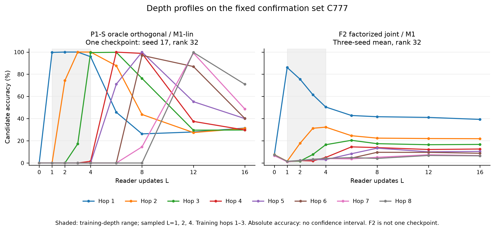
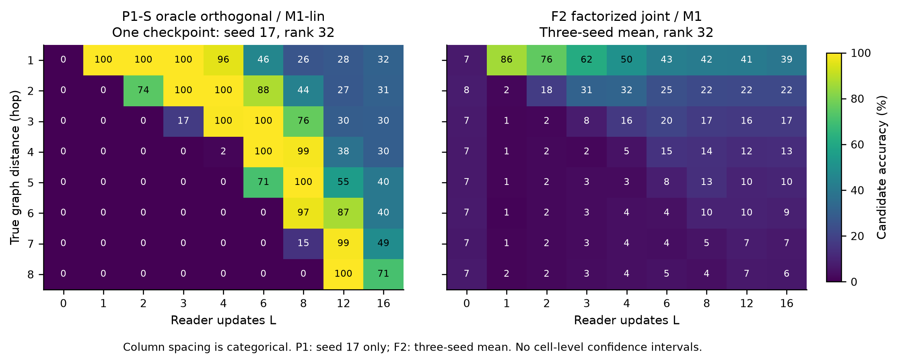
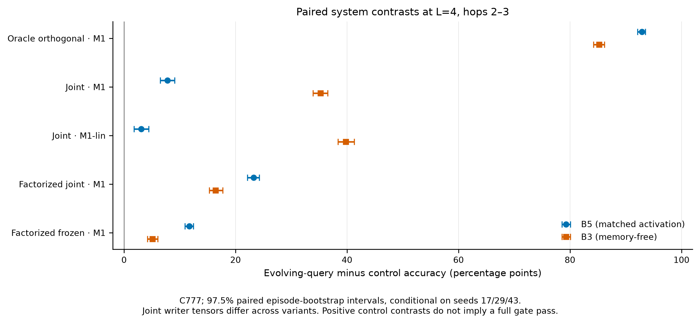
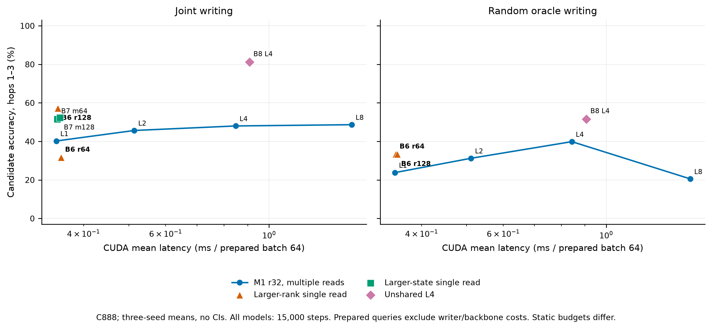
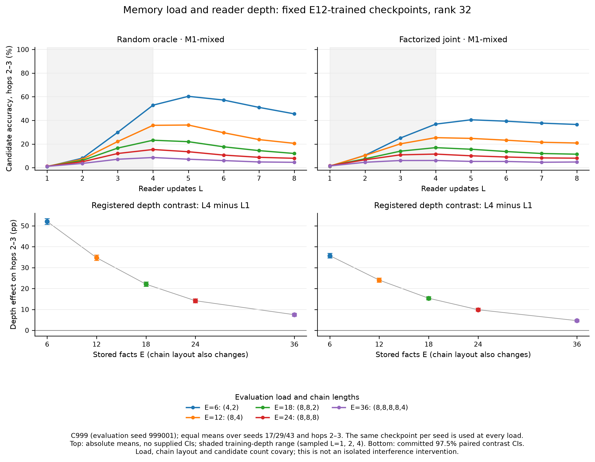
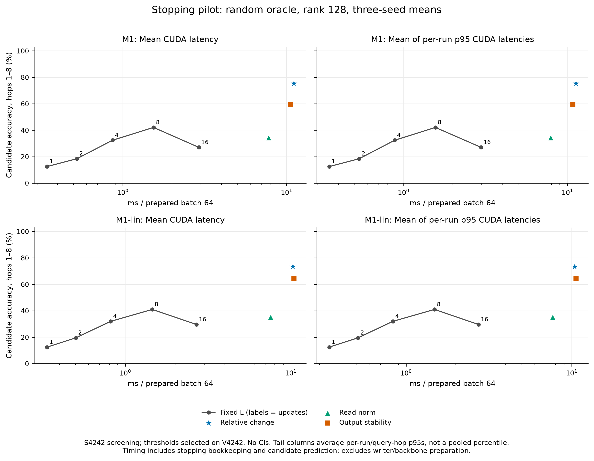

# Iterative Queries in a Low-Rank Memory Adapter: Composition, Writer Dependence, and Budget Limits

*Symbolic manuscript draft. Code cutoff: `14af341`; numerical and claim authority:
[symbolic evidence ledger](evidence_symbolic.md), introduced in `e8f90d2` and extended
with IS in `23a5165`.
Main-text experimental claims carry ledger IDs in HTML comments. IS is included;
end-to-end results and the planned stability/readout studies remain incomplete.*

## Abstract

Can a low-rank adapter use additional computation to extract compositions from a fixed
context memory? We study a reader that repeatedly updates a low-dimensional query while
holding both its input and memory snapshot fixed. The associated writer performs one
decay-first delta update per eligible context token. Under orthogonal oracle writing,
additional reads improve reachable-hop accuracy and exceed fixed-query and memory-free
controls. <!-- S1 --><!-- S2 --> Learned writing changes the result: the original joint
writer gives a smaller, seed-dependent benefit, while factorized writing gives stronger
walk-specific depth effects but fails to preserve single-hop accuracy. <!-- S3 --><!-- S9 -->
On hops2–3, four reads at rank32 outperform the tested larger single-read rank/state
configurations with factorized learned writing, but the original joint-writer practical
budget gate fails. <!-- B5 --><!-- B7 --> At rank32, the reachable-hop L4−L1 benefit
shrinks from E12 to E36 under the registered load/layout changes, while the multi-read
capability criterion still holds at the tested training loads. <!-- IS1 --><!-- IS2 -->
Screening stopping policies partly recover random-oracle long-hop accuracy, yet do not
repair factorized single-hop losses or reduce measured latency in the tested implementation.
<!-- H1 --><!-- H2 --><!-- H4 --> Conditional theory separates composition inside a fixed
output subspace, limitations of one-read observations, writer shortcuts, and fixed-point
certificates. The resulting contribution is a bounded account of when repeated memory
access helps, together with negative results that prevent capability gains from being
mistaken for general efficiency or end-to-end reasoning gains. <!-- B7 --><!-- B8 --><!-- B9 -->

## 1. Problem and scope

A context-dependent adapter must decide both what to store and how to query it. Increasing
the size of its memory or bottleneck is one option; spending more computation on a stored
representation is another. These choices answer different questions. A larger state may
retain information that a smaller state loses, whereas an additional query may reveal a
composition already represented in the smaller state. Neither possibility follows merely
from counting parameters. We therefore ask whether the query can evolve productively
without changing the input, rewriting the context, or executing the frozen base projection
again inside the reader loop.

The distinction is easiest to formulate for a chain of associations. A query specifies a
starting entity, and the target is the chain terminal. A reader with a suitable memory map
can retrieve a successor, use that result to form another query, and continue. However,
accuracy on a terminal task need not identify that algorithm. A learned writer may expose
information about the terminal set directly, so a model can answer some questions without
following their paths. Proposition 10 provides an explicit conditional construction of
such an endpoint statistic; factorizing writer inputs removes a particular direct term,
without eliminating every possible source of global information.

Our empirical scope is correspondingly specific. Orthogonal oracle writing supplies a
clear positive result for shared evolving-query readers, whereas the learned joint-writer
benefit at rank32 varies across the tested training seeds. <!-- S1 --><!-- S3 --> A
factorized writer changes the depth profile and increases walk specificity, including
when its T1-pretrained writer is frozen, but none of those factorized conditions passes
the full hop-preservation gate. <!-- S9 --> This combination motivates treating writer
design and reader depth as interacting parts of an inference system, rather than
equating a positive average depth effect with a complete solution.

We distinguish three experimental questions. First, does changing evaluation depth
improve one trained reader while preserving its input and memory? Second, do separately
trained evolving-query systems outperform fixed-query or memory-free controls? Third,
does spending computation on extra reads improve an actual budget frontier relative to
larger single reads? The positive oracle and factorized capability comparisons address
specific versions of the first two questions; they do not establish a general favorable
accuracy–latency frontier. <!-- S1 --><!-- S2 --><!-- S9 --><!-- B5 --><!-- B7 --><!-- B8 -->

The paper presents both the useful mechanism and its restrictions. The rank follow-up
changes training duration as well as rank, the sharing follow-up compares separately
trained systems, and adaptive stopping is evaluated on screening data without confidence
intervals. <!-- S8 --><!-- B3 --><!-- H1 --><!-- H4 --> End-to-end language-model performance
is a separate unresolved question, not a consequence of selecting a symbolic reader.
<!-- B9 --> Keeping these distinctions explicit makes the negative outcomes informative:
they specify which interpretation of additional reader computation survives each control.

## 2. Related work and boundaries

[LoRA](https://arxiv.org/abs/2106.09685) supplies the starting parameterization: a frozen
base projection plus a trained low-rank branch. Our question concerns context-conditioned
computation inside that branch. It does not depend on presenting recurrence itself as a
new addition to low-rank adaptation. The [dated literature audit](../reports/lit_check.md)
is the scope record for the comparisons below; we retain its access limitations rather
than turning an incomplete search into a priority claim.

Associative fast weights are the closest antecedent to the memory access pattern.
[Ba et al.](https://arxiv.org/html/1610.06258v3) already use an evolving inner state to
read fixed fast weights repeatedly, with sustained input during the inner loop. Their
construction makes clear that repeated access to a fixed matrix predates this adapter
study. [Schlag et al.](https://proceedings.mlr.press/v139/schlag21a.html) connect linear
attention to fast-weight programming and motivate delta-style updates that correct
stored key–value associations. We use that lineage to separate the slow parameters
that learn a representation from the online matrix that stores the current context.

[δ-mem](https://arxiv.org/html/2605.12357v2) combines associative online state with
low-rank corrections to a frozen language model. Its old-state read provides a useful
comparison with our separation between writing the context and spending several reader
updates on the resulting snapshot. The relevant distinction is the read schedule and
query evolution, not a claim that associative memory or context-dependent low-rank
corrections are new. Matching these schedules also requires specifying the writer's
decay/update order, because nominally similar delta rules can retain different states.

Looped models investigate where repeated computation should occur.
[MixerLoop](https://arxiv.org/abs/2608.18230) repeats a delta-network mixer while applying
its dense feed-forward component once; the literature audit distinguishes its repeated
mixer updates from the fixed-memory reader considered here. [MemReasoner](https://arxiv.org/abs/2503.07903)
is a close memory-and-composition neighbor, with an end-to-end trained memory-augmented
language model. These comparisons motivate describing the exact object being iterated:
a low-dimensional query, a whole hidden state, or an update that also rewrites memory.
They do not justify transferring a result between those objects without an equivalence
argument.

[Deep equilibrium models](https://arxiv.org/abs/1909.01377) motivate another distinct
question: finding and differentiating through a fixed point. Our finite-depth reader
need not be a contraction to be useful, and a fixed-point error certificate would not
by itself establish correct task predictions. RecLoRA remains a related-work item whose
full-text architectural comparison is **TODO**: the committed audit could not verify its
page-level claims. We consequently make no claim about absent nonlinearities, routing,
or token mixing in that work, and do not use its unverified publication status in the
argument. The contribution sought here is a reproducible composition-and-budget study
with explicit writer controls and conditional analysis.

### Latent recurrence, sharing, and stopping

The [latent-reasoning survey](https://arxiv.org/html/2507.06203v2) distinguishes
vertical activation recurrence at fixed token/time from evolution across sequence
history. Our reader uses the former axis while the writer updates memory across
tokens. [Huginn](https://arxiv.org/html/2502.05171v2) supplies precedents for shared
Transformer recurrence, reinjected input, heavy-tailed training-depth sampling,
and heuristic prediction-KL exits. [Coconut](https://arxiv.org/html/2412.06769v4)
instead adds latent sequence positions by reusing hidden states as input embeddings;
its default fixed latent length should not be confused with guaranteed adaptive
halting. These are different placements of latent computation, with different caches
and training objectives.

[Ouro](https://arxiv.org/pdf/2510.25741v6) learns exit allocation for shared Transformer
loops and reports degradation beyond trained depth. That is a precedent for studying
nonmonotone depth, not a diagnosis of this reader's failure mechanism.
[Relaxed Recursive Transformers](https://arxiv.org/html/2410.20672v3) use depth-specific
LoRA to relax full-block sharing and train all model parameters; their oracle-exit
batching simulations do not establish this adapter's measured efficiency.
[Mixture-of-Recursions](https://arxiv.org/html/2507.10524v3) adds learned token-level
depth routing, including a variant that reuses first-recursion KV for later queries.
Consequently fixed context alone is not a unique distinction. Our specified compact
delta state, low-dimensional reader, and separate write schedule define the comparison.

[STARS](https://arxiv.org/html/2605.26733v1) already combines sampled depth with
Jacobian-vector regularization of looped dynamics. Its practical sampled-state proxy
is not a certified spectral radius or global contraction constant.
[ReLIT](https://arxiv.org/html/2608.08113v1) combines a frozen-backbone anchor with
recursive full-sequence answer/scratchpad updates and ACT halting. These precedents
narrow any claim about reinjection, frozen-backbone latent recurrence, or stabilization.
They motivate the [JS protocol](../prereg/JS.md), without supplying a result for it.

### Verbalizable directions and the readout boundary

[Verbalizable Representations Form a Global Workspace in Language Models](https://transformer-circuits.pub/2026/workspace/index.html)
defines J-lens using averaged transport from intermediate residuals toward final-layer
representations and vocabulary readout. Its sparse J-space construction is generally
a union of cones from an overcomplete frame, not the adapter's fixed col(B) or a single
rank-r subspace. It motivates asking whether intermediate reader states expose the
expected entities, while separating readability from causal use. The downstream
transport Jacobian and the reader's recurrent transition Jacobian are different
objects. The [expanded primary-source audit](../reports/lit_check.md#wp-t6-latent-recurrence-verbalizable-directions-and-stability)
records versions, access limits, and these distinctions; it supports no new priority claim.

## 3. Method: one write schedule, repeated low-dimensional reads

Let a frozen linear projection map an input x to Wx+b. Its adapter first forms u=Ax,
where A has output dimension r. A memory matrix M has shape r_mem×r_mem. With column-vector
notation, the shared reader is

\[
z^{(0)}=u,\qquad
z^{(s+1)}=u+\rho\,\phi(Rz^{(s)}+UMQz^{(s)}),\qquad
y=Wx+b+\alpha Bz^{(L)}.
\]

The same M is used throughout the inner loop. Q maps the current state to a memory
query, U maps its read back into the reader coordinates, and B supplies the output
bottleneck. The input is reinjected at every update. Increasing L therefore changes
the reader computation while leaving the base-projection schedule unchanged. Setting
L to zero gives the ordinary low-rank branch; this identity specifies a limiting case,
not an empirical claim that different trained readers coincide.

The memory writer uses a normalized key k and value v derived from the designated
writer inputs. The unfactorized learned writer takes
\(k=Ku/\max(\|Ku\|_2,\epsilon)\) and \(v=Vu\), with a positive norm clamp and
learned scalar sigmoid gates; factorization instead separates its head/relation
and tail projections. Oracle conditions specify their codes and gate values
directly. For an eligible write, the decay-first update is

\[
\bar M=\lambda M,\qquad
M^+=\bar M+\beta(v-\bar Mk)k^T.
\]

Reading precedes the current token's write. Padding neither reads nor writes, reset
clears the state before use, and a skipped write does not trigger decay. In the memory-QA
protocol, support facts populate the state and questions read without writing. Separate
questions and evaluation depths fork from the same completed context snapshot. These
semantics define which information remains fixed when a reader is evaluated at a
different depth; the binding specification is [notation.md](../notation.md).

We use M1 for ReLU and M1-lin for identity activation. B5 holds its initial memory query
fixed and caches the resulting read while allowing internal iterations; B3 removes the
memory path. B6 spends budget on larger rank in a single step, and B7 enlarges the
memory dimension while retaining the smaller reader dimension. B8 replaces shared
R/U/Q with step-specific matrices and is trained for a fixed unrolled depth. It is a
separate architecture comparison, not a reader that can be extended by reusing a
uniquely defined next shared step.

Writer conditions determine which cross-reader comparisons hold memory representations
fixed. Oracle writing uses specified entity codes. <!-- S2 --> A T1-pretrained frozen writer is
shared across the reader variants for its seed. <!-- S5 --><!-- S9 --> Under joint writing, however, each
reader variant trains its own writer, so a contrast with B5 or B3 compares learned
systems rather than isolating query evolution under an identical learned writer.
<!-- S2 --><!-- S3 --><!-- S5 --><!-- S9 --> The factorized learned conditions restrict
keys and the initial query/input projection to head/relation information and values
to the tail input. <!-- S9 --> Later reader queries can incorporate previously read values. <!-- S9 -->
This removes
the direct head-subtraction statistic analyzed in Proposition 10. This is a structural
restriction on an identified shortcut, not a universal guarantee about learned algorithms.

The symbolic primary layout contains 12 edges in chains of lengths 8 and 4, with
64-dimensional entity representations and rho=0.25; the primary reader and memory
dimensions are both 32. <!-- S1 --><!-- S3 --><!-- S9 --> Readers train on hops1–3, with
mixed depths {1,2,4} unless a fixed-depth comparison is explicitly named. <!-- S1 --><!-- S9 --><!-- B3 -->
These task conditions are part of every claim below. We separately account for trained
parameters, persistent state, prepared-query latency, and training protocol, because
matching one does not match the others.

## 4. Theory: useful computation without unconditional guarantees

**Fixed subspace, variable computation (Proposition 1).** At fixed memory and depth,
the branch has the form alpha B f(Ax), so its output lies in col(B), and its local
input-Jacobian rank is bounded by r wherever differentiable. Equal Ax implies equal
branch outputs only when the other inputs, including M and L, are fixed. Nothing in
this statement prevents f from changing with reader depth. Nor is it a global rank
bound on a stacked sequence map through history-dependent memories. Thus a depth
comparison can measure different computation inside the same bottleneck without
claiming an expanded output subspace.

**Composition order (Proposition 2).** For an identity activation, shared matrices,
constant reinjection, and a fixed snapshot, define T=rho(R+UMQ). The exact state is
\(z^{(L)}=\sum_{j=0}^{L}T^j u\). Additional steps permit higher-order products involving
memory. When the recurrent and memory terms do not commute, these are ordered matrix
products, not a scalar binomial expansion. At fixed M and L the map is still linear
and may be precomputed at a preparation/storage cost; the identity therefore supplies
neither an irreducible serial-computation lower bound nor an accuracy guarantee.

**An existence construction for chain following (Proposition 3).** Suppose all episode
entity codes in disjoint directed chains are orthonormal across the entire episode
(so their number does not exceed r), memory starts at zero, and each edge is written
once with exact unit gates. Suppose the linear reader implements an aligned
successor map with effective gain greater than one, maps terminals to zero, and has
no leakage onto competing codes. With a
matching code decoder, successive visited nodes receive increasing weights and the
terminal remains the prediction after enough steps. This aligned chain transition is
nilpotent on the entity-code span, so finite stabilization is possible even without Euclidean contraction;
acyclic data alone do not make an arbitrary learned transition nilpotent.
Exact storage alone does not ensure the required gain, query/value alignment, or decoder;
the theorem does not state that optimization must find this construction.

**Interference and information access (Propositions 4 and 5).** Nonorthogonal delta
writes can alter previously stored associations. A telescoping bound on differences
of operator powers permits memory error to be amplified with depth, while allowing
special cases with no growth. Separately, a one-read or fixed-query reader observes
the context only through MQu, given its fixed input and side information. Episodes
with identical observations must receive identical predictions. A chain-specific
Bayes ceiling needs the additional aligned first-hop and side-information assumptions;
it is not an impossibility theorem for every learned query or larger one-read model.

**Fixed-point error versus answers (Proposition 7).** For
\(F(z)=u+\rho\phi((R+UMQ)z)\), a valid global Lipschitz constant c<1 gives a unique
fixed point and \(\|z-z^*\|\le\|F(z)-z\|/(1-c)\). One sufficient upper bound is
\(\bar c=|\rho|L_\phi(\|R\|+\|U\|\|M\|\|Q\|)\).
A bound above one is inconclusive about actual contraction. Even a valid state-error
bound needs decoder-margin and task assumptions before it can say anything about a
label, and label stability alone is not correctness. Residual thresholds without a
certificate are empirical stopping policies.

The planned JS penalty concerns a different sufficient condition: for a smooth map
at an actual fixed point, transition spectral radius below one implies local
asymptotic stability. A finite last-read state need not be fixed, pointwise radii
do not control all transient products, and ReLU boundaries need additional care.
Thus the [preregistered stability study](../prereg/JS.md) is a test of a regularizer,
not an existing certificate or a demonstrated remedy. The failed sufficient bounds
from P4 establish no state-divergence claim. <!-- H3 -->

**Writer information and the final decoder (Propositions 10 and 11).** Under specified
common unit keys, constant gates, and zero initial memory, the writer admits an exact
exponentially weighted value expression. Difference values of the form
\(D(e_{tail}-e_{head})\) can expose endpoint statistics when the weighting error is
controlled relative to the decoder's endpoint margins; common keys alone are
insufficient. Tail-only factorization removes the direct head-subtraction term but
leaves other global statistics possible. More generally, an exact delta read is a
signed combination of written values whose coefficients depend on later-write key
erasure. Its interference depends on the value Gram matrix as well as key alignment.
Normalized addressing objectives do not set raw query magnitude, and an auxiliary
value decoder need not agree with the actual reader or downstream model. These are
conditional explanations and diagnostic requirements, not fitted causes of the
symbolic or language-model outcomes.

The remaining propositions set additional boundaries. The bias-free ReLU transmission
obstruction concerns an exact through-map on a positively spanning code set, not
universal classification failure of the residual reader (Prop.6). Exact elimination
of a high-dimensional recurrence requires its entire update to remain in a fixed
output subspace (Prop.8). The pure zero-output-factor double-BA dead start concerns
that branch's first derivative, not every V2 initialization (Prop.9). We use none of
these identities as evidence of a measured elimination speedup or a universal ranking
between linear and nonlinear readers. Full assumptions, proofs, and counterexamples
are in [theory.md](../theory.md); Appendix A gives proof sketches.

## 5. Mechanism experiments: depth is useful under specific writing conditions

We report candidate-restricted accuracy and distinguish percentage points (pp) from
absolute percentages. <!-- S1 --><!-- S9 --> Confirmation intervals are 97.5% paired episode-bootstrap
intervals conditional on the three fixed training seeds; absolute point profiles
have no standalone confidence intervals. <!-- S1 --><!-- S3 --><!-- S9 --> The depth
effect D is L4 minus L1 on hops2–3; walk specificity W subtracts the corresponding
effect on far hops6–8. This subtraction prevents a generic all-hop shift from being
described as selective improvement on the trained reachable hops.

The primary protocol treats reach, specificity, preservation of the single-hop task,
and replication as separate requirements; an improvement on only the reachable-hop
average is insufficient for its full gate. <!-- S1 --><!-- S4 --><!-- S5 --><!-- S9 -->
The fixed-query comparison addresses a different alternative explanation: internal
iterations may help even when the context observation is cached. The memory-free
comparison asks whether those iterations need any stored context at all. Neither
control is replaced by a larger-rank comparison, which changes the representation
budget. These distinctions explain why we retain both the registered composite
outcome and its component contrasts instead of selecting whichever metric is most
favorable for a particular writer.

The primary stage and its follow-ups also differ in evidential strength. The
original stage includes the registered changed-layout replication, whereas the
rank and factorized follow-ups report their own unreplicated results on the
reused confirmation set. <!-- S1 --><!-- S5 --><!-- S8 --><!-- S9 --> For learned
writers, a within-checkpoint depth contrast fixes that checkpoint's writer and
memory; a comparison of reader variants generally does not fix the jointly
trained writer. <!-- S3 --><!-- S9 --> We consequently interpret depth effects,
control effects, and cross-writer differences separately. A figure showing one
checkpoint helps expose the depth trajectory, but it cannot replace the pooled
endpoint or its training-seed breakdown.

### 5.1 Oracle writing and controlled reader contrasts

With orthogonal oracle writing, r32 M1 has D=+92.883 pp [92.233,93.550] and
W=+92.872 pp [92.208,93.564] on confirmation seed777001, while also improving hop1.
<!-- S1 --> The separately trained evolving-query reader exceeds B5 by +92.892 pp
[92.150,93.542] and B3 by +85.233 pp [84.233,86.183] on hops2–3 at L4, using the
same primary oracle codebook. <!-- S2 --> These contrasts support repeated,
query-dependent memory use for the tested task, rather than an explanation solely
in terms of more memory-free iterations. <!-- S1 --><!-- S2 -->

Exact one-hop-per-read timing is nevertheless not an empirical result. <!-- S7 -->
For the trained orthogonal M1-lin reader, hop4 accuracy at L4 is 2.483%, and hop8 at
L8 is zero, despite high accuracies for some intermediate longer hops at L8. <!-- S7 -->
Its hop1 accuracy falls from 99.567% at L1 to 96.550% at L4 and 26.300% at L8.
<!-- S7 --> These cells reject the automatic identification of a trained reader with
Proposition 3's aligned construction; they do not refute its sufficient conditions.
<!-- S7 --> The apparent benefit of depth must be described by hop and evaluation
depth, including the short-hop losses.

Random oracle codes give a different balance. At r32, M1 improves reachable hops by
+33.258 pp [32.016,34.484] but loses 18.933 pp on hop1; M1-lin likewise has a positive
depth effect and a substantial hop1 loss. <!-- S6 --> Both conditions fail only the
hop-preservation criterion. <!-- S6 --> Random oracle codes therefore should not be
treated as interference-free storage, and their positive reachable-hop effect should
not be relabeled a full gate pass. <!-- S6 -->

*Figure 1. Quality versus evaluation depth by hop: P1-S oracle_orth/M1-lin uses the
individual seed17 checkpoint; F2 joint_fact/M1 uses the three-seed mean of fixed-checkpoint
sweeps because individual-checkpoint F2 cells are not committed. <!-- S7 --><!-- S9 --> Candidate-restricted
accuracy, confirmation seed777001; source selectors are recorded with the figure. <!-- S7 --><!-- S9 -->
Curves have no confidence bands and do not imply exact one-hop timing or hop preservation.
<!-- S7 --><!-- S9 --> [PDF](figures/quality_depth.pdf).*

*Figure 2. Hop×L views of the same committed conditions: the left panel is seed17,
and the right panel is the three-seed mean, as in Figure 1. <!-- S7 --><!-- S9 --> Training hop lengths and
evaluation depths must be distinguished when reading extrapolation cells; successful
individual cells do not establish uniform longer-hop success. <!-- S7 --><!-- S9 -->
[PDF](figures/hop_depth_heatmap.pdf).*

### 5.2 Learned writers, factorization, and seed dependence

The unfactorized joint r32 M1 condition passes the registered gate with a much
smaller effect: D=+8.292 pp [7.383,9.292] and W=+2.492 pp [1.244,3.733]. <!-- S3 -->
Its mean advantage over B5 is +7.767 pp [6.516,9.050], but the three seed effects
are +9.300, −17.700, and +31.700 pp. <!-- S3 --> The pooled interval is consequently
compatible with a failed training seed, and it does not establish improvement for a
population of new seeds. <!-- S3 --> The joint linear reader fails the primary depth
gate, with specificity −0.408 pp [−1.475,0.753]. <!-- S4 -->

Unfactorized frozen T1 writers fail the replication-specificity criterion for both
readers; the M1 replication interval includes zero. <!-- S5 --> This result does not
show that joint training is necessary for every composable writer, because factorized
frozen writers produce positive depth and specificity effects under the tested F2
protocol. <!-- S5 --><!-- S9 --> Even the matched factorized T1 sources' validation
accuracies above 91% do not certify the full T2 gate after freezing: the resulting
readers retain positive depth effects but fail hop1 preservation. <!-- S12 --><!-- S9 -->

Factorization makes the distinction between composition evidence and overall utility
particularly clear. Joint_fact M1 yields D=+22.975 pp [22.017,23.975] and
W=+20.158 pp [19.058,21.192], but H=−35.617 pp [−37.217,−33.933]. <!-- S9 --> All
four factorized writer/reader conditions fail the complete depth gate because of
hop1 loss, even though their reach, specificity, and control contrasts pass the
reported criteria. <!-- S9 --> Moreover, joint_fact M1's final L4 reachable-hop
contrast against the unfactorized joint system is −19.108 pp [−20.534,−17.600],
despite a larger depth contrast. <!-- S10 --> Improving a contrast from a weaker
L1 baseline is therefore not equivalent to improving the deployed L4 system.
<!-- S10 -->

The larger-rank follow-up gives stronger joint-code effects in its tested regimes:
r64 M1 has D=+30.533 pp [29.225,31.900], with positive B5 contrasts for all three
tested seeds. <!-- S8 --> However, it uses 20,000 training steps instead of the
primary study's 15,000, and has no replication, so the comparison cannot isolate
rank or establish new-seed robustness. <!-- S8 -->

*Figure 3. Paired hops2–3 contrasts at L4 against fixed-query B5 and memory-free B3;
displayed intervals are the released 97.5% episode-bootstrap intervals. <!-- S2 --><!-- S3 --><!-- S9 --> Oracle and
learned writer conditions must retain their different sharing controls, and positive
pooled effects do not require every training seed to improve. <!-- S2 --><!-- S3 --><!-- S9 -->
[PDF](figures/paired_controls.pdf).*

### 5.3 Counterfactual specificity and decision history

Successor swaps provide screening-only diagnostics without released confidence
intervals. <!-- S11 --> For joint M1 at L4, among the
specified P1-S rows whose new path fits, the new-terminal follow rate is 44.220%
versus 35.293% for the unswapped query; joint M1-lin is nearly unchanged at
48.336% versus 47.913%. <!-- S11 --> The factorized M1 new-path-length-one stratum
has 47.985% versus 4.426%, but that different stratum prevents interpreting the
cross-study rate difference as a controlled factorization effect. <!-- S11 -->
These responses are consistent with path-sensitive behavior without uniquely
identifying pointer chasing or excluding global terminal statistics. <!-- S11 -->

The continuation decision also needs disclosure. The evidence ledger's
[decision-history correction, item 4](evidence_symbolic.md#discrepancies-and-interpretation-corrections) records an
explicit deviation from F2's original no-go rule: the orchestrator continued toward
P1-L using the earlier joint/M1 pass, while using F2 to inform writer form. <!-- S3 --><!-- S9 -->
This decision did not turn the factorized failures into passes. <!-- S9 --> It belongs
in the interpretation of the study, because a preregistered gate and a later justified
continuation decision are different records.

## 6. Budget experiments: capability does not establish efficiency

P2-S compares r32 shared M1 at L4 with larger single reads and an unshared reader;
the reference M1 uses mixed-depth training, while B6/B7 train at L1 and B8 at fixed
L4. <!-- B1 --><!-- B2 --><!-- B3 --><!-- B4 --> With unfactorized joint writing, M1
beats B6/r64 on reachable hops. <!-- B1 --> The M1−B6/r128 contrast is −3.233 pp
[−4.675,−1.833], and M1 also scores below both larger-state B7 configurations. <!-- B1 --> Thus the claim
that these larger single reads cannot replace the tested joint system is not
supported. <!-- B1 --> With random oracle codes, by contrast, M1 exceeds B6/r64
and r128 by +34.750 and +34.775 pp, respectively, with positive intervals. <!-- B2 -->

The factorized follow-up also supports a bounded capability claim. Mixed-depth
joint_fact M1/r32 at L4 exceeds B6/r64, B6/r128, B7/r_mem64, and B7/r_mem128 by
+24.017, +24.242, +23.875, and +23.550 pp, respectively; every reported interval
and tested-seed effect is positive. <!-- B5 --> These are comparisons against the
specified trained architectures, not an information-theoretic ceiling for every
single-read function. <!-- B5 -->

The two kinds of positive result should not be combined into an unrestricted resource
claim. A fixed-rank depth sweep spends more reader operations at the same persistent
state size. A larger-rank single read changes both its representational width and
state storage, while a larger-memory comparison changes the state while retaining the
same reader width. <!-- B1 --><!-- B5 --> Each comparison rules out a different explanation for the observed
accuracy; none licenses replacing measured latency by an analytic operation count.
The current factorized result establishes only the tested capability contrast, with
its accuracy–latency frontier still unmeasured. <!-- B5 --><!-- B8 -->

Matching training depth narrows the sharing question. B8 minus shared M1-L4 has
reachable-hop effects of +13.217 pp [11.983,14.450] for joint writing,
+5.458 [4.242,6.750] for joint_fact, and +3.200 [1.958,4.517] for random oracle
writing. <!-- B3 --> This comparison also changes parameter count and, for learned
joint writing, writer parameters; it is not a parameter-neutral causal estimate
of sharing. <!-- B3 --> Fixed-L4 shared training improves over the mixed-depth
reference, reducing the joint B8 gap from 33.733 to 13.217 pp, but the selected
protocol comparison does not identify a unique causal fraction due to depth.
<!-- B4 --> B8's pooled long-hop accuracy at evaluation L4 is lower for all three
writers, so its trained-hop advantage is not evidence of superior depth extrapolation.
<!-- B6 -->

The practical result is negative. <!-- B7 --> Joint M1/r32 at L4 attains 48.017% hops1–3 accuracy
at 0.848 ms per prepared batch64, whereas joint B6/r128 at L1 attains 57.244% at
0.352 ms; these are descriptive CUDA-event means without timing intervals. <!-- B7 -->
Every eligible joint M1 depth point is matched by an equal-or-faster single-step
point for both tested batch sizes, and Gate 3 fails. <!-- B7 --> Those models spend
different parameter and state budgets, so the negative practical result does not
erase the fixed-budget composition contrast; it rejects a broader efficiency claim.
<!-- S3 --><!-- B7 --> No factorized accuracy–latency benchmark closes that gap in
the evidence: its frontier remains open. <!-- B8 -->

The parameter and storage differences make the intended tradeoff concrete: the
joint M1 point has 13,314 trained parameters and 4,096 persistent FP32 bytes per
episode, versus 114,690 parameters and 65,536 bytes for B6/r128. <!-- B7 --> A
reader may therefore be attractive under a strict state allocation even when it
does not win the measured latency comparison. That possible application is a
conditional design choice, not a practical advantage established for the full
request path. The reported timings exclude the context writer and other preparation,
and the follow-up's aggregate resource ledger cannot supply missing comparative
training costs for individual models. <!-- B7 --><!-- B8 -->

*Figure 4. P2-S accuracy–latency points, with larger-rank single reads marked. <!-- B7 -->
Accuracy averages hops1–3, rather than only the reachable-hop endpoint; timings
exclude writer/context preparation and are descriptive means. <!-- B7 --> Different ranks trade
different parameters and persistent-state budgets. <!-- B7 --><!-- B8 -->
[PDF](figures/budget_latency.pdf).*

### Memory load, adaptation, and updated facts

Study IS uses a new confirmation set, C999 (evaluation seed999001, 2,000 episodes
per load), at r=r_mem=32, with oracle_random and joint_fact as primary writers.
<!-- IS1 --><!-- IS2 --> Its fixed E12-trained M1 checkpoints are evaluated at
E6/12/18/24/36; increasing load also changes chain layout and candidate count.
<!-- IS1 --> D(E) compares L4 with L1 on reachable hops2–3 within each checkpoint.
For oracle writing, D falls from 34.750 pp at E12 to 7.492 pp at E36, with
DeltaD=−27.258 pp [−28.800,−25.816]; for factorized writing it falls from
24.042 to 4.642 pp, with DeltaD=−19.400 pp [−20.542,−18.241]. <!-- IS1 -->
Both changes are negative in every tested seed; their 97.5% intervals use independent
load bootstrap streams rather than cross-layout episode pairing. <!-- IS1 -->
This supports the registered operational load/depth prediction without identifying
crosstalk as its sole cause or validating Proposition 4's operator bound as tight.
<!-- IS1 -->

*Figure 6. Plan §9.3 item4: fixed E12-trained shared M1 checkpoints across load/layout
conditions, averaging seeds17/29/43 and hops2–3 on C999. <!-- IS1 --> Top panels show
absolute accuracy means without supplied CIs; bottom panels reuse the released
97.5% within-load L4−L1 intervals. <!-- IS1 --> The same checkpoint per seed is used
at every load, while chain layouts and candidate counts covary. <!-- IS1 -->
[PDF](figures/memory_load_depth.pdf).*

For models trained at their evaluation load, all tested E12/24/36 M1@4 and B8@4
contrasts against B4@1 meet the registered point≥3 pp and CI lower>0 rule.
<!-- IS2 --> At the largest tested load, E36, their reachable-hop margins are:
<!-- IS2 -->

| Writer | M1-mixed@4−B4@1, pp [97.5% CI] | B8@4−B4@1, pp [97.5% CI] |
| --- | --- | --- |
| oracle_random | +4.483 [3.950,5.033] <!-- IS2 --> | +5.942 [5.225,6.675] <!-- IS2 --> |
| joint_fact | +3.433 [2.983,3.867] <!-- IS2 --> | +5.008 [4.500,5.500] <!-- IS2 --> |

The factorized M1 interval need not have its lower endpoint above 3 pp to qualify;
the threshold applies to the point estimate. <!-- IS2 --> These are separately trained
systems with different depth/sharing conditions, not a recheck of hop1 preservation
or the practical latency gate; the capability failure boundary beyond E36 was not
located. <!-- IS2 --><!-- B7 --> Under the inherited learning rate and fixed-step
protocol, all eight load-specific E24/E36 training contrasts against E12-trained
models evaluated at the same load are negative, ranging from −6.283 to −2.042 pp,
with negative intervals. <!-- IS3 --> That result does not show that independently
tuned or convergence-matched load adaptation is generally harmful. <!-- IS3 -->

The update-task check uses unchanged E12-trained readers with 14 stored facts:
12 current edges plus two obsolete records; its pooled queries cover hops1–4.
<!-- IS4 --> For B8@4, the absolute current/stale rates are:
<!-- IS4 -->

| Writer | Current, affected paths, % [97.5% CI] | Current, untouched paths, % [97.5% CI] | Obsolete terminal, affected paths, % [97.5% CI] |
| --- | --- | --- | --- |
| oracle_random | 41.750 [40.235,43.300] <!-- IS4 --> | 37.606 [36.051,39.211] <!-- IS4 --> | 0.510 [0.332,0.712] <!-- IS4 --> |
| joint_fact | 28.619 [27.452,29.735] <!-- IS4 --> | 30.468 [29.357,31.648] <!-- IS4 --> | 6.035 [5.486,6.591] <!-- IS4 --> |

Current terminals are selected more often than obsolete ones in these primary B8
conditions, with partial overall success. <!-- IS4 --> These are absolute-rate
intervals, not paired intervals for current−stale or affected−untouched effects;
untouched-path stale rates are undefined. <!-- IS4 --> They establish neither a
causal benefit from updating nor a guarantee that every reader follows updated paths.
<!-- IS4 -->

## 7. Stopping: accuracy recovery, incomplete preservation, and runtime cost

Stopping policies select thresholds using mean validation accuracy, freeze them,
and evaluate on screening seed4242 without confidence intervals; no confirmation
result is supplied. <!-- H1 --><!-- H4 --> Relative-change stopping on random-oracle
r128 M1 increases long-hop accuracy from 45.747% at L8 to 70.690%, using 8.301 mean
updates, but its hop1 accuracy remains below L1: 87.883% versus 99.983%. <!-- H1 -->
The corresponding linear reader also improves long-hop screening accuracy while
retaining a hop1 loss. <!-- H1 --> This is a selected empirical tradeoff, not a
certificate that the chain terminal has been reached. <!-- H1 --><!-- H3 -->

The tested r32 factorized stopping policies do not repair the hop1 preservation
failure. <!-- H4 --> All 12 factorized
family/rule choices fail hop1 preservation; even each family's descriptively
least-loss screening rule loses between 24.900 and 41.733 pp relative to L1.
<!-- H4 --> The unfactorized joint/M1 screening flag supplies no adaptive benefit
either: all three rules use exactly 16 mean updates and reproduce fixed-L16
endpoints, with a negative specificity effect in one training seed. <!-- H5 -->
These outcomes restrict the tested rules, rather than ruling out every possible
halting policy. <!-- H4 --><!-- H5 -->

Fewer reader updates also do not imply lower runtime. For oracle_random/r128/M1
at batch64, fixed L16 takes 2.912 ms and relative-change stopping takes 11.059 ms;
all 48 adaptive family/rule/batch cells are slower than L16 in both CUDA and wall
means. <!-- H2 --> This result includes the tested implementation's active-query
bookkeeping and candidate decoding, and is not a claim about optimized future
implementations or end-to-end latency. <!-- H2 -->

Finally, none of the 96,000 validation-plus-screening episode evaluations has a
sufficient factorized contraction bound below one. <!-- H3 --> This establishes
the absence of a certificate from that test, not actual noncontraction or
divergence. <!-- H3 --> The label-informed true-hop reference is not an accuracy
upper bound for these learned readers, reinforcing that update count cannot
simply be identified with graph distance. <!-- H6 -->

*Figure 5. Screening stopping accuracy versus prepared-reader latency, with mean
and exported tail-timing views identified separately. <!-- H1 --><!-- H2 --> Thresholds are selected on
validation; plotted screening points have no confidence intervals. <!-- H1 --><!-- H2 --> Tail columns
aggregate timing summaries and must not be read as a pooled request-latency
distribution. <!-- H2 --> Fewer steps do not establish a speedup. <!-- H1 --><!-- H2 -->
[PDF](figures/stopping_latency.pdf).*

## 8. End-to-end language models — TODO

The symbolic follow-up selects fixed-L4 B8 with a shared fixed-L4 comparator for
the next stage; this protocol choice supplies no end-to-end language-model effect.
<!-- B9 --> At the code cutoff, merged design/development records include the
[updated P1-L preregistration](../prereg/P1L.md),
[writer-fix screen report](../reports/P1L-writer-fix.md),
[read-fix state](../reports/WP-L4-state.md), and
[oracle-writer implementation report](../reports/WP-C7.md). <!-- B9 -->
They are the boundary of this draft's available implementation history, rather
than a completed comparative LLM result. <!-- B9 -->

**TODO:** incorporate only a subsequent audited, merged evidence ledger for the
end-to-end stage. Report the memory-only versus context-retained protocol,
single-hop writing/retrieval feasibility, fixed-L4 trained-system controls,
answer scoring, and ordinary-capability retention before interpreting any gain.
No provisional screen metric is inserted here. Proposition 11 motivates checking
raw read scale, interference, and the actual value-to-answer path; it does not
predict which writer correction will succeed. The current symbolic reader
selection cannot substitute for this evidence. <!-- B9 -->

The updated P1-L protocol plans to decode intermediate reader states through the
trained output path and frozen upper layers, and to compare name-logit-gradient
directions with a random-direction baseline. These are proposed diagnostics, not
readout results in this manuscript. A name gradient at the injection residual,
g_j, induces local reader sensitivity alpha B^T g_j. Averaging these gradients is
a J-lens-inspired probe; it should be distinguished from the published averaged
residual-transport lens and from the transition Jacobian that JS regularizes.
Hypothetical per-step upper-layer forwards incur diagnostic cost separate from
the deployed reader loop. Ordered entity readability would not alone establish
causal path following, so the existing counterfactual controls remain necessary.
The [primary-source audit](../reports/lit_check.md#two-jacobians-and-the-projects-proposed-readouts)
states the mapping and its limitations. No name-direction alignment intervention
or local terminal-stability remedy is reported as successful here.

**TODO — plan §9.3 item 6:** corresponding single-module and end-to-end results,
using separately identified protocols and uncertainty once the end-to-end evidence
is available. No result is imputed from the symbolic panels.

## 9. Limitations, reproducibility, and conclusion

The central limitation is conditionality. Writer form, learned representation,
reader training depth, and static budget all change the measured composition
benefit. <!-- S3 --><!-- S8 --><!-- S9 --><!-- B1 --><!-- B3 --><!-- B4 --> Candidate-restricted
accuracy is not full-vocabulary answer accuracy. <!-- S9 --><!-- S12 --> These metrics should not be exchanged when moving
from a controlled terminal task to generated language answers.

The uncertainty also has a narrow estimand. The bootstrap conditions on the fixed
training seeds, and the follow-ups reuse confirmation samples rather than supplying
independent confirmation of every successive claim. <!-- S3 --><!-- S8 --><!-- B3 --><!-- B5 -->
Training-seed failures, longer rank-follow-up training, and the disclosed F2 decision
deviation remain relevant even when a pooled interval is positive. <!-- S3 --><!-- S8 --><!-- S9 -->
Screening stopping results require their own future confirmation and do not inherit
the parent study's intervals. <!-- H1 --><!-- H4 --><!-- H5 -->

IS now supplies a same-checkpoint load/layout sweep and a bounded update-task
diagnostic. <!-- IS1 --><!-- IS4 --> Its fixed training protocol and varying layouts
limit interpretation: neither operator-bound tightness, a pure crosstalk effect,
nor a general benefit from load-specific retraining has been established.
<!-- IS1 --><!-- IS3 --> The largest tested capability load is not an identified
failure boundary, and low stale rates do not imply complete current-answer success.
<!-- IS2 --><!-- IS4 --> Local stability and verbalizable intermediate directions
remain hypotheses to test under their separate protocols.

Reproduction separates data access from rendering. The figures are produced by
[paper_figures.py](../../scripts/paper_figures.py) from committed CSV/JSON exports;
the [figure manifest](figures/provenance.json) identifies revisions, selectors,
aggregation, and claim IDs. No checkpoints are reevaluated and no bootstrap or
timing measurement is rerun for this manuscript. The evidence ledger retains exact
stored values and artifact commits; Appendix B records sets, seeds, and comparisons.
Preparation cost, training cost per model, and an optimized factorized latency
frontier remain outside the measured practical claim. <!-- B7 --><!-- B8 -->

Repeated low-dimensional queries are useful under particular writing and access
conditions, with the orthogonal-oracle and factorized capability comparisons
providing the clearest evidence. <!-- S1 --><!-- S2 --><!-- S9 --><!-- B5 --> They do
not establish the strongest efficiency claim: larger single reads challenge the
unfactorized joint reader, while the tested stopping rules neither repair all
short-hop losses nor reduce measured runtime. <!-- B1 --><!-- B7 --><!-- H2 --><!-- H4 -->
The appropriate conclusion is therefore a bounded mechanism result and a set of
reproducible failures, with broader budget and end-to-end claims left open.
<!-- B8 --><!-- B9 -->

The additional load study narrows this result further: depth benefits decrease
under the registered load/layout changes, while multi-read capability remains
positive at the tested training loads through E36. <!-- IS1 --><!-- IS2 --> Existing
latent-recurrence and interpretability research motivates the next diagnostics;
it supplies no missing efficiency, convergence, or end-to-end result for this adapter.

## Appendix A. Proof sketches and non-implications

The full arguments, counterexamples, and constructed checks are in
[theory.md](../theory.md), Props.1–11. These sketches specify the scope needed
to read the experimental sections; they are not new empirical results.

**A.1 Subspace and polynomial.** Induction gives a fixed-memory reader state
f(Ax); multiplication by B places every branch output in col(B), and the chain
rule factors its Jacobian through A and B. For an identity activation, substituting
\(z_{s+1}=u+Tz_s\) repeatedly yields \(\sum_{j=0}^{L}T^j u\). This may increase
memory-composition degree while preserving a linear input map at fixed M. It does
not imply a larger branch-output subspace or a lower bound against snapshot-specific
precomputation (Props.1–2).

**A.2 Ideal chain construction.** For disjoint directed chains, writing each edge
once with orthogonal entity codes, unit gates, and zero initial memory gives
\(M=\sum_{i\to j}c_jc_i^T\), independently of fact order. With an aligned linear
transition of gain a>1 that maps the terminal to zero without competing-code
leakage, the state is \(\sum_{j=0}^{\min(L,h)}a^j c_{i_j}\).
The matched decoder selects the deepest visited node. Nilpotence kills further
transition terms after the terminal. Nonorthogonal codes, imperfect gates,
misaligned projections, or a different decoder invalidate this particular
sufficient argument without invalidating the theorem (Prop.3).

**A.3 Error amplification and one-read observations.** The identity
\(X^j-Y^j=\sum_{k=0}^{j-1}X^{j-1-k}(X-Y)Y^k\) gives an operator-norm error bound
after summing reader powers; it is an upper bound, not a lower bound on damage.
A cached-read reader is a deterministic function of its input, one MQu, and allowed
side information. Identical observations imply identical predictions, and hence
an ambiguity limit only for distributions actually containing such observations.
An arbitrary learned Q need not satisfy an aligned-first-hop restriction
(Props.4–5).

**A.4 ReLU and elimination.** The output of a width-r bias-free ReLU through-map
lies in the cone generated by r columns of its output matrix. It cannot equal
identity on a set positively spanning the entire r-dimensional space; the
residual reader need not implement that through-map. Separately, if every
high-dimensional update is B times a reproducible low-dimensional function,
substituting h=x+Bz gives an exact reduced recurrence. Extra operations that
leave col(B) require a different proof. Shared linear powers satisfy
\((BA)^L=B(AB)^{L-1}A\); nonlinearities cannot generally be moved through the
factors (Props.6,8–9).

For the pure double-BA branch, local Lipschitz continuity and \(\phi(0)=0\) imply
\(\|BA\phi(BAx)\|=O(\|B\|^2)\) for bounded A near initialization. Its joint
first derivative at B=0 therefore vanishes, even if a ReLU Hessian does not exist.
A skip path changes that first-order statement; the same argument does not apply
to V2's single output factor (Prop.9).

**A.5 Stopping certificate.** If F is a contraction with constant c<1, the
triangle inequality gives
\(\|z-z^*\|\le\|z-F(z)\|+c\|z-z^*\|\).
Rearrangement proves the residual state-error bound. Multiplying by a decoder
norm bounds output perturbation; an additional positive class margin is needed
for label stability. No assumption connects that stable label to the target,
so correctness is not a consequence of contraction alone (Prop.7).

**A.6 Writer shortcut and exact delta read.** Common unit keys, zero initial
memory, and constant scalar gates give an exact weighted value recursion with
decay factor \(\lambda(1-\beta)\). Difference values
\(v_i=D(e_{tail}-e_{head})\) telescope to endpoint differences only in an equal-weight
reference sum; using the weighted recursion requires controlling its error relative
to decoder margins and the relevant code geometry. Common keys or generic head
information alone do not ensure a usable terminal statistic. Tail-only values
remove the direct head-subtraction term. More generally, for unit keys, zero
initial memory, constant scalar gates, and E actual writes without an intervening
reset, unrolling the decay-first writer yields
\(M_Eq=\sum_i\beta\lambda^{E-i}v_i k_i^T\prod_{j>i}(I-\beta k_jk_j^T)q\),
where the matrix product follows write order. The resulting coefficients are
signed, later writes affect earlier contributions, and interference power
contains off-diagonal value-Gram terms. An empty product is the identity.
Neither auxiliary angular alignment
nor isolated value decoding guarantees the actual downstream answer
(Props.10–11).

## Appendix B. Experimental protocol and evidence map

All empirical numbers in this draft are rounded from the authoritative
[evidence ledger](evidence_symbolic.md); figures use its linked committed exports.
The ledger's status and conditions take priority over shortened manuscript wording.

| Stage | Evaluation set | Training and comparison conditions | Ledger IDs |
| --- | --- | --- | --- |
| P1-S | C777: confirmation seed777001, 2,000 episodes | r32; 15,000 steps; train hops1–3, mixed L={1,2,4}; B4 uses L1. Depth sweeps hold x/u/M fixed within checkpoint. | S1–S7 <!-- S1 --><!-- S2 --><!-- S3 --><!-- S4 --><!-- S5 --><!-- S6 --><!-- S7 --> |
| Rank follow-up F1 | C777 reused | r64/128; 20,000 steps; mixed depths; no replication. Rank and training duration both change relative to P1-S. | S8 <!-- S8 --> |
| Factorized F2 | C777 reused | r32; 15,000 steps; joint_fact and t1_frozen_fact; mixed depths; no replication. No factorized condition passes hop1 preservation. | S9–S12 <!-- S9 --><!-- S10 --><!-- S11 --><!-- S12 --> |
| P2-S | C888: confirmation seed888001, 2,000 episodes | Primary endpoint models use 15,000 steps. Mixed-depth M1/r32 at L4 versus larger one-read B6/B7 or fixed-L4 B8; descriptive longer-trained references excluded from the primary gate. | B1/B2/B7 <!-- B1 --><!-- B2 --><!-- B7 --> |
| P2-S-F1 | C888 explicitly reused | Fixed-L4 M1 versus B8; fixed versus mixed M1; factorized mixed M1 versus larger one-read systems. No factorized timing benchmark. | B3–B6/B8/B9 <!-- B3 --><!-- B4 --><!-- B5 --><!-- B6 --><!-- B8 --><!-- B9 --> |
| IS | C999: new confirmation seed999001, 2,000 episodes per load | r32; fixed E12 checkpoints across E6/12/18/24/36; E24/E36 training at inherited LR/15,000 steps; update check uses 14 physical records, base_E12, hops1–4. | IS1–IS4 <!-- IS1 --><!-- IS2 --><!-- IS3 --><!-- IS4 --> |
| A5 swaps | S4242 screening | Stratum-specific original/new-terminal diagnostics; no CIs; P1-S fitting-path and F2 new-path-length-one strata differ. | S11 <!-- S11 --> |
| Stopping pilots | V4242 validation and S4242 screening, 2,000 episodes per checkpoint/split | Thresholds selected on validation, fixed before screening. Reuse mixed-depth checkpoints; no retraining or confirmation, no stopping CIs. | H1–H6 <!-- H1 --><!-- H2 --><!-- H3 --><!-- H4 --><!-- H5 --><!-- H6 --> |

The training seeds are 17/29/43. <!-- S1 --><!-- B3 --> P1-S/P2-S and their follow-ups use 2,000 paired
episode-bootstrap draws with seed2718 and confidence 97.5%, conditional on those
seeds; episodes are the pairing units, and the same episode is not independent
merely because several queries or model seeds are scored on it. <!-- S1 --><!-- S3 --><!-- B3 -->
IS uses the same fixed-seed episode-bootstrap convention within a load, but its
E36−E12 change uses independent load-specific streams derived from base seed2718.
<!-- IS1 --> IS4 additionally exports absolute-rate episode-bootstrap intervals;
they are not current−stale or affected−untouched contrast intervals. <!-- IS4 -->
These intervals are endpoint-specific, not simultaneous guarantees for every
sentence or model comparison. Absolute accuracy and timing points do not acquire
intervals from a neighboring contrast. <!-- S7 --><!-- B7 --><!-- H2 -->

The learned-writer P1-S replication uses typed chains(8,1), E=12, with distractors. <!-- S5 -->
Both primary oracle rows use a random-code replication at E=18 with chains(8,8,2);
the orthogonal primary pass is not a second orthogonal replication. <!-- S1 --><!-- S5 -->
Within each oracle or frozen-writer condition, reader variants share the designated
writer/codebook; joint variants train separate writers. <!-- S2 --><!-- S3 --><!-- S9 -->
The fixed-versus-mixed M1 selected learning rates all equal 0.003 despite separate
selection procedures; the manuscript does not invent a numerical learning-rate
difference as an observed confound. <!-- B4 -->

P2-S and P4-S prepared-query timings use FP32 on GH200 with five warmups and
20 repeats. <!-- B7 --><!-- H2 --> P2-S excludes context/writer preparation and
input projection; P4-S includes candidate decoding and stopping bookkeeping but
excludes writer/backbone preparation. <!-- B7 --><!-- H2 --> State bytes are per
episode, and trained versus merely registered parameters must be distinguished
for frozen oracle components. <!-- B7 --> P4-S stopping caps at L16 and begins
after the first update; read-norm uses L+1 reads, while relative-change and
output-stability use L. <!-- H1 --><!-- H4 --><!-- H5 --> Exported tail latency
summaries are kept descriptive; they are not a pooled end-to-end request percentile.
<!-- H2 -->

Reproduction command and compute-job provenance are recorded in
[WP-T5 report](../reports/WP-T5.md). Figure generation is a rendering job only:
it neither opens model checkpoints nor changes the scientific estimands or
registered decisions. Pending figure items are marked in Sections 8–9 rather
than populated from unmerged or provisional results.

| Manuscript figure | Plan §9.3 item | Committed figure pair |
| --- | --- | --- |
| Figure 1 | 1: quality–L by hop | quality_depth.pdf / quality_depth.png |
| Figure 2 | 3: hop×L heatmap | hop_depth_heatmap.pdf / hop_depth_heatmap.png |
| Figure 3 | 5: fixed-query and memory-free paired contrasts | paired_controls.pdf / paired_controls.png |
| Figure 4 | 2: quality–latency, larger single reads marked | budget_latency.pdf / budget_latency.png |
| Figure 5 | 7: stopping quality versus mean and tail latency | stopping_latency.pdf / stopping_latency.png |
| Figure 6, Section 6 | 4: memory load×L | memory_load_depth.pdf / memory_load_depth.png <!-- IS1 --> |
| TODO, Section 8 | 6: single-module / end-to-end correspondence | Pending P1-L evidence; no substituted result. |

## References and source records

- Hu et al., [*LoRA: Low-Rank Adaptation of Large Language Models*](https://arxiv.org/abs/2106.09685).
- Ba et al., [*Using Fast Weights to Attend to the Recent Past*](https://arxiv.org/html/1610.06258v3).
- Schlag, Irie, and Schmidhuber, [*Linear Transformers Are Secretly Fast Weight Programmers*](https://proceedings.mlr.press/v139/schlag21a.html).
- Lei et al., [*δ-mem: Efficient Online Memory For Large Language Models*](https://arxiv.org/html/2605.12357v2).
- Lin et al., [*Allocating Recurrent Compute in Looped Language Models*](https://arxiv.org/abs/2608.18230).
- Das et al., [*Can Memory-Augmented Language Models Generalize on Reasoning-in-a-Haystack Tasks?*](https://arxiv.org/abs/2503.07903).
- Bai, Kolter, and Koltun, [*Deep Equilibrium Models*](https://arxiv.org/abs/1909.01377).
- Gurnee et al., [*Verbalizable Representations Form a Global Workspace in Language Models*](https://transformer-circuits.pub/2026/workspace/index.html).
- Yang et al., [*Stabilizing Recurrent Dynamics for Test-Time Scalable Latent Reasoning in Looped Language Models*](https://arxiv.org/html/2605.26733v1).
- Geiping et al., [*Scaling up Test-Time Compute with Latent Reasoning: A Recurrent Depth Approach*](https://arxiv.org/html/2502.05171v2).
- Zhu et al., [*Scaling Latent Reasoning via Looped Language Models*](https://arxiv.org/pdf/2510.25741v6).
- Panwar, Singh, and Bansal, [*Think Deep, Speak Once: Relit, A Recursive Latent Implicit Transformer Framework*](https://arxiv.org/html/2608.08113v1).
- Zhu et al., [*A Survey on Latent Reasoning*](https://arxiv.org/html/2507.06203v2).
- Bae et al., [*Relaxed Recursive Transformers: Effective Parameter Sharing with Layer-wise LoRA*](https://arxiv.org/html/2410.20672v3).
- Bae et al., [*Mixture-of-Recursions: Learning Dynamic Recursive Depths for Adaptive Token-Level Computation*](https://arxiv.org/html/2507.10524v3).
- Hao et al., [*Training Large Language Models to Reason in a Continuous Latent Space*](https://arxiv.org/html/2412.06769v4).
- Project source records: [dated literature audit](../reports/lit_check.md),
  [symbolic evidence ledger](evidence_symbolic.md), [binding notation](../notation.md),
  and [full theory](../theory.md). The unresolved RecLoRA comparison remains a TODO.
